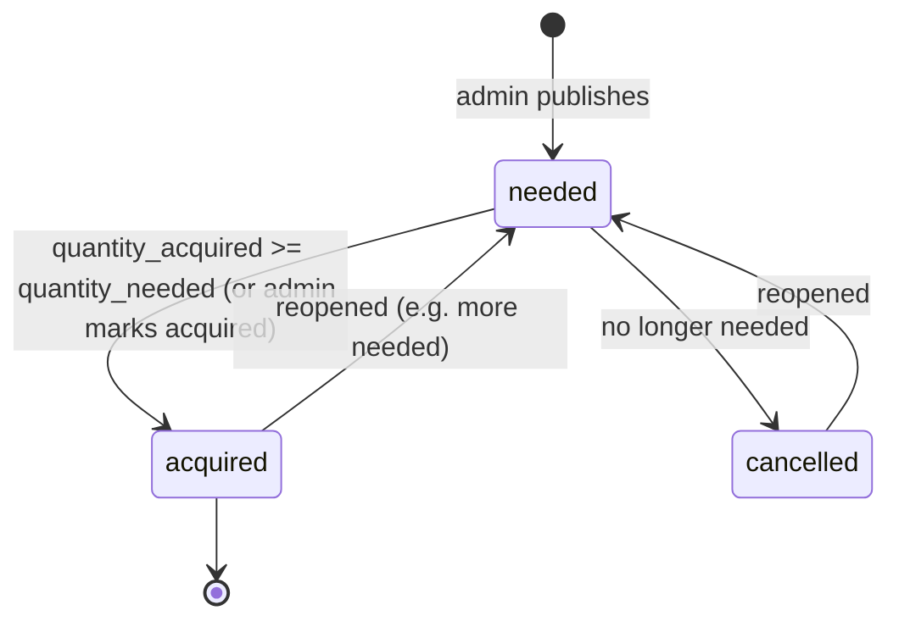
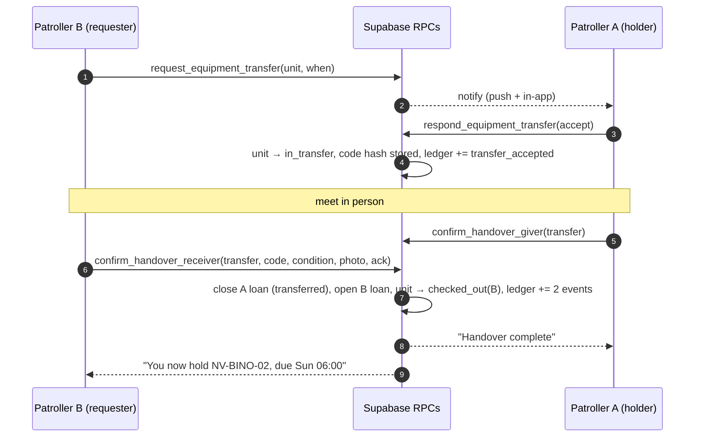
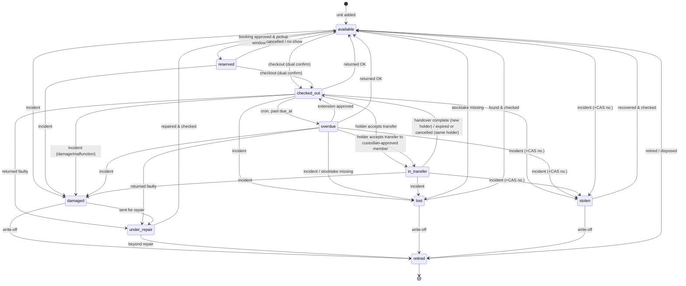
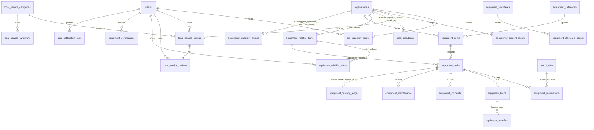

# Watchman — New Features Blueprint (v3)

*Drafted: 3 October 2026 · Revised: 21 October 2026 (v4) · Status: **proposal / build-ready draft** · Owner: Theescombe Fibre*

Canonical app: `platform/web` · Canonical backend: `platform/supabase` · Companions: [`SCALE_ROADMAP.md`](SCALE_ROADMAP.md), [`CURSOR_PROMPTS.md`](CURSOR_PROMPTS.md)

> **How to use this document.** Each feature has: user stories / flows → routes & screens → components → data model (draft SQL) → permissions → notifications → edge cases → POPIA / security → tests → acceptance. Build it with the ordered prompts in [`CURSOR_PROMPTS.md`](CURSOR_PROMPTS.md). All SQL here is a **draft**: read it, adapt it to the latest function bodies in the repo, and put it in **new** migration files. Nothing in this doc has been applied to Supabase. Items that still need a live check are listed in §18.

## Changelog

| Version | Date | Changes |
|---|---|---|
| **v4** | 21 Oct 2026 | **P8 — Google Play release readiness** (§19, prompt 22). The Android app is a Capacitor 8 shell (`platform/android`, `webDir` `dist`, `MainActivity` extends `BridgeActivity`) currently handed out as a sideloaded APK, which Play Protect flags. Residents can only install from Google Play. P8 is docs-and-release plumbing: investigate the existing project, Play App Signing with an upload keystore kept out of git, a signed AAB script, permission cleanup, public `/privacy` and `/delete-account`, and `PLAY_STORE_LISTING.md` (data safety, listing, closed testing, owner checklist). No SQL. Does not wait on G–P7. v3 still stands: no money in the app. |
| **v3** | 14 Oct 2026 | **Owner decision: no money in the app.** Removed in-app money collection (former Feature 3, §8 now a stub), the online-payment phase, the money-related capabilities and decisions, the payment research rows, and the related open items. **Feature 2 rewritten (§7)** as a money-free **Equipment wishlist / needs board**: admin/custodian lists needed items (photo, name, qty, est. price, reason, store link, product code, status needed/acquired/cancelled); residents view and send an "offer to help / contribute item" interest note; acquired items convert into inventory units (`equipment_units.wishlist_item_id`, `create_equipment_from_wishlist`). New table set `equipment_wishlist_items` + `equipment_wishlist_offers`, helper `can_manage_wishlist()`. Capabilities now: `resident_broadcaster`, `resident_moderator`, `equipment_custodian`. `community-private` SELECT policy now ships with equipment (P3). Phases renumbered: G → P0 → P1 → **P2 needs board** → P3 equipment → P4 local services → P5 outage + digest → P6 events/polls/lost & found → **P7** onboarding/tasks/cameras. Migration plan, ERD, permission matrices, isolation tests, defaults (§16), resolved items (§17) and open items (§18) updated; Cursor prompt pack reduced to 21 prompts. |
| **v2** | 3 Oct 2026 | New Phase G (§4): 7 fixes for gaps in today's code (G1–G7). New Feature 6 (§10): equipment inventory & borrowing with chain of custody, capability `equipment_custodian`. Security review (§12.7). Shared SQL helpers defined once (G2/G4). (verify) items resolved (§17). Decisions applied as defaults (§16). Cursor prompts moved to `CURSOR_PROMPTS.md`. Extras priorities renamed High/Medium/Later. |
| v1 | 3 Oct 2026 | First draft: foundations, resident moderators, money features (removed in v3), local services, extras, open decisions |

---

## Table of contents

1. [Executive summary](#1-executive-summary)
2. [Build order, phases and effort](#2-build-order-phases-and-effort)
3. [What exists today (grounding)](#3-what-exists-today-grounding)
4. [Phase G — Fix existing-code gaps first](#4-phase-g--fix-existing-code-gaps-first-new-in-v2)
5. [Phase 0 — Shared foundations](#5-phase-0--shared-foundations)
6. [Feature 1 — Resident moderators and street reps](#6-feature-1--resident-moderators-and-street-reps)
7. [Feature 2 — Equipment wishlist / needs board](#7-feature-2--equipment-wishlist--needs-board-new-in-v3)
8. [(Removed in v3)](#8-removed-in-v3)
9. [Feature 4 — Local services directory](#9-feature-4--local-services-directory)
10. [Feature 6 — Patroller equipment inventory & borrowing](#10-feature-6--patroller-equipment-inventory--borrowing-chain-of-custody-new-in-v2)
11. [Feature 5 — Suggested extra features](#11-feature-5--suggested-extra-features)
12. [Cross-cutting: ERD, notifications, storage, POPIA, audit, security review](#12-cross-cutting-concerns)
13. [Migration file plan](#13-migration-file-plan)
14. [Two-org isolation test matrix](#14-two-org-isolation-test-matrix)
15. [Ready-to-paste Cursor prompts → `CURSOR_PROMPTS.md`](#15-ready-to-paste-cursor-prompts)
16. [Defaults applied (override any)](#16-defaults-applied-override-any)
17. [Resolved "(verify)" items](#17-resolved-verify-items-v2)
18. [Still genuinely open](#18-still-genuinely-open-needs-you-or-a-live-check)
19. [P8 — Google Play release readiness](#19-p8--google-play-release-readiness)

*(Feature numbers are kept from v1 so earlier references still work. The equipment feature is "Feature 6" but sits in §10, before the extras.)*

---

## 1. Executive summary

Watchman already has the hard parts these features need:
- multi-tenant organizations with working-area isolation (`working_organization_id()`, `current_org_ids()`);
- resident verification (`is_verified_household()`);
- in-app notifications (`app_notifications` + `notify_app_user()`) and FCM pushes (`notify-resident-event`);
- a staff audit log (`activity_logs` via `write_staff_activity()`);
- patrol shifts (`patrol_slots`) and patroller profiles;
- storage buckets;
- an emergency directory page that serves three routes.

The new work builds on these. It does not add a parallel system. The v2 review also found **real security gaps in today's code** (forgeable audit log, open storage writes, globally editable emergency numbers). These are fixed first, in Phase G.

| # | Feature | What it is in one line | Effort |
|---|---|---|---|
| G | Existing-code gap fixes | Broadcast hide/edit, audit-log hardening, emergency directory org scope, storage write lockdown, users privilege guard, notification preferences, isolation test script | **M** total (7 small PRs) |
| 0 | Shared foundations | Capability grants table, generic content reports, org-scoped storage buckets | **M** |
| 1 | Resident moderators / street reps | Give named residents scoped powers (broadcast, moderate resident content) per organization. Not a new global role | **M** |
| 2 | Equipment wishlist / needs board | Admin lists equipment the watch needs (photo, qty, est. price, reason, store link); residents view and offer to help or contribute an item. No money in the app. Acquired items become inventory | **S–M** |
| 6 | **Equipment inventory & borrowing** | Watch gear catalogue with QR labels, shift-linked bookings, dual-confirmed checkout/return, patroller-to-patroller handover handshake, incident reports (incl. SAPS CAS no.), append-only custody ledger, stocktake and dashboards | **L** (3 PRs + UI PR) |
| 4 | Local services directory | Residents list trades/businesses as a **Local services** tab in Contacts, with synonym + full-text + fuzzy search and verified-neighbour ratings | **L** |
| 5 | Extras | Outage notices, daily digest, events + RSVP, polls, lost & found / pets, onboarding, volunteer tasks, camera footage requests | S–M each |
| P8 | Google Play release readiness | Signed AAB (Play App Signing), permission cleanup, public privacy and account-deletion URLs, store listing and data-safety draft | **S–M** |

**Key design decisions**

1. **Capabilities, not roles.** A resident moderator keeps `users.role = 'resident'`. Extra powers come from an `org_capability_grants` row tied to **one organization**: `resident_broadcaster`, `resident_moderator` and **`equipment_custodian`** (Quartermaster). Every grant and revoke is audited and can expire.
2. **No money in the app (v3).** The needs board shows what the watch needs and collects interest notes only; no amounts are collected, no payment details are shown, no payment flows exist.
3. **Four-eyes on high-value write-offs.**
4. **Custody you can trust.** Every equipment movement needs two confirmations. It is written to an append-only, hash-chained ledger that nobody (not even the service role) can edit. Units can only change state through one SQL function that enforces the state machine.
5. **Search without paid AI.** Synonyms, a category tree, Postgres full-text search and `pg_trgm`.
6. **Everything is org-scoped.** RPCs derive the org from the row and check `current_org_ids()`. Cross-org failures say "not found". Storage writes are scoped by org or parent entity (G4).
7. **All state changes go through SECURITY DEFINER RPCs** with an explicit grant convention (§4.5). Tables have RLS on and no client write policies.

---

## 2. Build order, phases and effort

Effort scale (one developer working with Cursor): **S** ≈ 1–2 days · **M** ≈ 3–5 days · **L** ≈ 1–2 weeks.

| Phase | Scope | Depends on | Effort | Why this order |
|---|---|---|---|---|
| **G** | G1 broadcast hide/edit · G2 audit log · G3 emergency directory org scope · G4 storage writes · G5 users guard · G6 notification prefs · G7 isolation script | — | M (7 × S) | Fixes live security/integrity gaps. Adds helpers and prefs every later phase uses |
| **P0** | Foundations: `org_capability_grants`, `has_org_capability()`, `community_content_reports`, `community-media` + `community-private` buckets, `RequireCapability` + `useOrgCapabilities` | G2, G4 | M | Every later feature uses these |
| **P1** | Feature 1: resident moderators / street reps | P0, G1 | M | Fast win. Unblocks moderation for P4 |
| **P2** | Feature 2: equipment wishlist / needs board (items, offers, status) | P0 | S–M | Visible community value with no financial or legal overhead |
| **P3** | **Feature 6: equipment inventory** (P3a catalogue + QR, P3b bookings + checkout/return, P3c transfers + incidents + cron, P3d dashboards/stocktake/exports) | P0, G6 (P2 optional for wishlist link) | L | Watch-internal and high trust value. Placed after P2 so acquired needs-board items can turn into inventory |
| **P4** | Feature 4: Local services, taxonomy + synonyms, search, reviews, reports → moderators | P0, P1 | L | Relies on moderators for abuse handling |
| **P5** | Outage notices, daily digest | P1, G6 | S–M | Cheap and high-visibility |
| **P6** | Events + RSVP, polls / committee votes, lost & found / pets | P0 | M each | Community engagement |
| **P7** | Onboarding checklist, volunteer task sign-up, camera footage requests | — | S–M | Nice to have |
| **P8** | Google Play release: upload-key signing, `bundleRelease` AAB, permission cleanup, `/privacy`, `/delete-account`, `PLAY_STORE_LISTING.md` | — (current app) | S–M | Sideloaded APKs are flagged by Play Protect. Residents install from Play only. No SQL, so it does not wait on G–P7 |

Run **the two-org isolation test** (§14, automated by G7) at the end of every phase.

```mermaid
gantt
  title Suggested sequence (relative, not dates)
  dateFormat  X
  axisFormat %s
  section Fix first
  G gap fixes (7 small PRs)           :g, 0, 6
  section Foundations
  P0 capability grants + storage      :p0, after g, 4
  section Residents
  P1 resident moderators              :p1, after p0, 4
  section Needs
  P2 equipment needs board            :p2, after p1, 3
  section Watch operations
  P3 equipment inventory              :p3, after p2, 10
  section Directory
  P4 local services                   :p4, after p3, 9
  section Extras
  P5 outages + digest                 :p5, after p4, 3
  P6 events / polls / lost & found    :p6, after p5, 10
  P7 onboarding / tasks / cameras     :p7, after p6, 6
  section Release
  P8 Google Play readiness            :p8, 0, 3
```



---

## 3. What exists today (grounding)

Confirmed by reading the repo at commit `55c5225` (21 Aug 2026), plus the untracked `20260827010000_end_patrol_idempotent.sql`. Rows marked **gap** are fixed in Phase G (§4).

### 3.1 Frontend

| Concern | Where |
|---|---|
| Routing | `platform/web/src/App.jsx`: lazy pages, guards `PrivateRoute`, `NeighborhoodRoute`, `RequireRole allowedRoles={...} allowPlatformConsole`, `RequireActiveOrganization` |
| Role matrix | `platform/web/src/auth/roleMatrix.js`: `ROLE_MATRIX` (`hotspotManage`, `incidentModerate`, …), `AREA_BROADCAST_ROLES = ["admin","technical_support","nw_admin","committee"]`, `canPostAreaBroadcast(role, platformRole)`, `EMERGENCY_DIRECTORY_MANAGER_ROLES`, `RESIDENT_HOME_ROLES`, `HOUSEHOLD_MODE_ROLES`, `RESIDENT_DIRECTORY_ROLES`, `homeBackNav()`, `isGlobalAppRole()` |
| Role guard | `platform/web/src/components/RequireRole.jsx`: only checks `users.role` (+ platform console). **Has no capability concept yet.** |
| Auth user shape | `platform/web/src/auth/AuthProvider.jsx` → `buildPhase1Profile()`: `role`, `platformRole`, `organizationId`, `activeOrganizationId`, `isVerifiedResident`, `verificationMethod`, `homeLat/Lng`, … |
| Org scope hook | `platform/web/src/utils/organizationScope.js` → `useScopedOrganization()` returns `{ activeOrganizationId, activeOrganization, includeUnscoped, scope }` |
| Area broadcast UI | `platform/web/src/pages/AreaBroadcast.jsx` (route `/admin/broadcast`, guarded by `AREA_BROADCAST_ROLES`), utils `platform/web/src/utils/areaBroadcasts.js` (`postAreaBroadcast`, `listAreaBroadcasts`, `subscribeAreaBroadcasts`, `notifyResidentEvent`) |
| Emergency directory | `platform/web/src/pages/EmergencyContacts.jsx` (one page serving `/resident/contacts`, `/intelligence/contacts`, `/admin/contacts`; detects view from `useLocation`), utils `platform/web/src/utils/emergencyDirectory.js` (bucket `emergency-directory`, `uploadEmergencyDirectoryImage`) |
| Resident home | `platform/web/src/pages/ResidentDashboard.jsx` (grid of `ActionCard` tiles: Report incident, Your reports, SOS board, Chat with patrol, Verify neighbours, My sector, Emergency contacts, How to use), components in `platform/web/src/components/resident/` |
| Admin residents | `platform/web/src/pages/AdminResidents.jsx` (route `/admin/residents`, `RESIDENT_DIRECTORY_ROLES`; verify via `verifyResidentAsStaff`; promote via direct `supabase.from("users").update({ role })`) |
| Admin menu | `platform/web/src/components/admin/AdminToolsMenu.jsx` (groups with `{ id, label, to, icon, tone, show, badge }`) |
| Notifications | `platform/web/src/utils/appNotifications.js` (`useAppNotifications`, realtime on `app_notifications`), `platform/web/src/components/layout/AppNotificationBell.jsx` |
| Profile | `platform/web/src/pages/Profile.jsx` (verified badge block around the `user?.isVerifiedResident` checks) |
| Stack | React 19, react-router-dom 7, @tanstack/react-query 5, Tailwind classes, react-icons, react-hot-toast, Capacitor 8 (Android), Supabase JS 2 |

### 3.2 Backend

| Concern | Where / name |
|---|---|
| Org helpers | `public.working_organization_id()`, `public.current_org_ids()` (`20260815028000_intelligence_org_isolation.sql`) |
| Staff helpers | `public.is_global_app_staff()` (admin / technical_support), `public.is_platform_staff()`, `public.is_hotspot_staff()`, `public.can_moderate_incidents()`, `public.is_resident_staff_verifier()`, `public.resident_in_caller_scope(uuid)`, `public.is_staff_role(text)`, `public.is_watch_local_staff_role(text)` |
| Verification | `public.is_verified_household(uuid)` (`resident_profiles.verification_date` or `users.verified`) |
| Area broadcasts | table `public.area_broadcasts (id, organization_id, author_id, headline, body, created_at, expires_at)`; `public.can_post_area_broadcast()`; `public.post_area_broadcast(p_headline, p_body)`; `public.list_area_broadcasts(p_limit)` (latest version in `20260818030000_area_broadcast_home_windows.sql` returns `pinned_until`, `activity_until`). RLS: select by org, insert by `can_post_area_broadcast()`. **gap → G1:** no update/delete policy, so nobody can hide a notice today. |
| Broadcast audit | trigger `trg_log_watch_staff_broadcast()` (`20260819020100`) logs only when the author's role is `nw_admin` / `committee` |
| Audit log | table `public.activity_logs`; writer `public.write_staff_activity(p_action, p_details, p_actor_id, p_organization_id)`; viewer `/admin/staff-activity` (`list_watch_staff_activity`, global staff only, nw_admin/committee actors only). **gap → G2:** any user can insert rows (`activity_logs_insert_actor`) and every org member can read them (`activity_logs_select_scope`) |
| In-app notices | table `public.app_notifications (user_id, kind, title, body, href, read_at)`; `public.notify_app_user(...)` (**service_role only**, so call it from `SECURITY DEFINER` functions); `list_my_app_notifications`, `mark_app_notifications_read` |
| Push | edge function `platform/supabase/functions/notify-resident-event` (types `vouch`, `broadcast`, `membership`; FCM via `user_push_tokens`) |
| Emergency directory | table `public.emergency_directory_entries` (**global, has no `organization_id`**); `can_manage_emergency_directory()` (any `nw_admin`); `list_emergency_directory()`; `upsert_emergency_directory_entry(...)`. **gap → G3** |
| Storage | public buckets `emergency-directory`, `security-branding`, `city-hub-photos`, `incident-photos`. `20260820090000_storage_public_buckets_no_listing.sql` removed public SELECT policies (public URLs still work, listing doesn't). Current upload paths are **not** org-prefixed (`incident-photos/{incident}/…`, `city-hub-photos/{post}/…`, `security-branding/{company}/…`, `emergency-directory/{owner}/…`). **gap → G4:** INSERT/UPDATE/DELETE policies check only `bucket_id`. `criminal-photos` is used in code but has no policies in the repo |
| Orgs / members | `public.organizations (type nw_group/security_company/city_admin, status, settings_json …)`, `public.organization_members (organization_id, user_id, member_role, status)` |
| Users columns used here | `role`, `platform_role`, `organization_id`, `active_organization_id`, `verified`, `verification_method`, `verified_by_user_id`, `full_name`, `phone`, `address`, `home_suburb_id`, `patroller_request_status`. Base `users` RLS lives in the dashboard, not the repo; `AdminResidents.jsx` promotes with a direct `users.update({ role })`. **gap → G5** |
| Patrol & equipment grounding | `patrol_slots (id, date, start_time, end_time, zone, volunteer_uid, volunteer_name, organization_id)`, unique `(organization_id, date, start_time, volunteer_uid)`, written by `PatrolSchedule.jsx`; `patroller_profiles (user_id, organization_id, training_certified, certification_date, status active/inactive/suspended)`; `user_vehicles` (`Vehicles.jsx`); offline helpers `chat/hooks/useNetworkStatus.js`, `chat/components/OfflineBanner.jsx`, `chat_messages.client_message_id` idempotency (`20260820050000`), `@capacitor/preferences`; libs `exceljs`, `html2pdf.js`, `recharts`; no QR library; no test runner (eslint only) |
| Definer hardening | `20260820080000_advisor_rpc_harden.sql` revoked PUBLIC/anon on existing SECURITY DEFINER functions once and moved internal ones (`notify_app_user`, `write_staff_activity`, trigger functions) to service_role. New functions must repeat this (§4.5 convention) |
| SQL style | `text` + `CHECK (... IN (...))` instead of enums. `SECURITY DEFINER` + `SET search_path = public`. Every function gets `REVOKE ALL … FROM PUBLIC; GRANT EXECUTE … TO authenticated, service_role`. `DROP POLICY IF EXISTS` before `CREATE POLICY`. Role comparisons use `replace(lower(trim(role::text)), '-', '_')`. SAST dates use `timezone('Africa/Johannesburg', now())`. |
| Cron | `pg_cron` in schema `extensions`; job `chat_messages_retention_6mo` (`platform/supabase/sql/schedule_chat_retention_cron.sql`) |
| Latest migration | `20260827010000_end_patrol_idempotent.sql` (untracked). New files must sort **after** it. |

> **Note on the emergency directory:** `emergency_directory_entries` is global (city-wide). An NW admin who adds a doctor today adds it for every neighbourhood, and can even edit the police number. **v2 fixes this in G3** (default D12): entries get a nullable `organization_id`, and civic numbers stay city-wide but only global staff can edit them.

---

## 4. Phase G — Fix existing-code gaps first (new in v2)

These fix problems found **in the code that exists today**. They also lay the groundwork the new features need. Ship them before P0, one small PR each (prompts G1–G7 in [`CURSOR_PROMPTS.md`](CURSOR_PROMPTS.md)). Every finding below was checked against the repo at `55c5225`.

| # | Gap found (evidence) | Risk | Fix | Effort |
|---|---|---|---|---|
| G1 | `area_broadcasts` has **no UPDATE/DELETE policy and no hide columns** (`20260816002000_away_broadcasts_civic.sql`, `20260818030000`). A wrong or abusive notice can't be taken down without SQL. Realtime only listens for `INSERT`. `/admin/broadcast` is guarded by role only (`AREA_BROADCAST_ROLES`). | Medium | Add hide/restore columns and RPCs (author + staff). Edit-own within 15 minutes. Add a realtime `UPDATE` listener. Server stays authoritative (`can_post_area_broadcast()`), and the route guard becomes capability-aware in P1. | S |
| G2 | **Audit log is weak.** (a) Policy `activity_logs_insert_actor` (`20260815010000`) lets **any signed-in user insert forged audit rows** with any `action`/`details_json` (including a fake `actor_role`). (b) `activity_logs_select_scope` (`20260819020200`) lets **every org member (residents too) read their org's staff log**. (c) `list_watch_staff_activity` only shows actors whose role is `nw_admin`/`committee`, and only global staff can call it. (d) `trg_log_watch_staff_user_changes` logs a role change only when old or new role is `nw_admin`/`committee`, so `resident → patroller` or `→ admin` promotions are not logged. (e) City Hub post delete/archive and `admin-delete-user` aren't logged. | **High** (forgery + leak) | Drop the client insert policy (writes only via `write_staff_activity()`). Restrict SELECT to staff of that org. Make the table append-only. Log every role and platform-role change. Add triggers for City Hub delete/archive. Log before `admin-delete-user` deletes. New `list_org_audit_log()` for NW admins (their own org) and global staff (working org). | M |
| G3 | `emergency_directory_entries` is **global** (no `organization_id`), but `can_manage_emergency_directory()` lets **any `nw_admin`** add or edit entries, so one watch's admin can change the police number every neighbourhood sees. | **High** (integrity) | Add nullable `organization_id`. NULL = city-wide civic entry (global staff only). NW admin entries are forced to their working org and can only edit their own org's rows. `list_emergency_directory()` returns global rows plus the caller's org rows. | S |
| G4 | **Storage writes are wide open.** Policies on `incident-photos` (`20260328163000`), `city-hub-photos` (`20260815034000`/`035000`), `emergency-directory` and `security-branding` (`20260815074000`/`076000`) check only `bucket_id`, so **any signed-in user can overwrite or delete any file** in those buckets (e.g. replace incident evidence or a watch logo). `20260820090000` only removed public listing. The `criminal-photos` bucket is used in code but has **no policies in the repo** (verify live). | **High** | Lock writes to the right people using the path's first segment, which already identifies the owner entity: `incident-photos/{incident_id}/…`, `city-hub-photos/{post_id}/…`, `security-branding/{company_id}/…`. Emergency directory moves to `{org_id or 'global'}/…`. Add safe helpers `try_uuid()`, `storage_path_org_id()`, `storage_path_in_caller_org()` (used by P0). Reads are unchanged, so existing public URLs keep working. | M |
| G5 | **User-row self-escalation not provably blocked.** The base `users` RLS policies live in the dashboard, not the repo. `AdminResidents.jsx` promotes with a direct `supabase.from("users").update({ role })`, so some UPDATE policy allows writes to `role`. Nothing in the repo stops an NW admin setting `role = 'admin'`, or a user editing their own `verified` / `organization_id`. | **High** (verify live) | `BEFORE UPDATE` guard trigger on `public.users`. When the caller is a client (`current_user = 'authenticated'`), it blocks: self-changes to privileged columns; non-global-staff setting a global role (`admin`, `technical_support`) or `platform_role`; and edits to users outside the caller's org. SECURITY DEFINER RPCs (running as owner) are unaffected. Also document the grant convention. | S |
| G6 | **No notification preferences.** Every push and in-app notice is all-or-nothing. New features add many more kinds (needs board, equipment, reviews). | Medium (spam → uninstalls) | `user_notification_prefs` + `should_notify(user, kind, channel)`. SOS / emergency kinds can never be muted. Profile → Notifications UI. `notify_app_user` callers and `notify-resident-event` check it. | M |
| G7 | **No automated isolation proof.** The roadmap item "Isolation proof" is manual. There's no test framework, only eslint. | Medium | `platform/supabase/sql/isolation_tests_community.sql`: a transaction-wrapped script that impersonates users via `set_config('request.jwt.claims', …)` and `SET LOCAL ROLE authenticated`, asserts with `RAISE EXCEPTION`, then rolls back. Extend it in every phase. | S |

> **Do not edit applied migrations.** Every fix is a **new** file that `CREATE OR REPLACE`s functions and `DROP POLICY IF EXISTS` / `CREATE POLICY`s policies. Before writing each one, `rg` for the latest definition of the function you replace and copy that body, because several functions were redefined more than once.

### 4.1 G1 — `20261003001000_area_broadcast_hide_restore.sql`

```sql
ALTER TABLE public.area_broadcasts
  ADD COLUMN IF NOT EXISTS hidden_at timestamptz,
  ADD COLUMN IF NOT EXISTS hidden_by uuid REFERENCES public.users (id) ON DELETE SET NULL,
  ADD COLUMN IF NOT EXISTS hidden_reason text CHECK (hidden_reason IS NULL OR char_length(hidden_reason) <= 300),
  ADD COLUMN IF NOT EXISTS edited_at timestamptz;

CREATE INDEX IF NOT EXISTS area_broadcasts_org_visible_idx
  ON public.area_broadcasts (organization_id, created_at DESC) WHERE hidden_at IS NULL;

-- SELECT policy: members see visible notices; staff also see hidden ones (for restore).
-- Re-create from the latest definition (rg "ON public.area_broadcasts"), adding the hidden filter:
--   USING (organization_id IN (SELECT public.current_org_ids())
--          AND (hidden_at IS NULL OR public.is_area_broadcast_staff() OR author_id = auth.uid()))
-- No UPDATE/DELETE policies: all changes go through the RPCs below.

CREATE OR REPLACE FUNCTION public.is_area_broadcast_staff()
RETURNS boolean LANGUAGE sql STABLE SECURITY DEFINER SET search_path = public AS $$
  SELECT public.is_global_app_staff() OR public.is_platform_staff()
    OR EXISTS (SELECT 1 FROM public.users cu WHERE cu.id = auth.uid()
               AND replace(lower(trim(cu.role::text)), '-', '_') IN ('nw_admin', 'committee'));
$$;

-- hide_area_broadcast(p_id, p_reason): author OR is_area_broadcast_staff(); org check via current_org_ids();
--   sets hidden_*; write_staff_activity('area_broadcast_hidden'); notify author if hidden by someone else.
-- restore_area_broadcast(p_id): is_area_broadcast_staff() only.
-- (Bodies identical to §6.5 minus the resident_moderator clause; P1 replaces both.)

CREATE OR REPLACE FUNCTION public.edit_area_broadcast(p_id uuid, p_headline text, p_body text)
RETURNS public.area_broadcasts LANGUAGE plpgsql SECURITY DEFINER SET search_path = public AS $$
DECLARE b public.area_broadcasts;
BEGIN
  SELECT * INTO b FROM public.area_broadcasts WHERE id = p_id FOR UPDATE;
  IF b.id IS NULL OR b.organization_id NOT IN (SELECT public.current_org_ids()) THEN RAISE EXCEPTION 'notice not found'; END IF;
  IF b.author_id IS DISTINCT FROM auth.uid() THEN RAISE EXCEPTION 'forbidden'; END IF;
  IF b.created_at < now() - interval '15 minutes' THEN RAISE EXCEPTION 'notices can only be edited for 15 minutes; hide and re-post instead'; END IF;
  IF b.hidden_at IS NOT NULL THEN RAISE EXCEPTION 'notice is hidden'; END IF;
  IF nullif(trim(p_headline), '') IS NULL OR char_length(trim(p_headline)) > 120 THEN RAISE EXCEPTION 'headline is required (max 120)'; END IF;
  IF nullif(trim(p_body), '') IS NULL OR char_length(trim(p_body)) > 4000 THEN RAISE EXCEPTION 'message is required (max 4000)'; END IF;
  UPDATE public.area_broadcasts SET headline = trim(p_headline), body = trim(p_body), edited_at = now()
  WHERE id = p_id RETURNING * INTO b;
  RETURN b;   -- no re-push on edit (avoid notification spam)
END $$;

-- list_area_broadcasts(p_limit): re-create from 20260818030000 adding `AND b.hidden_at IS NULL`
--   plus `edited_at` in the output (DROP FUNCTION first because the return type changes).

DO $$ DECLARE fn text; BEGIN
  FOREACH fn IN ARRAY ARRAY['public.is_area_broadcast_staff()', 'public.hide_area_broadcast(uuid, text)',
    'public.restore_area_broadcast(uuid)', 'public.edit_area_broadcast(uuid, text, text)', 'public.list_area_broadcasts(integer)'] LOOP
    EXECUTE format('REVOKE ALL ON FUNCTION %s FROM PUBLIC, anon', fn);
    EXECUTE format('GRANT EXECUTE ON FUNCTION %s TO authenticated, service_role', fn);
  END LOOP; END $$;
```

**Frontend:** `utils/areaBroadcasts.js` gets `hideAreaBroadcast`, `restoreAreaBroadcast`, `editAreaBroadcast`. `subscribeAreaBroadcasts` adds `event: 'UPDATE'` (drop the row from lists when `hidden_at` is set). `AreaBroadcast.jsx` gets a "Hide" action with a reason dialog, a "Hidden" filter for staff, and "Edit" for 15 minutes. Resident home tiles already re-fetch, so a hidden notice disappears.

### 4.2 G2 — `20261003002000_audit_log_hardening.sql`

```sql
-- (a) No direct client writes. write_staff_activity() is SECURITY DEFINER and keeps working.
DROP POLICY IF EXISTS activity_logs_insert_actor ON public.activity_logs;
REVOKE INSERT, UPDATE, DELETE, TRUNCATE ON public.activity_logs FROM anon, authenticated;

-- Append-only, even for definer code (service_role maintenance can still DELETE for retention via a GUC).
CREATE OR REPLACE FUNCTION public.trg_activity_logs_append_only()
RETURNS trigger LANGUAGE plpgsql SET search_path = public AS $$
BEGIN
  IF TG_OP = 'DELETE' AND current_setting('app.audit_retention', true) = 'on' THEN RETURN OLD; END IF;
  RAISE EXCEPTION 'activity_logs is append-only';
END $$;
DROP TRIGGER IF EXISTS activity_logs_append_only ON public.activity_logs;
CREATE TRIGGER activity_logs_append_only BEFORE UPDATE OR DELETE ON public.activity_logs
  FOR EACH ROW EXECUTE FUNCTION public.trg_activity_logs_append_only();
-- NOTE: activity_logs.user_id/organization_id are ON DELETE SET NULL FKs. A SET NULL is an UPDATE,
-- so this trigger would block user deletion. Either (preferred) drop those two FKs and keep plain
-- uuids (names resolved at read time, "Former member" when gone), or allow UPDATEs that only null
-- user_id/organization_id. The draft takes the preferred route:
ALTER TABLE public.activity_logs DROP CONSTRAINT IF EXISTS activity_logs_user_id_fkey;
ALTER TABLE public.activity_logs DROP CONSTRAINT IF EXISTS activity_logs_organization_id_fkey;
-- (verify the live constraint names with \d public.activity_logs before applying)

-- (a2) Org helpers used from here on (moved forward from P0 so G2–G5 can use them; §5.4 shows the
--      same bodies and simply CREATE OR REPLACEs them again):
--      public.is_org_nw_admin(p_org_id uuid)      -> caller is nw_admin of THAT org (home org or active membership)
--      public.user_in_org(p_user_id, p_org_id)    -> internal; REVOKE from authenticated, GRANT service_role

-- (b) Read: staff of that org only (not residents/patrollers).
DROP POLICY IF EXISTS activity_logs_select_scope ON public.activity_logs;
CREATE POLICY activity_logs_select_scope ON public.activity_logs
  FOR SELECT TO authenticated
  USING (
    public.is_global_app_staff() OR public.is_platform_staff()
    OR (organization_id IN (SELECT public.current_org_ids()) AND public.is_org_nw_admin(organization_id))
  );

-- (c) Org audit viewer: NW admin (own org) + global staff (working org). Filters: action prefix, actor, date range.
CREATE OR REPLACE FUNCTION public.list_org_audit_log(
  p_limit integer DEFAULT 200, p_before timestamptz DEFAULT NULL,
  p_action_prefix text DEFAULT NULL, p_actor uuid DEFAULT NULL)
RETURNS TABLE (id uuid, created_at timestamptz, action text, details_json jsonb,
               organization_id uuid, actor_user_id uuid, actor_name text, actor_role text)
LANGUAGE plpgsql STABLE SECURITY DEFINER SET search_path = public AS $$
DECLARE org uuid := public.working_organization_id();
BEGIN
  IF auth.uid() IS NULL THEN RAISE EXCEPTION 'not authenticated'; END IF;
  IF org IS NULL OR org NOT IN (SELECT public.current_org_ids()) THEN RAISE EXCEPTION 'choose a working neighbourhood'; END IF;
  IF NOT (public.is_global_app_staff() OR public.is_platform_staff() OR public.is_org_nw_admin(org)) THEN
    RAISE EXCEPTION 'forbidden';
  END IF;
  RETURN QUERY
  SELECT al.id, al.created_at, al.action, al.details_json, al.organization_id, al.user_id,
         coalesce(nullif(trim(al.details_json->>'actor_name'), ''), nullif(trim(u.full_name), ''), 'Former member'),
         coalesce(nullif(trim(al.details_json->>'actor_role'), ''), replace(lower(trim(u.role::text)), '-', '_'))
  FROM public.activity_logs al LEFT JOIN public.users u ON u.id = al.user_id
  WHERE al.organization_id = org
    AND (p_before IS NULL OR al.created_at < p_before)
    AND (p_action_prefix IS NULL OR al.action LIKE replace(replace(p_action_prefix, '%', ''), '_', '\_') || '%')
    AND (p_actor IS NULL OR al.user_id = p_actor)
  ORDER BY al.created_at DESC
  LIMIT GREATEST(1, LEAST(coalesce(p_limit, 200), 500));
END $$;

-- (c2) list_watch_staff_activity: re-create from 20260819020200 with the role filter widened to
--      any non-resident actor (nw_admin, committee, patroller roles, capability holders via details_json->>'capability').
-- (d) trg_log_watch_staff_user_changes: re-create from 20260819020100 so ANY role change and ANY
--      platform_role change is logged ('role_changed', 'platform_role_changed'), and the trigger
--      becomes AFTER UPDATE OF role, platform_role, organization_id, verified.
--      Also log 'resident_verified' / 'resident_unverified' when verified flips.
-- (e) City Hub: AFTER DELETE trigger on city_hub_posts + AFTER UPDATE when archived/status changes
--      → write_staff_activity('city_hub_post_deleted' | 'city_hub_post_archived', {post_id, title}, auth.uid(), author org).
--      (Use the actual archive column name from 20260815032000.)

REVOKE ALL ON FUNCTION public.list_org_audit_log(integer, timestamptz, text, uuid) FROM PUBLIC, anon;
GRANT EXECUTE ON FUNCTION public.list_org_audit_log(integer, timestamptz, text, uuid) TO authenticated, service_role;
REVOKE ALL ON FUNCTION public.trg_activity_logs_append_only() FROM PUBLIC, anon, authenticated;
```

**Edge function `admin-delete-user`:** after authorising the caller and before deleting, insert an `activity_logs` row with the service-role client: `action = 'user_deleted'`, `user_id = caller`, `organization_id = target org`, and `details_json = { subject_user_id, subject_role, subject_name_initials }`. Store initials only, because the subject's data is being erased (POPIA). `delete-my-account` does the same with `action = 'account_self_deleted'`.

**UI:** add an **Audit log** tab to `/admin/staff-activity` for NW admins (`list_org_audit_log`), with CSV export. Keep the global view for platform staff.

**Retention (default D23):** keep audit rows for **5 years**. A yearly pg_cron job sets `app.audit_retention = on` in its own transaction and deletes older rows.

### 4.3 G3 — `20261003003000_emergency_directory_org_scope.sql`

```sql
ALTER TABLE public.emergency_directory_entries
  ADD COLUMN IF NOT EXISTS organization_id uuid REFERENCES public.organizations (id) ON DELETE CASCADE;
CREATE INDEX IF NOT EXISTS emergency_directory_org_idx ON public.emergency_directory_entries (organization_id);
-- Existing rows stay NULL = city-wide civic entries.

CREATE OR REPLACE FUNCTION public.can_manage_emergency_entry(p_org_id uuid)
RETURNS boolean LANGUAGE sql STABLE SECURITY DEFINER SET search_path = public AS $$
  SELECT CASE
    WHEN p_org_id IS NULL THEN public.is_global_app_staff() OR public.is_platform_staff()  -- city-wide rows
    ELSE p_org_id IN (SELECT public.current_org_ids())
         AND (public.is_global_app_staff() OR public.is_platform_staff() OR public.is_org_nw_admin(p_org_id))
  END;
$$;

-- list_emergency_directory(): keep RETURNS SETOF public.emergency_directory_entries (rowtype now includes organization_id)
CREATE OR REPLACE FUNCTION public.list_emergency_directory()
RETURNS SETOF public.emergency_directory_entries LANGUAGE sql STABLE SECURITY DEFINER SET search_path = public AS $$
  SELECT * FROM public.emergency_directory_entries e
  WHERE (e.organization_id IS NULL OR e.organization_id IN (SELECT public.current_org_ids()))
    AND (e.active OR public.can_manage_emergency_entry(e.organization_id))
  ORDER BY (e.organization_id IS NULL), e.sort_order, e.name;   -- local entries first
$$;

-- upsert_emergency_directory_entry: re-create from 20260815076000 with ONE extra trailing param
--   p_scope text DEFAULT 'org'   -- 'org' | 'global'
-- Rules: target_org := CASE WHEN p_scope = 'global' THEN NULL ELSE working_organization_id() END;
--   new row: IF NOT can_manage_emergency_entry(target_org) THEN RAISE 'Not allowed';
--   update:  load row FOR UPDATE; IF NOT can_manage_emergency_entry(row.organization_id) THEN RAISE 'Not allowed';
--            organization_id is never changed by an update (no moving rows between orgs).
-- DROP the old 12-arg signature in the same migration so no caller keeps the unchecked version.
-- Same for any delete RPC (rg "emergency_directory_entries" for DELETE paths).
```

**UI:** `EmergencyContacts.jsx` admin form gets a scope switch: "This neighbourhood" (default) or "City-wide" (global staff only). List rows get a "Local"/"City" chip. Resident view is unchanged apart from local entries sorting first. This closes **D12** (medical/other contacts are org-scoped by default).

### 4.4 G4 — `20261003004000_storage_write_hardening.sql`

```sql
-- Safe helpers (never raise on bad input)
CREATE OR REPLACE FUNCTION public.try_uuid(p text)
RETURNS uuid LANGUAGE plpgsql IMMUTABLE AS $$
BEGIN RETURN p::uuid; EXCEPTION WHEN others THEN RETURN NULL; END $$;

CREATE OR REPLACE FUNCTION public.storage_path_org_id(p_name text)
RETURNS uuid LANGUAGE sql IMMUTABLE AS $$ SELECT public.try_uuid((storage.foldername(p_name))[1]); $$;

CREATE OR REPLACE FUNCTION public.storage_path_in_caller_org(p_name text)
RETURNS boolean LANGUAGE sql STABLE SECURITY DEFINER SET search_path = public AS $$
  SELECT public.storage_path_org_id(p_name) IS NOT NULL
     AND public.storage_path_org_id(p_name) IN (SELECT public.current_org_ids());
$$;

-- Entity helpers (definer: read the parent row regardless of the caller's table RLS)
CREATE OR REPLACE FUNCTION public.storage_incident_writable(p_name text)
RETURNS boolean LANGUAGE sql STABLE SECURITY DEFINER SET search_path = public AS $$
  -- incident_in_caller_orgs(uuid) exists (20260820060000): incident.organization_id IN current_org_ids().
  -- Legacy incidents with NULL organization_id would fail it; if any still get created that way,
  -- add `OR i.<reporter column> = auth.uid()` (check the incidents column name before applying).
  SELECT public.incident_in_caller_orgs(public.try_uuid((storage.foldername(p_name))[1]));
$$;
CREATE OR REPLACE FUNCTION public.storage_city_hub_post_manageable(p_name text)
RETURNS boolean LANGUAGE sql STABLE SECURITY DEFINER SET search_path = public AS $$
  SELECT EXISTS (
    SELECT 1 FROM public.city_hub_posts p
    WHERE p.id = public.try_uuid((storage.foldername(p_name))[1])
      AND public.can_manage_city_hub_post(p.created_by_user_id)
  );
$$;

-- incident-photos: upload only into an incident you can see (both upload sites write `{incident_id}/…`
-- AFTER inserting the incident: IncidentForm.jsx, ResidentActivityReport.jsx). Update/delete: uploader or incident moderators.
DROP POLICY IF EXISTS "<existing incident-photos insert policy>" ON storage.objects;   -- names from 20260328163000
CREATE POLICY incident_photos_insert ON storage.objects FOR INSERT TO authenticated
  WITH CHECK (bucket_id = 'incident-photos' AND public.storage_incident_writable(name));
CREATE POLICY incident_photos_update ON storage.objects FOR UPDATE TO authenticated
  USING (bucket_id = 'incident-photos' AND owner_id = (SELECT auth.uid())::text)
  WITH CHECK (bucket_id = 'incident-photos' AND owner_id = (SELECT auth.uid())::text);
CREATE POLICY incident_photos_delete ON storage.objects FOR DELETE TO authenticated
  USING (bucket_id = 'incident-photos' AND (
    owner_id = (SELECT auth.uid())::text
    OR (public.can_moderate_incidents() AND public.storage_incident_writable(name))));  -- deleteIncident.js

-- city-hub-photos (`{post_id}/…`, utils/cityHubPhotos.js): writes by whoever can manage that post.
CREATE POLICY city_hub_photos_insert ON storage.objects FOR INSERT TO authenticated
  WITH CHECK (bucket_id = 'city-hub-photos' AND public.storage_city_hub_post_manageable(name));
CREATE POLICY city_hub_photos_update ON storage.objects FOR UPDATE TO authenticated
  USING (bucket_id = 'city-hub-photos' AND public.storage_city_hub_post_manageable(name))
  WITH CHECK (bucket_id = 'city-hub-photos' AND public.storage_city_hub_post_manageable(name));
CREATE POLICY city_hub_photos_delete ON storage.objects FOR DELETE TO authenticated
  USING (bucket_id = 'city-hub-photos' AND public.storage_city_hub_post_manageable(name));
-- Confirmed: CityHub.jsx inserts the post first, then calls uploadCityHubPhotos(inserted.id, …) and
-- uploadCityHubDocuments(inserted.id, …), so the post row exists when the insert policy runs.

-- security-branding (`{company_id}/…`, uploadSecurityBrandingImage): own company or global staff.
CREATE POLICY security_branding_write ON storage.objects FOR INSERT TO authenticated
  WITH CHECK (bucket_id = 'security-branding' AND (
    public.is_global_app_staff()
    OR public.try_uuid((storage.foldername(name))[1]) IN (SELECT public.my_security_company_ids())));
-- + matching UPDATE (USING + WITH CHECK) and DELETE policies with the same predicate.

-- emergency-directory: new path `{org_id}/…` or `global/…`; legacy `{owner}/…` objects stay readable by URL.
CREATE POLICY emergency_directory_write ON storage.objects FOR INSERT TO authenticated
  WITH CHECK (bucket_id = 'emergency-directory' AND (
    ((storage.foldername(name))[1] = 'global' AND public.can_manage_emergency_entry(NULL))
    OR public.can_manage_emergency_entry(public.storage_path_org_id(name))));
-- + UPDATE/DELETE: same predicate OR owner_id = auth.uid()::text (lets the uploader of a legacy object replace it).

-- Drop the old bucket-only INSERT/UPDATE/DELETE policies for these four buckets
-- (exact names: rg -n "ON storage.objects" platform/supabase/migrations).

DO $$ DECLARE fn text; BEGIN
  FOREACH fn IN ARRAY ARRAY['public.try_uuid(text)', 'public.storage_path_org_id(text)',
    'public.storage_path_in_caller_org(text)', 'public.storage_incident_writable(text)',
    'public.storage_city_hub_post_manageable(text)', 'public.can_manage_emergency_entry(uuid)'] LOOP
    EXECUTE format('REVOKE ALL ON FUNCTION %s FROM PUBLIC, anon', fn);
    EXECUTE format('GRANT EXECUTE ON FUNCTION %s TO authenticated, service_role', fn);
  END LOOP; END $$;
```

**Frontend:** `uploadEmergencyDirectoryImage` path becomes `${scope === 'global' ? 'global' : activeOrganizationId}/${kind}_${Date.now()}.${ext}`. The other upload paths don't change.

**Live check before applying:** run `select policyname, cmd, qual, with_check from pg_policies where schemaname='storage' and tablename='objects';`. Confirm the policy names you drop, and inspect `criminal-photos`. If it allows bucket-only writes, add the same pattern: path `{org}/…` or a moderator check via `can_moderate_incidents()`.

**Org-scoped storage (roadmap item):** new buckets (`community-media`, `community-private`, equipment) use `{org_id}/…` from day one. Existing buckets are scoped through their parent entity (incident, post, company), which already belongs to an org. Physically moving legacy objects isn't needed.

### 4.5 G5 — `20261003005000_users_privilege_guard.sql`

```sql
CREATE OR REPLACE FUNCTION public.trg_users_privilege_guard()
RETURNS trigger LANGUAGE plpgsql SECURITY DEFINER SET search_path = public AS $$
DECLARE
  is_global boolean;
  new_role text := replace(lower(trim(coalesce(NEW.role::text, ''))), '-', '_');
BEGIN
  -- Only police direct client writes. SECURITY DEFINER RPCs run as the function owner
  -- (current_user = 'postgres'), edge functions use service_role: both pass.
  IF current_user NOT IN ('authenticated', 'anon') THEN RETURN NEW; END IF;

  is_global := public.is_global_app_staff() OR public.is_platform_staff();

  -- 1) Self-edits can never touch privileged columns.
  IF NEW.id = auth.uid() AND NOT is_global AND (
       NEW.role IS DISTINCT FROM OLD.role
    OR NEW.platform_role IS DISTINCT FROM OLD.platform_role
    OR NEW.verified IS DISTINCT FROM OLD.verified
    OR NEW.verification_method IS DISTINCT FROM OLD.verification_method
    OR NEW.verified_by_user_id IS DISTINCT FROM OLD.verified_by_user_id
    OR NEW.organization_id IS DISTINCT FROM OLD.organization_id) THEN
    -- (if the live users table has an account status / suspended column, add it here too;
    --  patroller_request_status stays self-editable because Profile.jsx sets it to request patroller access)
    RAISE EXCEPTION 'you cannot change your own role, verification or neighbourhood here';
  END IF;
  -- active_organization_id self-change is allowed only to an org the user belongs to:
  IF NEW.id = auth.uid() AND NEW.active_organization_id IS DISTINCT FROM OLD.active_organization_id
     AND NEW.active_organization_id IS NOT NULL AND NOT is_global
     AND NOT public.user_in_org(NEW.id, NEW.active_organization_id) THEN
    RAISE EXCEPTION 'not a member of that neighbourhood';
  END IF;

  -- 2) Editing someone else: only global staff, or NW admin/committee of that user's org.
  IF NEW.id <> auth.uid() AND NOT is_global THEN
    IF NOT (OLD.organization_id IN (SELECT public.current_org_ids()) AND public.is_area_broadcast_staff()) THEN
      RAISE EXCEPTION 'forbidden';
    END IF;
    -- local staff can never mint global/platform roles or move users across orgs
    IF new_role IN ('admin', 'technical_support', 'city_admin', 'security_admin')   -- GLOBAL_APP_ROLES + partner roles (roleMatrix.js)
       OR NEW.platform_role IS DISTINCT FROM OLD.platform_role
       OR NEW.organization_id IS DISTINCT FROM OLD.organization_id THEN
      RAISE EXCEPTION 'only platform staff can make that change';
    END IF;
    -- committee may not promote to nw_admin (D1: committee can't assign)
    IF new_role = 'nw_admin' AND NOT public.is_org_nw_admin(OLD.organization_id) THEN
      RAISE EXCEPTION 'only an NW admin can appoint another NW admin';
    END IF;
  END IF;
  RETURN NEW;
END $$;

DROP TRIGGER IF EXISTS aaa_users_privilege_guard ON public.users;
CREATE TRIGGER aaa_users_privilege_guard BEFORE UPDATE ON public.users
  FOR EACH ROW EXECUTE FUNCTION public.trg_users_privilege_guard();
REVOKE ALL ON FUNCTION public.trg_users_privilege_guard() FROM PUBLIC, anon, authenticated;
```

**Live check (must do):** `select policyname, cmd, roles, qual, with_check from pg_policies where tablename='users';` and `\df+` the signup and handle-new-user functions. If a signup trigger or RPC is **SECURITY INVOKER** and writes `role`/`organization_id` for the new user, it will hit rule 1. In that case make it DEFINER, or exempt `TG_OP`/first-login with an explicit flag. `GLOBAL_APP_ROLES = ['admin','technical_support']` (roleMatrix.js:312). The partner roles `security_admin`/`city_admin` are also blocked for local staff. Test `AdminResidents.jsx` promote, `move_member_to_neighborhood`, the household-mode switch, and Profile edit afterwards.

**Grant convention (applies to every new migration in this doc):**

1. Every function: `REVOKE ALL ON FUNCTION … FROM PUBLIC, anon;`. `20260820080000_advisor_rpc_harden.sql` did a one-off sweep, but new functions get PUBLIC execute by default again.
2. Client-callable RPCs: `GRANT EXECUTE … TO authenticated, service_role`.
3. Internal helpers (trigger functions, cron jobs, recompute, `notify_*`, `user_has_org_capability`, `user_in_org`, `equipment_ledger_append`): `REVOKE … FROM authenticated` and `GRANT … TO service_role` only.
4. Tables whose writes go through RPCs: `REVOKE INSERT, UPDATE, DELETE ON … FROM anon, authenticated`. RLS is still enabled with no write policies (defence in depth).
5. Every SECURITY DEFINER function has `SET search_path = public` (plus `extensions` only when it calls `digest`/`gen_random_bytes`) and starts with `IF auth.uid() IS NULL THEN RAISE …`. It resolves the org from the **row** (never from a client parameter alone) and checks `IN (SELECT public.current_org_ids())`.
6. Never trust client-supplied `organization_id`, `user_id`, amounts already confirmed, or storage paths. Re-derive them or validate the path prefix.

### 4.6 G6 — `20261003006000_notification_prefs.sql`

```sql
CREATE TABLE IF NOT EXISTS public.user_notification_prefs (
  user_id uuid NOT NULL REFERENCES public.users (id) ON DELETE CASCADE,
  kind text NOT NULL,                     -- matches app_notifications.kind / push type
  push_enabled boolean NOT NULL DEFAULT true,
  in_app_enabled boolean NOT NULL DEFAULT true,
  quiet_hours_start time,                 -- SAST, e.g. 22:00 (push only; in-app still lands)
  quiet_hours_end time,                   -- e.g. 06:00
  updated_at timestamptz NOT NULL DEFAULT now(),
  PRIMARY KEY (user_id, kind),
  CHECK (kind ~ '^[a-z_]{2,40}$')
);
ALTER TABLE public.user_notification_prefs ENABLE ROW LEVEL SECURITY;
DROP POLICY IF EXISTS unp_own ON public.user_notification_prefs;
CREATE POLICY unp_own ON public.user_notification_prefs FOR ALL TO authenticated
  USING (user_id = auth.uid()) WITH CHECK (user_id = auth.uid());
GRANT SELECT, INSERT, UPDATE, DELETE ON public.user_notification_prefs TO authenticated;

-- Kinds that can never be muted (safety). Keep in sync with web/src/utils/notificationKinds.js.
CREATE OR REPLACE FUNCTION public.is_mandatory_notification_kind(p_kind text)
RETURNS boolean LANGUAGE sql IMMUTABLE AS $$
  SELECT p_kind IN ('sos', 'panic', 'emergency', 'security', 'account', 'equipment_overdue_escalation');
$$;

CREATE OR REPLACE FUNCTION public.should_notify(p_user_id uuid, p_kind text, p_channel text DEFAULT 'push')
RETURNS boolean LANGUAGE sql STABLE SECURITY DEFINER SET search_path = public AS $$
  SELECT public.is_mandatory_notification_kind(p_kind) OR NOT EXISTS (
    SELECT 1 FROM public.user_notification_prefs p
    WHERE p.user_id = p_user_id AND p.kind = p_kind
      AND (
        (p_channel = 'push' AND (NOT p.push_enabled OR (
            p.quiet_hours_start IS NOT NULL AND p.quiet_hours_end IS NOT NULL AND (
              CASE WHEN p.quiet_hours_start <= p.quiet_hours_end
                   THEN (timezone('Africa/Johannesburg', now()))::time BETWEEN p.quiet_hours_start AND p.quiet_hours_end
                   ELSE (timezone('Africa/Johannesburg', now()))::time >= p.quiet_hours_start
                     OR (timezone('Africa/Johannesburg', now()))::time <= p.quiet_hours_end END))))
        OR (p_channel = 'in_app' AND NOT p.in_app_enabled)
      ));
$$;
REVOKE ALL ON FUNCTION public.should_notify(uuid, text, text) FROM PUBLIC, anon, authenticated;
GRANT EXECUTE ON FUNCTION public.should_notify(uuid, text, text) TO service_role;
GRANT EXECUTE ON FUNCTION public.is_mandatory_notification_kind(text) TO authenticated, service_role;

-- notify_app_user(): re-create from its latest definition with an early
--   IF NOT public.should_notify(p_user_id, p_kind, 'in_app') THEN RETURN; END IF;
-- notify-resident-event / notify-chat-message edge functions: filter recipient tokens with
--   should_notify(user_id, type, 'push') (service-role rpc) before sending FCM.
```

**UI:** Profile → **Notifications** section (`components/profile/NotificationPrefs.jsx`) has one row per kind with two toggles and optional quiet hours. Mandatory kinds show a lock icon with "Safety alerts can't be turned off". Daily digest (§11.3) builds on this table.

### 4.7 G7 — Isolation test harness `platform/supabase/sql/isolation_tests_community.sql`

```sql
-- Run in the SQL editor against a STAGING project (never prod). Everything rolls back.
BEGIN;
-- fixtures: two orgs, users A_res, A_admin, B_res, B_admin (insert into auth.users/public.users or pick existing test ids)
CREATE OR REPLACE FUNCTION pg_temp.as_user(p uuid) RETURNS void LANGUAGE plpgsql AS $$
BEGIN
  PERFORM set_config('request.jwt.claims', json_build_object('sub', p, 'role', 'authenticated')::text, true);
  EXECUTE 'SET LOCAL ROLE authenticated';
END $$;
CREATE OR REPLACE FUNCTION pg_temp.expect_error(p_sql text, p_like text) RETURNS void LANGUAGE plpgsql AS $$
BEGIN
  BEGIN EXECUTE p_sql; EXCEPTION WHEN others THEN
    IF SQLERRM NOT ILIKE '%' || p_like || '%' THEN RAISE EXCEPTION 'wrong error: %', SQLERRM; END IF; RETURN; END;
  RAISE EXCEPTION 'expected error "%" for: %', p_like, p_sql;
END $$;
-- example assertions
SELECT pg_temp.as_user(:'b_admin');
SELECT pg_temp.expect_error(format('select public.grant_org_capability(%L, %L)', :'a_res', 'resident_moderator'), 'not in this neighbourhood');
RESET ROLE;
SELECT pg_temp.as_user(:'a_res');
DO $$ BEGIN IF EXISTS (SELECT 1 FROM public.activity_logs) THEN RAISE EXCEPTION 'resident can read audit log'; END IF; END $$;
RESET ROLE;
ROLLBACK;
```

Each phase appends the rows from §14 for its tables. Run it with `psql -v a_res=… -v b_admin=… -f …` against staging.

---

## 5. Phase 0 — Shared foundations

### 5.1 Capability grants (used by Features 1, 2, 4, 6)

A **capability** is a named power that a specific user holds in **one** organization. It sits on top of `users.role` and does not replace it.

| Capability | Who typically holds it | Powers |
|---|---|---|
| `resident_broadcaster` | Street rep | Post area broadcasts (rate-limited) |
| `resident_moderator` | Resident moderator | Everything `resident_broadcaster` can do, plus hide resident notices, moderate Local services listings and reviews, handle reports, see the moderation queue |
| `equipment_custodian` | Quartermaster / gear officer (any watch member) | Manage the equipment inventory: approve loans, confirm checkouts/returns, resolve incidents, run stocktakes (Feature 6, §10) |

Why a table and not a new `users.role` value:
- One person can be resident + street rep + equipment custodian at once. A single role column can't express that.
- Grants are per organization, so they follow the isolation model automatically.
- It doesn't disturb `ROLE_MATRIX`, `RequireRole`, `homePathForRole`, signup guards (`20260815033000_preserve_privileged_roles_on_signup.sql`) or the `organization_members.member_role` CHECK.
- Grants carry `granted_by`, `revoked_by`, `expires_at` and reasons, which gives an audit trail for free.

### 5.2 Generic content reports

One `community_content_reports` table serves broadcasts, service listings, reviews, and later lost & found / events. The moderation queue page reads from it.

### 5.3 Storage buckets (org-scoped paths)

| Bucket | Public? | Path convention | Used for |
|---|---|---|---|
| `community-media` | public (no listing) | `{organization_id}/{feature}/{entity_id}/{timestamp}_{n}.{ext}` | Needs-board photos, equipment catalogue photos, service listing photos, event covers |
| `community-private` | **private** (signed URLs) | `{organization_id}/equipment/{unit_id}/{event}/{file}` · `{organization_id}/equipment/{unit_id}/invoice/{file}` | Equipment condition/incident photos, purchase invoices |

`feature` ∈ `needs`, `equipment`, `services`, `events`, `lost-found`.

### 5.4 Draft SQL — `20261003010000_org_capability_grants.sql`

```sql
-- Scoped capabilities per organization (resident moderators, street reps, equipment custodians).
-- Layered on top of users.role; does not replace it.

CREATE TABLE IF NOT EXISTS public.org_capability_grants (
  id uuid PRIMARY KEY DEFAULT gen_random_uuid(),
  organization_id uuid NOT NULL REFERENCES public.organizations (id) ON DELETE CASCADE,
  user_id uuid NOT NULL REFERENCES public.users (id) ON DELETE CASCADE,
  capability text NOT NULL CHECK (capability IN (
    'resident_broadcaster',
    'resident_moderator',
    'equipment_custodian'
  )),
  title text CHECK (title IS NULL OR char_length(title) <= 60),   -- e.g. 'Street rep · Theescombe Ave'
  scope_suburb_id uuid REFERENCES public.suburbs (id) ON DELETE SET NULL, -- optional, future street/suburb scoping
  note text CHECK (note IS NULL OR char_length(note) <= 500),
  granted_by uuid REFERENCES public.users (id) ON DELETE SET NULL,
  granted_at timestamptz NOT NULL DEFAULT now(),
  expires_at timestamptz,
  revoked_by uuid REFERENCES public.users (id) ON DELETE SET NULL,
  revoked_at timestamptz,
  revoke_reason text CHECK (revoke_reason IS NULL OR char_length(revoke_reason) <= 500)
);

CREATE UNIQUE INDEX IF NOT EXISTS org_capability_grants_active_uidx
  ON public.org_capability_grants (organization_id, user_id, capability)
  WHERE revoked_at IS NULL;

CREATE INDEX IF NOT EXISTS org_capability_grants_user_active_idx
  ON public.org_capability_grants (user_id)
  WHERE revoked_at IS NULL;

ALTER TABLE public.org_capability_grants ENABLE ROW LEVEL SECURITY;

-- Core check for any user (used by triggers / RPCs where auth.uid() may not be the subject).
CREATE OR REPLACE FUNCTION public.user_has_org_capability(
  p_user_id uuid,
  p_capability text,
  p_org_id uuid
)
RETURNS boolean
LANGUAGE sql
STABLE
SECURITY DEFINER
SET search_path = public
AS $$
  SELECT p_user_id IS NOT NULL AND p_org_id IS NOT NULL AND EXISTS (
    SELECT 1
    FROM public.org_capability_grants g
    WHERE g.user_id = p_user_id
      AND g.organization_id = p_org_id
      AND g.revoked_at IS NULL
      AND (g.expires_at IS NULL OR g.expires_at > now())
      AND (
        g.capability = p_capability
        OR (p_capability = 'resident_broadcaster' AND g.capability = 'resident_moderator')
      )
  );
$$;

-- Caller check against the working organization (or an explicit org the caller belongs to).
CREATE OR REPLACE FUNCTION public.has_org_capability(p_capability text, p_org_id uuid DEFAULT NULL)
RETURNS boolean
LANGUAGE sql
STABLE
SECURITY DEFINER
SET search_path = public
AS $$
  SELECT
    COALESCE(p_org_id, public.working_organization_id()) IN (SELECT public.current_org_ids())
    AND public.user_has_org_capability(
      auth.uid(),
      p_capability,
      COALESCE(p_org_id, public.working_organization_id())
    );
$$;

-- is_org_nw_admin + user_in_org are first created in G2 (20261003002000); repeated here verbatim.
-- NW admin *of this org* (home org or an active nw_admin membership) — not just any user whose
-- global role is nw_admin. Reused by wishlist + equipment helpers.
CREATE OR REPLACE FUNCTION public.is_org_nw_admin(p_org_id uuid)
RETURNS boolean
LANGUAGE sql
STABLE
SECURITY DEFINER
SET search_path = public
AS $$
  SELECT p_org_id IS NOT NULL AND EXISTS (
    SELECT 1 FROM public.users cu
    WHERE cu.id = auth.uid()
      AND replace(lower(trim(cu.role::text)), '-', '_') = 'nw_admin'
      AND (
        cu.organization_id = p_org_id
        OR EXISTS (
          SELECT 1 FROM public.organization_members om
          WHERE om.user_id = cu.id AND om.organization_id = p_org_id
            AND om.status = 'active' AND om.member_role = 'nw_admin'
        )
      )
  );
$$;

-- Is a user (any user, not the caller) a member of an org? Used to stop cross-org grants.
CREATE OR REPLACE FUNCTION public.user_in_org(p_user_id uuid, p_org_id uuid)
RETURNS boolean
LANGUAGE sql
STABLE
SECURITY DEFINER
SET search_path = public
AS $$
  SELECT EXISTS (SELECT 1 FROM public.users u WHERE u.id = p_user_id AND u.organization_id = p_org_id)
      OR EXISTS (SELECT 1 FROM public.organization_members om
                 WHERE om.user_id = p_user_id AND om.organization_id = p_org_id AND om.status = 'active');
$$;

-- Who may assign / revoke: Main admin, Technical support, platform staff (working area),
-- or the NW admin of that organization. Committee cannot (default D1).
CREATE OR REPLACE FUNCTION public.can_manage_org_capabilities(p_org_id uuid DEFAULT NULL)
RETURNS boolean
LANGUAGE sql
STABLE
SECURITY DEFINER
SET search_path = public
AS $$
  SELECT
    COALESCE(p_org_id, public.working_organization_id()) IN (SELECT public.current_org_ids())
    AND (
      public.is_global_app_staff()
      OR public.is_platform_staff()
      OR public.is_org_nw_admin(COALESCE(p_org_id, public.working_organization_id()))
    );
$$;

DROP POLICY IF EXISTS org_capability_grants_select ON public.org_capability_grants;
CREATE POLICY org_capability_grants_select ON public.org_capability_grants
  FOR SELECT TO authenticated
  USING (
    user_id = auth.uid()
    OR public.can_manage_org_capabilities(organization_id)
  );
-- v2: other members do NOT read this table (it holds admin notes / revoke reasons).
-- Badges come from list_capability_badges(), which returns only user_id + capability + title.
-- No INSERT/UPDATE/DELETE policies: writes go through RPCs only.

CREATE OR REPLACE FUNCTION public.grant_org_capability(
  p_user_id uuid,
  p_capability text,
  p_title text DEFAULT NULL,
  p_note text DEFAULT NULL,
  p_expires_at timestamptz DEFAULT NULL
)
RETURNS public.org_capability_grants
LANGUAGE plpgsql
SECURITY DEFINER
SET search_path = public
AS $$
DECLARE
  org_id uuid := public.working_organization_id();
  target_role text;
  row_out public.org_capability_grants;
BEGIN
  IF auth.uid() IS NULL THEN RAISE EXCEPTION 'not authenticated'; END IF;
  IF org_id IS NULL THEN RAISE EXCEPTION 'no neighbourhood selected'; END IF;
  IF NOT public.can_manage_org_capabilities(org_id) THEN RAISE EXCEPTION 'forbidden'; END IF;
  -- v2: explicit membership check. resident_in_caller_scope() returns TRUE for global staff for ANY
  -- user, which would let Main admin grant an Org B user a capability in Org A (cross-org leak).
  IF NOT public.user_in_org(p_user_id, org_id) THEN RAISE EXCEPTION 'user is not in this neighbourhood'; END IF;
  IF p_expires_at IS NOT NULL AND p_expires_at <= now() THEN RAISE EXCEPTION 'expiry must be in the future'; END IF;

  SELECT replace(lower(trim(u.role::text)), '-', '_') INTO target_role
  FROM public.users u WHERE u.id = p_user_id;

  -- Resident-side capabilities are for households (residents + household-mode watch members).
  IF p_capability IN ('resident_broadcaster', 'resident_moderator')
     AND target_role NOT IN ('resident', 'volunteer', 'patroller', 'investigator', 'committee', 'nw_admin') THEN
    RAISE EXCEPTION 'capability not allowed for this role';
  END IF;
  -- Default D3: resident-side moderators must be verified households.
  IF p_capability IN ('resident_broadcaster', 'resident_moderator')
     AND NOT public.is_verified_household(p_user_id) THEN
    RAISE EXCEPTION 'only verified households can hold this responsibility';
  END IF;
  -- Equipment custodians must be watch members (not plain residents).
  IF p_capability = 'equipment_custodian'
     AND target_role NOT IN ('volunteer', 'patroller', 'investigator', 'committee', 'nw_admin') THEN
    RAISE EXCEPTION 'equipment custodian must be a watch member';
  END IF;

  INSERT INTO public.org_capability_grants (
    organization_id, user_id, capability, title, note, granted_by, expires_at
  )
  VALUES (
    org_id, p_user_id, p_capability,
    nullif(trim(p_title), ''), nullif(trim(p_note), ''), auth.uid(), p_expires_at
  )
  ON CONFLICT (organization_id, user_id, capability) WHERE revoked_at IS NULL
  DO UPDATE SET title = EXCLUDED.title, note = EXCLUDED.note, expires_at = EXCLUDED.expires_at
  RETURNING * INTO row_out;

  PERFORM public.write_staff_activity(
    'capability_granted',
    jsonb_build_object('grant_id', row_out.id, 'target_user_id', p_user_id,
                       'capability', p_capability, 'title', row_out.title),
    auth.uid(), org_id
  );

  PERFORM public.notify_app_user(
    p_user_id, 'capability',
    CASE p_capability
      WHEN 'resident_moderator' THEN 'You are now a resident moderator'
      WHEN 'resident_broadcaster' THEN 'You can now post neighbourhood notices'
      WHEN 'equipment_custodian' THEN 'You are now the equipment custodian'
      ELSE 'New responsibility assigned'
    END,
    coalesce(row_out.title, 'Assigned by your neighbourhood watch.'),
    CASE p_capability
      WHEN 'equipment_custodian' THEN '/equipment/admin'
      ELSE '/resident/moderate'
    END
  );

  RETURN row_out;
END;
$$;

CREATE OR REPLACE FUNCTION public.revoke_org_capability(p_grant_id uuid, p_reason text DEFAULT NULL)
RETURNS void
LANGUAGE plpgsql
SECURITY DEFINER
SET search_path = public
AS $$
DECLARE
  g public.org_capability_grants;
BEGIN
  IF auth.uid() IS NULL THEN RAISE EXCEPTION 'not authenticated'; END IF;
  SELECT * INTO g FROM public.org_capability_grants WHERE id = p_grant_id FOR UPDATE;
  IF g.id IS NULL OR g.revoked_at IS NOT NULL THEN RAISE EXCEPTION 'grant not found'; END IF;
  -- holders may step down themselves
  IF g.user_id <> auth.uid() AND NOT public.can_manage_org_capabilities(g.organization_id) THEN
    RAISE EXCEPTION 'forbidden';
  END IF;

  UPDATE public.org_capability_grants
  SET revoked_at = now(), revoked_by = auth.uid(), revoke_reason = nullif(trim(p_reason), '')
  WHERE id = p_grant_id;

  PERFORM public.write_staff_activity(
    'capability_revoked',
    jsonb_build_object('grant_id', g.id, 'target_user_id', g.user_id,
                       'capability', g.capability, 'reason', p_reason),
    auth.uid(), g.organization_id
  );
  IF g.user_id <> auth.uid() THEN
    PERFORM public.notify_app_user(g.user_id, 'capability', 'A responsibility was removed',
      coalesce(nullif(trim(p_reason), ''), 'Contact your NW admin for details.'), '/profile');
  END IF;
END;
$$;

CREATE OR REPLACE FUNCTION public.get_my_org_capabilities()
RETURNS text[]
LANGUAGE sql
STABLE
SECURITY DEFINER
SET search_path = public
AS $$
  SELECT coalesce(array_agg(DISTINCT g.capability ORDER BY g.capability), '{}')
  FROM public.org_capability_grants g
  WHERE g.user_id = auth.uid()
    AND g.organization_id = public.working_organization_id()
    AND g.revoked_at IS NULL
    AND (g.expires_at IS NULL OR g.expires_at > now());
$$;

CREATE OR REPLACE FUNCTION public.list_org_capability_grants(p_include_revoked boolean DEFAULT false)
RETURNS TABLE (
  id uuid, user_id uuid, full_name text, street_label text, capability text, title text,
  granted_by_name text, granted_at timestamptz, expires_at timestamptz,
  revoked_at timestamptz, revoked_by_name text, revoke_reason text
)
LANGUAGE sql
STABLE
SECURITY DEFINER
SET search_path = public
AS $$
  SELECT g.id, g.user_id, u.full_name,
         public.resident_street_label(coalesce(nullif(trim(rp.home_address), ''), u.address)),  -- same expression as list_resident_neighbours
         g.capability, g.title, gb.full_name, g.granted_at, g.expires_at,
         g.revoked_at, rb.full_name, g.revoke_reason
  FROM public.org_capability_grants g
  JOIN public.users u ON u.id = g.user_id
  LEFT JOIN public.resident_profiles rp ON rp.user_id = g.user_id
  LEFT JOIN public.users gb ON gb.id = g.granted_by
  LEFT JOIN public.users rb ON rb.id = g.revoked_by
  WHERE g.organization_id = public.working_organization_id()
    AND g.organization_id IN (SELECT public.current_org_ids())
    AND (p_include_revoked OR g.revoked_at IS NULL)
  ORDER BY g.revoked_at NULLS FIRST, g.granted_at DESC;
$$;

-- Badges for any list of users (neighbour cards, broadcast author line, profile).
CREATE OR REPLACE FUNCTION public.list_capability_badges(p_user_ids uuid[])
RETURNS TABLE (user_id uuid, capability text, title text)
LANGUAGE sql
STABLE
SECURITY DEFINER
SET search_path = public
AS $$
  SELECT g.user_id, g.capability, g.title
  FROM public.org_capability_grants g
  WHERE g.user_id = ANY (p_user_ids)
    AND g.organization_id IN (SELECT public.current_org_ids())
    AND g.revoked_at IS NULL
    AND (g.expires_at IS NULL OR g.expires_at > now())
    AND g.capability IN ('resident_broadcaster', 'resident_moderator', 'equipment_custodian');
$$;

DO $$
DECLARE fn text;
BEGIN
  FOREACH fn IN ARRAY ARRAY[
    'public.user_has_org_capability(uuid, text, uuid)',
    'public.has_org_capability(text, uuid)',
    'public.can_manage_org_capabilities(uuid)',
    'public.grant_org_capability(uuid, text, text, text, timestamptz)',
    'public.revoke_org_capability(uuid, text)',
    'public.get_my_org_capabilities()',
    'public.list_org_capability_grants(boolean)',
    'public.list_capability_badges(uuid[])'
  ] LOOP
    EXECUTE format('REVOKE ALL ON FUNCTION %s FROM PUBLIC, anon', fn);
    EXECUTE format('GRANT EXECUTE ON FUNCTION %s TO authenticated', fn);
    EXECUTE format('GRANT EXECUTE ON FUNCTION %s TO service_role', fn);
  END LOOP;
END $$;
-- Internal helpers (take an arbitrary user id): never callable from the client.
REVOKE ALL ON FUNCTION public.user_has_org_capability(uuid, text, uuid) FROM PUBLIC, anon, authenticated;
REVOKE ALL ON FUNCTION public.user_in_org(uuid, uuid) FROM PUBLIC, anon, authenticated;
GRANT EXECUTE ON FUNCTION public.user_has_org_capability(uuid, text, uuid) TO service_role;
GRANT EXECUTE ON FUNCTION public.user_in_org(uuid, uuid) TO service_role;
REVOKE ALL ON FUNCTION public.is_org_nw_admin(uuid) FROM PUBLIC, anon;
GRANT EXECUTE ON FUNCTION public.is_org_nw_admin(uuid) TO authenticated, service_role;

REVOKE ALL ON public.org_capability_grants FROM anon;
REVOKE INSERT, UPDATE, DELETE ON public.org_capability_grants FROM authenticated;  -- RPC-only writes
GRANT SELECT ON public.org_capability_grants TO authenticated;
GRANT ALL ON public.org_capability_grants TO service_role;
```

> **Resolved (v2):** `public.resident_street_label(p_address text)` (`20260815042000`) is always fed `coalesce(nullif(trim(rp.home_address), ''), u.address)` (`resident_profiles.home_address` first, then `users.address`). See `20260815042000`, `20260815067000`, `20260818010000`. The SQL above uses the same expression.

### 5.5 Draft SQL — `20261003012000_community_content_reports.sql`

```sql
CREATE TABLE IF NOT EXISTS public.community_content_reports (
  id uuid PRIMARY KEY DEFAULT gen_random_uuid(),
  organization_id uuid NOT NULL REFERENCES public.organizations (id) ON DELETE CASCADE,
  content_type text NOT NULL CHECK (content_type IN (
    'area_broadcast', 'service_listing', 'service_review',
    'lost_found', 'event'
  )),
  content_id uuid NOT NULL,
  reporter_user_id uuid REFERENCES public.users (id) ON DELETE SET NULL,
  reason text NOT NULL CHECK (reason IN ('spam', 'scam', 'offensive', 'false_info', 'privacy', 'duplicate', 'other')),
  details text CHECK (details IS NULL OR char_length(details) <= 1000),
  status text NOT NULL DEFAULT 'open' CHECK (status IN ('open', 'actioned', 'dismissed')),
  handled_by uuid REFERENCES public.users (id) ON DELETE SET NULL,
  handled_at timestamptz,
  resolution_note text,
  created_at timestamptz NOT NULL DEFAULT now()
);

-- one open report per reporter per item (prevents report-spamming)
CREATE UNIQUE INDEX IF NOT EXISTS community_reports_one_open_uidx
  ON public.community_content_reports (content_type, content_id, reporter_user_id)
  WHERE status = 'open';
CREATE INDEX IF NOT EXISTS community_reports_org_open_idx
  ON public.community_content_reports (organization_id, created_at DESC)
  WHERE status = 'open';

ALTER TABLE public.community_content_reports ENABLE ROW LEVEL SECURITY;

CREATE OR REPLACE FUNCTION public.can_moderate_resident_content(p_org_id uuid DEFAULT NULL)
RETURNS boolean
LANGUAGE sql
STABLE
SECURITY DEFINER
SET search_path = public
AS $$
  SELECT
    COALESCE(p_org_id, public.working_organization_id()) IN (SELECT public.current_org_ids())
    AND (
      public.can_moderate_incidents()          -- admin, tech, nw_admin, committee, city_admin + platform
      OR public.has_org_capability('resident_moderator', COALESCE(p_org_id, public.working_organization_id()))
    );
$$;
REVOKE ALL ON FUNCTION public.can_moderate_resident_content(uuid) FROM PUBLIC;
GRANT EXECUTE ON FUNCTION public.can_moderate_resident_content(uuid) TO authenticated, service_role;

DROP POLICY IF EXISTS community_reports_select ON public.community_content_reports;
CREATE POLICY community_reports_select ON public.community_content_reports
  FOR SELECT TO authenticated
  USING (reporter_user_id = auth.uid() OR public.can_moderate_resident_content(organization_id));

CREATE OR REPLACE FUNCTION public.report_community_content(
  p_content_type text, p_content_id uuid, p_reason text, p_details text DEFAULT NULL
)
RETURNS uuid
LANGUAGE plpgsql
SECURITY DEFINER
SET search_path = public
AS $$
DECLARE
  org_id uuid;
  new_id uuid;
  mod_id uuid;
BEGIN
  IF auth.uid() IS NULL THEN RAISE EXCEPTION 'not authenticated'; END IF;

  -- Resolve the org from the content row (never trust the client)
  org_id := CASE p_content_type
    WHEN 'area_broadcast'  THEN (SELECT organization_id FROM public.area_broadcasts WHERE id = p_content_id)
    WHEN 'service_listing' THEN (SELECT organization_id FROM public.local_service_listings WHERE id = p_content_id)
    WHEN 'service_review'  THEN (SELECT organization_id FROM public.local_service_reviews WHERE id = p_content_id)
    ELSE NULL
  END;
  -- NOTE: the whole CASE expression is planned at once, so EVERY table referenced here must
  -- already exist. Ship only the 'area_broadcast' branch in P0/P1 and CREATE OR REPLACE this
  -- function in later migrations as local_service_* / lost-found / event tables land.

  IF org_id IS NULL OR org_id NOT IN (SELECT public.current_org_ids()) THEN
    RAISE EXCEPTION 'content not found';
  END IF;

  -- simple rate limit: 10 reports / 24h per user
  IF (SELECT count(*) FROM public.community_content_reports
      WHERE reporter_user_id = auth.uid() AND created_at > now() - interval '24 hours') >= 10 THEN
    RAISE EXCEPTION 'too many reports today';
  END IF;

  INSERT INTO public.community_content_reports (organization_id, content_type, content_id, reporter_user_id, reason, details)
  VALUES (org_id, p_content_type, p_content_id, auth.uid(), p_reason, nullif(trim(p_details), ''))
  ON CONFLICT DO NOTHING
  RETURNING id INTO new_id;

  -- notify resident moderators of this org
  FOR mod_id IN
    SELECT g.user_id FROM public.org_capability_grants g
    WHERE g.organization_id = org_id AND g.capability = 'resident_moderator' AND g.revoked_at IS NULL
  LOOP
    PERFORM public.notify_app_user(mod_id, 'moderation', 'New report to review',
      replace(p_content_type, '_', ' ') || ' · ' || p_reason, '/resident/moderate');
  END LOOP;

  RETURN new_id;
END;
$$;
REVOKE ALL ON FUNCTION public.report_community_content(text, uuid, text, text) FROM PUBLIC;
GRANT EXECUTE ON FUNCTION public.report_community_content(text, uuid, text, text) TO authenticated, service_role;

-- resolve_community_report(p_report_id uuid, p_status text, p_note text, p_hide_content boolean)
--   checks can_moderate_resident_content(org), sets status/handled_by/handled_at,
--   optionally calls the per-feature hide RPC, writes write_staff_activity('content_report_resolved', ...).
-- list_community_reports(p_status text DEFAULT 'open') returns reports + content preview for the queue.

GRANT SELECT ON public.community_content_reports TO authenticated;
GRANT ALL ON public.community_content_reports TO service_role;
```

### 5.6 Draft SQL — `20261003020000_community_storage_buckets.sql`

```sql
INSERT INTO storage.buckets (id, name, public, file_size_limit, allowed_mime_types)
VALUES
  ('community-media', 'community-media', true, 8388608,
   ARRAY['image/jpeg', 'image/png', 'image/webp']::text[]),
  ('community-private', 'community-private', false, 10485760,
   ARRAY['image/jpeg', 'image/png', 'image/webp', 'application/pdf']::text[])
ON CONFLICT (id) DO UPDATE SET
  public = EXCLUDED.public,
  file_size_limit = EXCLUDED.file_size_limit,
  allowed_mime_types = EXCLUDED.allowed_mime_types;

-- Helpers public.try_uuid(text), public.storage_path_org_id(text) and
-- public.storage_path_in_caller_org(text) are created in G4 (20261003004000, §4.4),
-- which runs before this file. They never raise on a non-uuid first segment
-- (a bare ::uuid cast inside a policy would error, and SQL does not guarantee AND short-circuit).

-- community-media: public URL read (no SELECT policy => no listing, same as 20260820090000),
-- writes only inside your own org folder; delete own files or moderators.
DROP POLICY IF EXISTS "community_media_insert_org" ON storage.objects;
CREATE POLICY "community_media_insert_org" ON storage.objects
  FOR INSERT TO authenticated
  WITH CHECK (bucket_id = 'community-media' AND public.storage_path_in_caller_org(name));

DROP POLICY IF EXISTS "community_media_delete_owner_or_mod" ON storage.objects;
CREATE POLICY "community_media_delete_owner_or_mod" ON storage.objects
  FOR DELETE TO authenticated
  USING (
    bucket_id = 'community-media'
    AND public.storage_path_in_caller_org(name)
    AND (owner_id = (SELECT auth.uid())::text OR public.can_moderate_resident_content(public.storage_path_org_id(name)))
  );

-- community-private: write only inside own org; read own files, custodians read equipment files.
DROP POLICY IF EXISTS "community_private_insert_org" ON storage.objects;
CREATE POLICY "community_private_insert_org" ON storage.objects
  FOR INSERT TO authenticated
  WITH CHECK (bucket_id = 'community-private' AND public.storage_path_in_caller_org(name));

-- ▼ SHIPS IN 20261003035000_equipment_catalogue.sql (needs can_manage_equipment / is_equipment_member); shown here for completeness.
DROP POLICY IF EXISTS "community_private_select" ON storage.objects;
CREATE POLICY "community_private_select" ON storage.objects
  FOR SELECT TO authenticated
  USING (
    bucket_id = 'community-private'
    AND public.storage_path_in_caller_org(name)
    AND (
      owner_id = (SELECT auth.uid())::text
      OR ((storage.foldername(name))[2] = 'equipment'
          AND (public.can_manage_equipment(public.storage_path_org_id(name))
               OR ((storage.foldername(name))[4] IS DISTINCT FROM 'invoice'
                   AND public.is_equipment_member(public.storage_path_org_id(name)))))   -- defined in P3
    )
  );
```

> **Resolved (v2):** Supabase marks `storage.objects.owner` (uuid) as **deprecated** and recommends **`owner_id` (text)**, compared as text with the JWT subject ([Supabase docs: Storage ownership](https://supabase.com/docs/guides/storage/security/ownership); [supabase#29836](https://github.com/supabase/supabase/issues/29836)). No existing Watchman storage policy uses either column, so new policies use `owner_id = (SELECT auth.uid())::text`. **Ship order:** the `community-private` SELECT policy depends on `can_manage_equipment()` / `is_equipment_member()`, so it ships in the P3 equipment migration (`20261003035000`). The P0 bucket migration only creates the buckets plus the media and insert policies.

### 5.7 Frontend foundations

| File | Purpose |
|---|---|
| `platform/web/src/hooks/useOrgCapabilities.js` | `useQuery(['org-capabilities', user?.id, activeOrganizationId], () => supabase.rpc('get_my_org_capabilities'))`. Returns `{ capabilities: string[], has(cap), loading, refetch }`. Treat `isRpcNotFoundError` as `[]`. |
| `platform/web/src/auth/capabilities.js` | Constants + labels: `CAPABILITIES = { RESIDENT_BROADCASTER: 'resident_broadcaster', … }`, `CAPABILITY_LABELS`, `capabilityImplies(held, wanted)` (moderator ⇒ broadcaster). Pure helpers like `canPostAreaBroadcastWithCaps(role, platformRole, caps)`. |
| `platform/web/src/components/RequireCapability.jsx` | Wraps children; allows when `allowedRoles` matches (same normalisation as `RequireRole`) **or** the user holds one of `anyCapabilities`, **or** `allowPlatformConsole`. Shows `PageSkeleton` while loading. On deny, redirects to `homePathForRole()` (not hard-coded `/dashboard`, because residents live on `/resident`). |
| `platform/web/src/components/community/ReportContentButton.jsx` | Small "Report" menu → `report_community_content` RPC |
| `platform/web/src/components/community/CapabilityBadge.jsx` | Chip such as "Street rep", "Moderator", "Custodian" (teal / amber / emerald) |
| `platform/web/src/utils/communityMedia.js` | `uploadCommunityImage({ orgId, feature, entityId, file })` → path `${orgId}/${feature}/${entityId}/${Date.now()}_${n}.${ext}`. Reuse the `safeFileExt` pattern from `utils/cityHubPhotos.js`. Compress client-side to ≤ 1600 px with a canvas helper (no shared image-compression util exists today). `uploadPrivateFile()` + `getSignedUrl(path, 300)` |

---

## 6. Feature 1 — Resident moderators and street reps

### 6.1 Summary

NW admins (and Main admin / Technical support) can give a resident a **scoped capability** in their own organization: **Street rep** (`resident_broadcaster`, can post neighbourhood notices) or **Resident moderator** (`resident_moderator`, can post notices, hide resident notices, and moderate Local services and reports). The person stays a resident and still lands on `/resident`. They get a badge on their profile and in neighbour lists, plus a small **Moderator tools** card on the resident home. Every grant, revoke and moderation action is written to `activity_logs` and shows in `/admin/staff-activity`.

### 6.2 User stories

| Role | Story |
|---|---|
| NW admin | Open **Residents** (`/admin/residents`) → a resident row → **Resident roles** → pick *Street rep* or *Moderator*, add an optional title ("Street rep · Theescombe Ave") and an optional end date, then **Assign**. The resident is notified. |
| NW admin | See every current and past assignment (who assigned, when, why revoked) in a **Resident roles** tab. Revoke with a reason. |
| Main admin / Tech | Same as NW admin, but for the currently selected working area (`/choose-area`). |
| Street rep (resident) | See **Post a notice** on the resident home. Paste a WhatsApp message (headline + body). It pins for 12 h on every household's home and pushes to phones, exactly like staff notices, with a "Street rep" badge on the author line. |
| Resident moderator | Everything a street rep can do. Also: open **Moderator tools** (`/resident/moderate`) to see reported notices, listings and reviews, hide or restore them with a reason, and dismiss false reports. |
| Any resident | See who the street reps / moderators are (badge on neighbour cards and broadcast author). Report a notice that looks wrong. |
| Holder | **Step down** from the role in Profile (self-revoke). |
| Committee | *(D1)* by default can **not** assign, but can moderate (already covered by `can_moderate_incidents()`). |

### 6.3 Routes & screens

| Route | Guard | Screen |
|---|---|---|
| `/admin/residents` (existing) | unchanged | Adds a **Resident roles** column/button per row (visible when `canManageCapabilities`) and a **Resident roles** tab listing grants (active + history) |
| `/resident/broadcast` *(new)* | `NeighborhoodRoute` + `RequireCapability anyCapabilities={['resident_broadcaster','resident_moderator']} allowedRoles={AREA_BROADCAST_ROLES} allowPlatformConsole` | Reuses `AreaBroadcast.jsx` with resident back-nav ("Back to home"). Shows the remaining daily quota. |
| `/admin/broadcast` (existing) | unchanged | Gains a **Hide** action on each notice (staff) |
| `/resident/moderate` *(new)* | `RequireCapability anyCapabilities={['resident_moderator']} allowedRoles={INCIDENT_STAFF_ROLES} allowPlatformConsole` | Moderation queue: tabs *Reports* · *Hidden* · *Notices*. Each item: preview, reporter count, reasons, actions **Hide**, **Restore**, **Dismiss** |
| `/profile` (existing) | unchanged | Badge row ("Street rep · Theescombe Ave") + **Step down** link |

Resident home (`ResidentDashboard.jsx`): when `capabilities.length > 0`, insert one `ActionCard` **"Moderator tools"** (icon `FaUserShield`) linking to `/resident/moderate` for moderators, or **"Post a notice"** (`FaBullhorn`) → `/resident/broadcast` for street reps. Place it right after the SOS block so it is easy to find, without pushing SOS down.

### 6.4 Components (suggested paths)

| File | Notes |
|---|---|
| `platform/web/src/components/admin/ResidentCapabilityDialog.jsx` | Modal: capability radio (Street rep / Moderator / Equipment custodian), title, optional expiry date, note. Calls `grant_org_capability`. |
| `platform/web/src/components/admin/ResidentCapabilityList.jsx` | Table from `list_org_capability_grants(include_revoked)`, with revoke button + reason prompt |
| `platform/web/src/pages/ResidentModeration.jsx` | Queue page (`list_community_reports`, `resolve_community_report`, `hide_area_broadcast`, `restore_area_broadcast`) |
| `platform/web/src/components/community/CapabilityBadge.jsx` | From P0 |
| `platform/web/src/utils/orgCapabilities.js` | RPC wrappers: `grantCapability`, `revokeCapability`, `listCapabilityGrants`, `listCapabilityBadges(userIds)` |
| `platform/web/src/auth/roleMatrix.js` | Add `CAPABILITY_MANAGER_ROLES = ["admin","technical_support","nw_admin"]`, `canManageCapabilities(role, platformRole)`. Extend `canPostAreaBroadcast(role, platformRole, caps = [])` so it also returns true for `resident_broadcaster` / `resident_moderator`. **The default `caps = []` keeps existing callers working.** |
| `platform/web/src/pages/AreaBroadcast.jsx` | Use `useOrgCapabilities()`, pass caps to `canPostAreaBroadcast`, take `back` from `homeBackNav` (already does), show quota + "Hide" for moderators/staff |
| `platform/web/src/utils/areaBroadcasts.js` | Add `hideAreaBroadcast(id, reason)`, `restoreAreaBroadcast(id)`; `listAreaBroadcasts` passes through `author_badge` |

### 6.5 Data model — `20261003011000_area_broadcast_moderators.sql`

```sql
-- Let capability holders broadcast; add hide/restore; badge the author; log capability posts.

-- hidden_at / hidden_by / hidden_reason and staff/author hide+restore already exist from G1
-- (20261003001000_area_broadcast_hide_restore.sql). This file adds capability posting and
-- REPLACES hide/restore so resident moderators can act on capability-authored notices.
ALTER TABLE public.area_broadcasts
  ADD COLUMN IF NOT EXISTS author_badge text CHECK (author_badge IS NULL OR author_badge IN ('street_rep', 'moderator'));

-- 1) Who may post: keep the existing role list, add capabilities in the working org.
CREATE OR REPLACE FUNCTION public.can_post_area_broadcast()
RETURNS boolean
LANGUAGE sql
STABLE
SECURITY DEFINER
SET search_path = public
AS $$
  SELECT public.is_global_app_staff()
    OR public.is_platform_staff()
    OR EXISTS (
      SELECT 1
      FROM public.users cu
      WHERE cu.id = auth.uid()
        AND replace(lower(trim(cu.role::text)), '-', '_') IN (
          'admin', 'technical_support', 'nw_admin', 'committee'
        )
    )
    OR public.has_org_capability('resident_broadcaster');
$$;

CREATE OR REPLACE FUNCTION public.is_area_broadcast_staff()
RETURNS boolean
LANGUAGE sql
STABLE
SECURITY DEFINER
SET search_path = public
AS $$
  SELECT public.is_global_app_staff()
    OR public.is_platform_staff()
    OR EXISTS (
      SELECT 1 FROM public.users cu
      WHERE cu.id = auth.uid()
        AND replace(lower(trim(cu.role::text)), '-', '_') IN ('admin', 'technical_support', 'nw_admin', 'committee')
    );
$$;
REVOKE ALL ON FUNCTION public.is_area_broadcast_staff() FROM PUBLIC;
GRANT EXECUTE ON FUNCTION public.is_area_broadcast_staff() TO authenticated, service_role;

-- 2) post_area_broadcast: same body as 20260818030000 + quota + author_badge.
CREATE OR REPLACE FUNCTION public.post_area_broadcast(p_headline text, p_body text)
RETURNS public.area_broadcasts
LANGUAGE plpgsql
SECURITY DEFINER
SET search_path = public
AS $$
DECLARE
  org_id uuid;
  row_out public.area_broadcasts;
  cleaned_headline text;
  cleaned_body text;
  is_staff boolean := public.is_area_broadcast_staff();
  badge text := NULL;
  posted_today integer;
BEGIN
  IF auth.uid() IS NULL THEN RAISE EXCEPTION 'not authenticated'; END IF;
  IF NOT public.can_post_area_broadcast() THEN RAISE EXCEPTION 'forbidden'; END IF;

  cleaned_headline := trim(p_headline);
  cleaned_body := trim(p_body);
  IF cleaned_headline = '' THEN RAISE EXCEPTION 'headline is required'; END IF;
  IF char_length(cleaned_headline) > 120 THEN RAISE EXCEPTION 'headline is too long'; END IF;
  IF cleaned_body = '' THEN RAISE EXCEPTION 'message is required'; END IF;
  IF char_length(cleaned_body) > 4000 THEN RAISE EXCEPTION 'message is too long'; END IF;

  SELECT public.working_organization_id() INTO org_id;
  IF org_id IS NULL THEN
    SELECT o.id INTO org_id FROM public.organizations o
    WHERE o.id IN (SELECT public.current_org_ids()) ORDER BY o.name LIMIT 1;
  END IF;
  IF org_id IS NULL THEN RAISE EXCEPTION 'no neighbourhood selected'; END IF;

  IF NOT is_staff THEN
    badge := CASE WHEN public.has_org_capability('resident_moderator', org_id) THEN 'moderator' ELSE 'street_rep' END;
    SELECT count(*) INTO posted_today FROM public.area_broadcasts
    WHERE author_id = auth.uid() AND created_at > now() - interval '24 hours';
    IF posted_today >= 3 THEN   -- D2: daily quota for capability holders
      RAISE EXCEPTION 'daily notice limit reached (3 per 24 hours)';
    END IF;
  END IF;

  INSERT INTO public.area_broadcasts (organization_id, author_id, headline, body, expires_at, author_badge)
  VALUES (org_id, auth.uid(), cleaned_headline, cleaned_body, now() + interval '24 hours', badge)
  RETURNING * INTO row_out;

  RETURN row_out;
END;
$$;
REVOKE ALL ON FUNCTION public.post_area_broadcast(text, text) FROM PUBLIC;
GRANT EXECUTE ON FUNCTION public.post_area_broadcast(text, text) TO authenticated, service_role;

-- 3) list: hide hidden rows; expose author_badge. Return type changes => DROP first (as 30000 did).
DROP FUNCTION IF EXISTS public.list_area_broadcasts(integer);
CREATE FUNCTION public.list_area_broadcasts(p_limit integer DEFAULT 8)
RETURNS TABLE (
  id uuid, headline text, body text, created_at timestamptz, expires_at timestamptz,
  author_name text, pinned_until timestamptz, activity_until timestamptz,
  author_badge text, author_id uuid
)
LANGUAGE sql
STABLE
SECURITY DEFINER
SET search_path = public
AS $$
  SELECT b.id,
         coalesce(nullif(trim(b.headline), ''), 'Neighbourhood notice'),
         b.body, b.created_at, b.expires_at,
         coalesce(nullif(trim(u.full_name), ''), 'Neighbourhood watch'),
         b.created_at + interval '12 hours',
         b.created_at + interval '24 hours',
         b.author_badge,
         b.author_id
  FROM public.area_broadcasts b
  LEFT JOIN public.users u ON u.id = b.author_id
  WHERE b.organization_id = public.working_organization_id()
    AND b.created_at >= now() - interval '24 hours'
    AND b.hidden_at IS NULL
  ORDER BY b.created_at DESC
  LIMIT GREATEST(1, LEAST(coalesce(p_limit, 8), 30));
$$;
REVOKE ALL ON FUNCTION public.list_area_broadcasts(integer) FROM PUBLIC;
GRANT EXECUTE ON FUNCTION public.list_area_broadcasts(integer) TO authenticated, service_role;

-- 4) hide / restore
CREATE OR REPLACE FUNCTION public.hide_area_broadcast(p_id uuid, p_reason text DEFAULT NULL)
RETURNS void
LANGUAGE plpgsql
SECURITY DEFINER
SET search_path = public
AS $$
DECLARE b public.area_broadcasts;
BEGIN
  IF auth.uid() IS NULL THEN RAISE EXCEPTION 'not authenticated'; END IF;
  SELECT * INTO b FROM public.area_broadcasts WHERE id = p_id FOR UPDATE;
  IF b.id IS NULL OR b.organization_id NOT IN (SELECT public.current_org_ids()) THEN
    RAISE EXCEPTION 'notice not found';
  END IF;
  -- Author can always hide own notice. Staff can hide any. Resident moderators can hide
  -- capability-authored notices (author_badge IS NOT NULL) but NOT staff notices.
  IF NOT (
    b.author_id = auth.uid()
    OR public.is_area_broadcast_staff()
    OR (b.author_badge IS NOT NULL AND public.has_org_capability('resident_moderator', b.organization_id))
  ) THEN
    RAISE EXCEPTION 'forbidden';
  END IF;

  UPDATE public.area_broadcasts
  SET hidden_at = now(), hidden_by = auth.uid(), hidden_reason = nullif(trim(p_reason), '')
  WHERE id = p_id;

  PERFORM public.write_staff_activity('area_broadcast_hidden',
    jsonb_build_object('broadcast_id', b.id, 'headline', left(b.headline, 160), 'reason', p_reason),
    auth.uid(), b.organization_id);

  IF b.author_id IS NOT NULL AND b.author_id <> auth.uid() THEN
    PERFORM public.notify_app_user(b.author_id, 'moderation', 'Your notice was hidden',
      coalesce(nullif(trim(p_reason), ''), b.headline), '/resident');
  END IF;
END;
$$;

CREATE OR REPLACE FUNCTION public.restore_area_broadcast(p_id uuid)
RETURNS void
LANGUAGE plpgsql
SECURITY DEFINER
SET search_path = public
AS $$
DECLARE b public.area_broadcasts;
BEGIN
  SELECT * INTO b FROM public.area_broadcasts WHERE id = p_id FOR UPDATE;
  IF b.id IS NULL OR b.organization_id NOT IN (SELECT public.current_org_ids()) THEN
    RAISE EXCEPTION 'notice not found';
  END IF;
  IF NOT (public.is_area_broadcast_staff()
          OR (b.author_badge IS NOT NULL AND public.has_org_capability('resident_moderator', b.organization_id))) THEN
    RAISE EXCEPTION 'forbidden';
  END IF;
  UPDATE public.area_broadcasts SET hidden_at = NULL, hidden_by = NULL, hidden_reason = NULL WHERE id = p_id;
  PERFORM public.write_staff_activity('area_broadcast_restored',
    jsonb_build_object('broadcast_id', b.id), auth.uid(), b.organization_id);
END;
$$;

REVOKE ALL ON FUNCTION public.hide_area_broadcast(uuid, text) FROM PUBLIC;
REVOKE ALL ON FUNCTION public.restore_area_broadcast(uuid) FROM PUBLIC;
GRANT EXECUTE ON FUNCTION public.hide_area_broadcast(uuid, text) TO authenticated, service_role;
GRANT EXECUTE ON FUNCTION public.restore_area_broadcast(uuid) TO authenticated, service_role;

-- 5) Audit: also log capability-authored notices (today only nw_admin/committee are logged).
CREATE OR REPLACE FUNCTION public.trg_log_watch_staff_broadcast()
RETURNS trigger
LANGUAGE plpgsql
SECURITY DEFINER
SET search_path = public
AS $$
DECLARE actor_role text;
BEGIN
  SELECT replace(lower(trim(role::text)), '-', '_') INTO actor_role
  FROM public.users WHERE id = NEW.author_id;

  IF NOT public.is_watch_local_staff_role(actor_role) AND NEW.author_badge IS NULL THEN
    RETURN NEW;
  END IF;

  PERFORM public.write_staff_activity(
    'area_broadcast',
    jsonb_build_object(
      'broadcast_id', NEW.id,
      'headline', left(coalesce(NEW.headline, ''), 160),
      'body_preview', left(coalesce(NEW.body, ''), 200),
      'author_badge', NEW.author_badge
    ),
    NEW.author_id,
    NEW.organization_id
  );
  RETURN NEW;
END;
$$;
```

> **Staff activity visibility:** handled in **G2** (§4). That migration replaces the role-only filter in `list_watch_staff_activity` and adds `list_org_audit_log()`, which lists every actor (Main admin, Tech, capability holders) for the working org. Nothing extra is needed here.
>
> **Realtime note:** the `UPDATE` listener on `area_broadcasts` is added in G1, so hidden notices already disappear live.
>
> **Push:** `notify-resident-event` already checks `broadcast.author_id === callerId`, so street-rep pushes work unchanged. Optionally prefix the push title with "Street rep:" when `author_badge` is set.

### 6.6 Permission matrix

| Action | Resident | Street rep | Resident moderator | Patroller | Committee | NW admin | Main admin / Tech | Platform staff |
|---|---|---|---|---|---|---|---|---|
| Post area notice | – | ✅ (3/24 h) | ✅ (3/24 h) | – | ✅ | ✅ | ✅ | ✅ |
| Hide own notice | – | ✅ | ✅ | – | ✅ | ✅ | ✅ | ✅ |
| Hide street-rep / moderator notices | – | – | ✅ | – | ✅ | ✅ | ✅ | ✅ |
| Hide staff notices | – | – | – | – | ✅ | ✅ | ✅ | ✅ |
| Moderation queue (`/resident/moderate`) | – | – | ✅ | – | ✅ | ✅ | ✅ | ✅ |
| Assign / revoke capability | – | – | – | – | *D1* | ✅ (own org) | ✅ (working area) | ✅ (working area) |
| Step down (self-revoke) | – | ✅ | ✅ | – | – | – | – | – |
| See badges | ✅ | ✅ | ✅ | ✅ | ✅ | ✅ | ✅ | ✅ |

### 6.7 Notifications

| Event | Channel | To |
|---|---|---|
| Capability granted / revoked | `app_notifications` (`kind = 'capability'`) | Target user |
| Street-rep notice posted | Existing FCM push via `notify-resident-event` type `broadcast` + realtime home strip | All org households |
| Notice hidden | `app_notifications` (`moderation`) | Author (if not the hider) |
| New content report | `app_notifications` (`moderation`) | Org's resident moderators (staff see the badge count on the admin menu) |

### 6.8 Edge cases

- **Resident moves neighbourhood** (`move_member_to_neighborhood` / `assign_resident_to_neighborhood`): grants are tied to the old org. `has_org_capability` already checks `current_org_ids()`, so the power silently lapses. Add a trigger on `users.organization_id` change that auto-revokes grants for the old org, with reason "moved neighbourhood".
- **Resident promoted to watch role** via `AdminResidents` (direct `users.update({ role })`): grants stay valid. That's fine for household-mode roles.
- **User deleted** (`delete-my-account` / `admin-delete-user`): `ON DELETE CASCADE` removes grants. Audit rows survive in `activity_logs` (user_id set null).
- **Expired grant:** the helper ignores it. Show "expired" in the history list.
- **Global staff with no working area:** `working_organization_id()` is null, so grant raises "no neighbourhood selected". The UI should send them to `/choose-area`.
- **Unverified resident:** `grant_org_capability` refuses resident-side capabilities for unverified households (default D3, already in the SQL above).
- **Notice quota abuse:** 3 per 24 h for capability holders. Staff are unlimited.

### 6.9 POPIA / security

- Badges reveal only name + title, never contact details. Moderators see report details but **not** reporter identity in the queue (show "2 reports" without names). Staff can see reporter IDs for abuse follow-up.
- All writes go through `SECURITY DEFINER` RPCs. The table has no client insert/update policy.
- Every grant, revoke, hide and restore writes to `activity_logs`. This advances roadmap §9 "Structured audit log for high-risk admin actions".

### 6.10 Acceptance criteria

- [ ] NW admin of Org A can grant `resident_moderator` to a verified resident of Org A; the target receives an in-app notification.
- [ ] NW admin of Org A **cannot** grant to a resident of Org B (RPC raises `user is not in this neighbourhood`).
- [ ] Street rep sees **Post a notice** on `/resident`, can post; the notice shows the "Street rep" badge; 4th post within 24 h is rejected.
- [ ] Street rep cannot open `/admin/broadcast` (still role-gated) but can open `/resident/broadcast`.
- [ ] Resident moderator can hide a street rep's notice, cannot hide an NW admin's notice.
- [ ] Hidden notice disappears from all homes in the org within seconds (realtime UPDATE).
- [ ] Revoking the grant removes the home card on next load and blocks RPCs immediately.
- [ ] `/admin/staff-activity` (after widening `list_watch_staff_activity`) shows `capability_granted`, `capability_revoked`, `area_broadcast` (street rep) and `area_broadcast_hidden`.
- [ ] Main admin in working area Org B sees only Org B grants.
- [ ] Existing staff broadcast flow is unchanged (regression).

---

## 7. Feature 2 — Equipment wishlist / needs board (new in v3)

### 7.1 Summary

The watch keeps a public-to-members **needs board** of equipment it wants: "4× two-way radios", "1× thermal monocular". Residents can see what's needed and why. They can tap **Offer to help** to leave a short interest note, e.g. "I can give a spare torch" or "My company can supply 2 radios at cost". **No money moves through the app, and no payment details are shown or collected.** The committee follows up offline. When an item is acquired (bought by the watch, or contributed by a resident or sponsor), the admin marks it **acquired**, and it can become units in the equipment inventory (Feature 6, §10) in one step.

Why this shape (v3 decision, 14 Oct 2026): collecting money in-app raises tax, accounting and app-store payment-policy questions. A needs board gives most of the community value (transparency about what the watch needs) without any of that.

### 7.2 User stories

| As a… | I want to… | So that… |
|---|---|---|
| NW admin / equipment custodian | list an item we need with photo, quantity, estimated price, reason, store link and product code | residents understand what we need and why |
| NW admin / custodian | mark an item acquired (fully or partly) or cancelled | the board stays current |
| NW admin / custodian | turn an acquired item into equipment units | the gear goes straight into the borrowing system with its history |
| Resident (any org member) | browse the needs board | I know how I can help |
| Resident | send an "offer to help / contribute item" note | the committee can contact me |
| Resident | withdraw my offer | I'm not chased if plans change |
| NW admin / custodian | see and respond to offers (acknowledge / accept / decline / fulfilled) | offers don't get lost |

### 7.3 Status lifecycle



Offers have their own status: `new → acknowledged → accepted → fulfilled`, with `declined` and `withdrawn` (by the resident) as side exits.

### 7.4 Routes and screens

| Route | Who | Screen |
|---|---|---|
| `/resident/needs` (and `/needs` for watch members) | org members | Needs board: cards with photo, name, "2 of 4 acquired", estimated price (informational), reason, store link (opens externally), product code; filter needed/acquired; **Offer to help** button |
| `/resident/needs/:id` | org members | Detail + "My offer" status + withdraw |
| `/admin/needs` | NW admin, custodian, global staff | List + editor (photo upload, fields), offers inbox per item, mark acquired/cancelled, **Add to inventory** |

Entry points:
- a conditional resident home tile "Watch needs (3)", shown only when items are `needed` (keeps 8 tiles, D16);
- `AdminToolsMenu.jsx` → "Needs board";
- a link from `/equipment/admin`.

### 7.5 Components

| File | Purpose |
|---|---|
| `platform/web/src/utils/equipmentWishlist.js` | RPC wrappers + `WISHLIST_STATUS_META` |
| `platform/web/src/pages/NeedsBoard.jsx`, `NeedsItemPage.jsx` | Member pages |
| `platform/web/src/pages/admin/NeedsAdmin.jsx` | Editor + offers inbox |
| `platform/web/src/components/needs/NeedCard.jsx`, `OfferDialog.jsx` | Card with progress chip; dialog with kind, quantity and note (≤ 500 chars) plus a hint: "Don't include payment or personal ID details. The committee will contact you in the app or by phone." |

### 7.6 Data model — `20261003030000_equipment_wishlist.sql`

```sql
-- Who manages the needs board: NW admin of the org, equipment custodians, global/platform staff (working org).
CREATE OR REPLACE FUNCTION public.can_manage_wishlist(p_org_id uuid DEFAULT NULL)
RETURNS boolean LANGUAGE sql STABLE SECURITY DEFINER SET search_path = public AS $$
  SELECT COALESCE(p_org_id, public.working_organization_id()) IN (SELECT public.current_org_ids())
    AND (
      public.is_global_app_staff() OR public.is_platform_staff()
      OR public.is_org_nw_admin(COALESCE(p_org_id, public.working_organization_id()))
      OR public.has_org_capability('equipment_custodian', COALESCE(p_org_id, public.working_organization_id()))
    );
$$;

CREATE TABLE IF NOT EXISTS public.equipment_wishlist_items (
  id uuid PRIMARY KEY DEFAULT gen_random_uuid(),
  organization_id uuid NOT NULL REFERENCES public.organizations (id) ON DELETE CASCADE,
  title text NOT NULL CHECK (char_length(title) BETWEEN 2 AND 120),
  reason text CHECK (reason IS NULL OR char_length(reason) <= 1000),          -- why the watch needs it
  photo_path text,                                                             -- community-media/{org}/needs/{id}/…
  quantity_needed integer NOT NULL DEFAULT 1 CHECK (quantity_needed BETWEEN 1 AND 500),
  quantity_acquired integer NOT NULL DEFAULT 0 CHECK (quantity_acquired >= 0),
  est_unit_price_cents bigint CHECK (est_unit_price_cents IS NULL OR est_unit_price_cents >= 0),  -- informational only
  store_url text CHECK (store_url IS NULL OR (store_url ~* '^https://' AND char_length(store_url) <= 500)),
  product_code text CHECK (product_code IS NULL OR char_length(product_code) <= 80),
  priority text NOT NULL DEFAULT 'normal' CHECK (priority IN ('low', 'normal', 'high', 'urgent')),
  category_hint text,                                                          -- free text; inventory category chosen on conversion
  status text NOT NULL DEFAULT 'needed' CHECK (status IN ('needed', 'acquired', 'cancelled')),
  status_note text CHECK (status_note IS NULL OR char_length(status_note) <= 500),
  acquired_at timestamptz,
  created_by uuid REFERENCES public.users (id) ON DELETE SET NULL,
  created_at timestamptz NOT NULL DEFAULT now(),
  updated_at timestamptz NOT NULL DEFAULT now()
);
CREATE INDEX IF NOT EXISTS equipment_wishlist_org_idx ON public.equipment_wishlist_items (organization_id, status, priority);

CREATE TABLE IF NOT EXISTS public.equipment_wishlist_offers (
  id uuid PRIMARY KEY DEFAULT gen_random_uuid(),
  organization_id uuid NOT NULL REFERENCES public.organizations (id) ON DELETE CASCADE,
  wishlist_item_id uuid NOT NULL REFERENCES public.equipment_wishlist_items (id) ON DELETE CASCADE,
  user_id uuid REFERENCES public.users (id) ON DELETE SET NULL,
  kind text NOT NULL DEFAULT 'contribute_item' CHECK (kind IN ('contribute_item', 'source_at_cost', 'lend_item', 'other_help')),
  quantity integer CHECK (quantity IS NULL OR quantity BETWEEN 1 AND 500),
  note text CHECK (note IS NULL OR char_length(note) <= 500),
  status text NOT NULL DEFAULT 'new' CHECK (status IN ('new', 'acknowledged', 'accepted', 'declined', 'withdrawn', 'fulfilled')),
  handled_by uuid REFERENCES public.users (id) ON DELETE SET NULL,
  handled_at timestamptz,
  handled_note text CHECK (handled_note IS NULL OR char_length(handled_note) <= 500),
  created_at timestamptz NOT NULL DEFAULT now()
);
CREATE UNIQUE INDEX IF NOT EXISTS equipment_wishlist_one_open_offer
  ON public.equipment_wishlist_offers (wishlist_item_id, user_id) WHERE status IN ('new', 'acknowledged', 'accepted');

ALTER TABLE public.equipment_wishlist_items ENABLE ROW LEVEL SECURITY;
ALTER TABLE public.equipment_wishlist_offers ENABLE ROW LEVEL SECURITY;

-- Items: any member of the org can read (needed/acquired); managers also see cancelled.
DROP POLICY IF EXISTS wishlist_items_select ON public.equipment_wishlist_items;
CREATE POLICY wishlist_items_select ON public.equipment_wishlist_items FOR SELECT TO authenticated
  USING (organization_id IN (SELECT public.current_org_ids())
         AND (status <> 'cancelled' OR public.can_manage_wishlist(organization_id)));
-- Offers: own offers, or managers of that org. Other residents never see who offered.
DROP POLICY IF EXISTS wishlist_offers_select ON public.equipment_wishlist_offers;
CREATE POLICY wishlist_offers_select ON public.equipment_wishlist_offers FOR SELECT TO authenticated
  USING (user_id = auth.uid() OR public.can_manage_wishlist(organization_id));

REVOKE ALL ON public.equipment_wishlist_items, public.equipment_wishlist_offers FROM anon, authenticated;
GRANT SELECT ON public.equipment_wishlist_items, public.equipment_wishlist_offers TO authenticated;
GRANT ALL ON public.equipment_wishlist_items, public.equipment_wishlist_offers TO service_role;

-- RPCs (SECURITY DEFINER; org from the row; cross-org → 'not found')
-- upsert_wishlist_item(p_id, p_title, p_reason, p_photo_path, p_quantity_needed, p_est_unit_price_cents,
--                      p_store_url, p_product_code, p_priority, p_category_hint)
--     can_manage_wishlist(working org) for new rows; can_manage_wishlist(row.organization_id) for updates;
--     photo path must start '{org}/needs/'; audit 'wishlist_item_saved'.
-- set_wishlist_item_status(p_id, p_status, p_quantity_acquired, p_note)
--     manager; acquired sets acquired_at; status auto-flips to 'acquired' when quantity_acquired >= quantity_needed;
--     notifies users with open offers ("Thanks, this item has been acquired"); audit 'wishlist_item_status'.
-- create_wishlist_offer(p_item_id, p_kind, p_quantity, p_note)
--     any member of the item's org; item must be 'needed'; rate limit 5 offers / 24 h per user;
--     rejects notes containing 9+ consecutive digits or the words 'account number' / 'IBAN' / 'card'
--     ('please don't share payment details; the committee will contact you');
--     notifies managers (kind 'wishlist').
-- withdraw_wishlist_offer(p_offer_id)              offer owner.
-- respond_wishlist_offer(p_offer_id, p_status, p_note)  manager; notifies the offerer.
-- list_wishlist_items(p_status)                    members: items + my_offer_status; managers: + open_offer_count.
-- list_wishlist_offers(p_item_id)                  managers: offers with offerer full_name, phone, street label
--     (resident_street_label(coalesce(nullif(trim(rp.home_address),''), u.address))) for follow-up.
-- (create_equipment_from_wishlist lives in the equipment migration 035000, §10.5.)

-- report_community_content gets a 'wishlist_offer' branch? No: offers are private. Items are staff-authored,
-- so no report branch is needed.
```

### 7.7 Permission matrix

| Action | Resident | Watch member | Custodian | NW admin | Global staff (working org) |
|---|---|---|---|---|---|
| View needs board (needed/acquired) | ✓ own org | ✓ own org | ✓ | ✓ | ✓ |
| Offer to help / withdraw own offer | ✓ | ✓ | ✓ | ✓ | ✓ |
| See other people's offers | ✗ | ✗ | ✓ | ✓ | ✓ |
| Create / edit / cancel items | ✗ | ✗ | ✓ | ✓ | ✓ |
| Mark acquired, add to inventory | ✗ | ✗ | ✓ | ✓ | ✓ |

### 7.8 Notifications

- New offer → managers (`wishlist`, in-app + push if prefs allow).
- Offer acknowledged/accepted/declined → offerer.
- Item acquired → users with open offers.
- Optional: new urgent item → all org members (in-app only; push only for `urgent`, respecting G6 prefs).

### 7.9 Edge cases

| Case | Handling |
|---|---|
| Resident offers on an acquired/cancelled item | Rejected: "this item is no longer needed" |
| Resident moves neighbourhood | Open offers in the old org → `withdrawn` (extend the P1 move trigger) |
| Store link to a scam site | Only managers create links; `https://` only; opened with `rel="noopener noreferrer"` in the external browser |
| Partial acquisition (2 of 4 radios) | `quantity_acquired` updates; the card shows progress; status stays `needed` |
| Contributed item arrives | Manager marks the offer `fulfilled` and adds to inventory with `funding_source = 'contributed_item'`; the offerer's name can go in `funding_note` only with their consent (UI checkbox) |

### 7.10 POPIA / security

- Offers contain the offerer's identity and a free-text note, visible only to managers. Notes are capped and screened for payment-detail patterns.
- Retention: closed offers are deleted after 12 months by the equipment housekeeping cron. Items are kept (they're watch records).
- No amounts are collected, no payment details are shown, and no payment flows exist. The estimated price is informational.
- All writes go through RPCs, and cross-org lookups return "not found".

### 7.11 Acceptance criteria

- [ ] An NW admin or custodian creates an item with photo, quantity, estimated price, reason, store link and product code. Residents of the same org see it, and Org B doesn't.
- [ ] A resident sends an offer. Managers get a notice and see the offerer's contact. Other residents can't see the offer.
- [ ] A note with a 10-digit number is rejected with the friendly message.
- [ ] Marking 4/4 acquired flips the status, and offerers are notified.
- [ ] **Add to inventory** creates N equipment units linked by `wishlist_item_id` (§10.5).
- [ ] No screen in the app shows payment details or takes money.

---

## 8. (Removed in v3)

This section was removed on 14 Oct 2026 (see the changelog). The number is kept so later sections keep their numbers.

---

## 9. Feature 4 — Local services directory

### 9.1 Summary

Residents can list a service or small business (plumber, welder, home baker, braai packs, tutor…) with photos, category, tags, contact options, service area, hours and a price range. It lives as a new **Local services** tab inside the existing Contacts page (`EmergencyContacts.jsx`), next to Emergency. Search is forgiving: *sparky* finds electricians, *cakes* finds home bakers, *braai* finds butchers and braai-pack sellers, *loodgieter* finds plumbers, and typos like *plumbr* still match. This runs on a synonyms table + category tree + Postgres full-text search + `pg_trgm`, with no paid AI. Verified neighbours can rate (1–5 stars + short review) and **vouch** ("I've used them"), one review per resident per listing, never on your own listing. Anyone can report abuse, and resident moderators handle reports.

### 9.2 User stories

| Role | Story |
|---|---|
| Resident (provider) | "I'm a welder in Theescombe. I add a listing with photos, my WhatsApp number, 'gates, burglar bars, braai stands' as tags, and 'Mon–Sat 7–17'." |
| Resident (searcher) | "My geyser burst. I type *geyser* and see plumbers neighbours have vouched for, sorted by relevance and vouches, with one-tap Call / WhatsApp." |
| Verified resident | "I used Thandi's cakes. I give 5 stars, write 'Beautiful birthday cake, on time', and tick *I vouch*." |
| Provider | "I reply publicly to a review once. I can pause my listing while I'm away. I'm reminded every 6 months to confirm it's still current." |
| Resident moderator | "A listing is a scam / duplicates / offensive. I hide it with a reason; the owner is notified." |
| NW admin | Same as moderator. Can also feature (pin) a listing, e.g. the watch's own sponsor. |
| Patroller / watch members | See the tab like residents (household mode). Useful for finding locksmiths and glaziers after incidents. |
| Other org | Sees nothing by default (org-scoped). *Later:* opt-in "visible city-wide" for businesses serving all of Gqeberha (D13). |

### 9.3 Routes & screens

Adding tabs to the existing page instead of creating a new section:

| Route | Change |
|---|---|
| `/resident/contacts` (existing) | Tab bar: **Emergency** (current content) · **Local services** (new). Tab state lives in the query string: `?tab=services`, so deep links and back-nav work. |
| `/intelligence/contacts`, `/admin/contacts` (existing) | Same tab bar. In admin view the services tab adds moderation filters (Pending · Published · Hidden · Reported). |
| `/resident/services/new`, `/resident/services/:id/edit` *(new)* | Listing form (stepper: Basics → Contact → Area & hours → Photos → Preview). Guard `RESIDENT_HOME_ROLES`. |
| `/resident/services/:id` *(new)* | Listing detail: gallery, description, tags, contact buttons, hours, price range, rating summary, vouch count ("Vouched by 7 neighbours"), reviews, **Write a review**, **Report** |
| `/resident/services/mine` *(new)* | My listings: status, pause/resume, "still current?" confirm |

Services tab layout (mobile-first):
1. Search box with placeholder rotating "Try: plumber, sparky, cakes, braai…" and debounce 250 ms.
2. Horizontal category chips (Trades · Food · Home · Kids & pets · Health & beauty · Tech · Transport · Events · Other). Tapping one filters, tapping again clears.
3. Results list: `ServiceListingCard` (photo, title, business name, category chip, ★ 4.8 (12), "Vouched by 7", service area, price range, Call / WhatsApp buttons).
4. Empty state: "No match for *xyz*. Try another word, or **ask the neighbourhood**" (deep link to Neighbours chat). Plus **Add your service** CTA.

Resident home: optionally add an `ActionCard` **"Local services"** → `/resident/contacts?tab=services`. Or rename the existing "Emergency contacts" tile subtitle to "Emergency numbers & local services" to keep the grid at 8 tiles (recommended).

### 9.4 Components

| File | Notes |
|---|---|
| `platform/web/src/pages/EmergencyContacts.jsx` (edit) | Add `ContactsTabs` + render `<LocalServicesTab />` when `tab === 'services'`. Keep existing emergency code untouched inside an `EmergencyTab` block. |
| `platform/web/src/components/contacts/ContactsTabs.jsx` | Accessible tablist (`role="tablist"`, arrow-key nav), syncs `?tab=` via `useSearchParams` |
| `platform/web/src/components/services/LocalServicesTab.jsx` | Search + chips + results + infinite scroll (`@tanstack/react-query` `useInfiniteQuery`) |
| `platform/web/src/components/services/ServiceListingCard.jsx` | Card |
| `platform/web/src/components/services/ServiceContactButtons.jsx` | `tel:`, `https://wa.me/27…` (normalise SA numbers `0xx…` → `27xx…`), `mailto:`, website |
| `platform/web/src/components/services/StarRating.jsx` | Display + input (keyboard accessible) |
| `platform/web/src/components/services/ReviewForm.jsx` | Stars, review text (≤ 1000), *I've used this service* checkbox, *I vouch* checkbox |
| `platform/web/src/components/services/ReviewList.jsx` | Reviews + owner reply + report |
| `platform/web/src/pages/ServiceListingForm.jsx` | Create/edit |
| `platform/web/src/pages/ServiceListingDetail.jsx` | Detail |
| `platform/web/src/pages/MyServiceListings.jsx` | Owner list |
| `platform/web/src/utils/localServices.js` | RPC wrappers (`searchLocalServices`, `upsertServiceListing`, `setListingStatus`, `upsertServiceReview`, `listListingReviews`, `listServiceCategories`), `normaliseSaPhone()`, `waLink()` |
| `platform/web/src/data/serviceCategories.js` | Client fallback copy of the category tree (icons per slug) |

### 9.5 Data model — `20261003040000_local_services_taxonomy.sql`

```sql
CREATE EXTENSION IF NOT EXISTS pg_trgm WITH SCHEMA extensions;

CREATE TABLE IF NOT EXISTS public.local_service_categories (
  slug text PRIMARY KEY CHECK (slug ~ '^[a-z0-9-]{2,40}$'),
  label text NOT NULL,
  parent_slug text REFERENCES public.local_service_categories (slug) ON DELETE SET NULL,
  icon text,                       -- react-icons name hint, e.g. 'FaWrench'
  sort_order integer NOT NULL DEFAULT 100,
  active boolean NOT NULL DEFAULT true
);

CREATE TABLE IF NOT EXISTS public.local_service_synonyms (
  id bigint GENERATED ALWAYS AS IDENTITY PRIMARY KEY,
  term text NOT NULL CHECK (term = lower(trim(term)) AND char_length(term) BETWEEN 2 AND 40),
  canonical text NOT NULL CHECK (canonical = lower(trim(canonical))),   -- word added to the search
  category_slug text REFERENCES public.local_service_categories (slug) ON DELETE CASCADE,
  weight real NOT NULL DEFAULT 1.0,
  UNIQUE (term, canonical)
);
CREATE INDEX IF NOT EXISTS local_service_synonyms_term_trgm
  ON public.local_service_synonyms USING gin (term extensions.gin_trgm_ops);

ALTER TABLE public.local_service_categories ENABLE ROW LEVEL SECURITY;
ALTER TABLE public.local_service_synonyms ENABLE ROW LEVEL SECURITY;
DROP POLICY IF EXISTS local_service_categories_read ON public.local_service_categories;
CREATE POLICY local_service_categories_read ON public.local_service_categories FOR SELECT TO authenticated USING (true);
DROP POLICY IF EXISTS local_service_synonyms_read ON public.local_service_synonyms;
CREATE POLICY local_service_synonyms_read ON public.local_service_synonyms FOR SELECT TO authenticated USING (true);
-- Writes: platform staff / global staff via SQL editor or a small admin UI later.

INSERT INTO public.local_service_categories (slug, label, parent_slug, icon, sort_order) VALUES
  ('trades', 'Trades & repairs', NULL, 'FaTools', 10),
  ('food', 'Food & baking', NULL, 'FaUtensils', 20),
  ('home', 'Home & garden', NULL, 'FaHome', 30),
  ('kids-pets', 'Kids & pets', NULL, 'FaPaw', 40),
  ('health-beauty', 'Health & beauty', NULL, 'FaSpa', 50),
  ('tech', 'Tech & security', NULL, 'FaLaptop', 60),
  ('transport', 'Transport & moving', NULL, 'FaTruck', 70),
  ('events', 'Events & entertainment', NULL, 'FaGlassCheers', 80),
  ('other', 'Other', NULL, 'FaStore', 999)
ON CONFLICT (slug) DO NOTHING;

INSERT INTO public.local_service_categories (slug, label, parent_slug, sort_order) VALUES
  ('plumbing', 'Plumbing', 'trades', 11), ('electrical', 'Electrical', 'trades', 12),
  ('welding', 'Welding & steel work', 'trades', 13), ('building', 'Building & renovations', 'trades', 14),
  ('painting', 'Painting', 'trades', 15), ('roofing', 'Roofing & waterproofing', 'trades', 16),
  ('carpentry', 'Carpentry', 'trades', 17), ('handyman', 'Handyman', 'trades', 18),
  ('appliance-repair', 'Appliance repair', 'trades', 19), ('auto', 'Mechanic & auto', 'trades', 20),
  ('locksmith', 'Locksmith & glazier', 'trades', 21), ('solar', 'Solar & inverters', 'trades', 22),
  ('baking', 'Cakes & baking', 'food', 23), ('catering', 'Catering', 'food', 24),
  ('braai-meat', 'Braai packs & butchery', 'food', 25), ('home-meals', 'Home-cooked meals', 'food', 26),
  ('garden', 'Garden services', 'home', 31), ('pool', 'Pool services', 'home', 32),
  ('cleaning', 'Cleaning', 'home', 33), ('pest-control', 'Pest control', 'home', 34),
  ('tutoring', 'Tutoring & lessons', 'kids-pets', 41), ('childcare', 'Childcare', 'kids-pets', 42),
  ('pet-care', 'Pet sitting & grooming', 'kids-pets', 43),
  ('hair-beauty', 'Hair & beauty', 'health-beauty', 51), ('fitness', 'Fitness', 'health-beauty', 52),
  ('it-support', 'IT & computers', 'tech', 61), ('cctv-alarms', 'CCTV, alarms & gates', 'tech', 62),
  ('moving', 'Moving & bakkie hire', 'transport', 71), ('shuttle', 'Lifts & shuttles', 'transport', 72),
  ('photography', 'Photography', 'events', 81), ('party-hire', 'Party & jumping castles', 'events', 82)
ON CONFLICT (slug) DO NOTHING;

-- Synonyms: EN + SA slang + Afrikaans (+ add isiXhosa terms with community input).
INSERT INTO public.local_service_synonyms (term, canonical, category_slug) VALUES
  ('plumber', 'plumbing', 'plumbing'), ('plumbing', 'plumbing', 'plumbing'), ('geyser', 'plumbing', 'plumbing'),
  ('leak', 'plumbing', 'plumbing'), ('drain', 'plumbing', 'plumbing'), ('loodgieter', 'plumbing', 'plumbing'),
  ('electrician', 'electrical', 'electrical'), ('sparky', 'electrical', 'electrical'), ('electric', 'electrical', 'electrical'),
  ('wiring', 'electrical', 'electrical'), ('coc', 'electrical', 'electrical'), ('elektrisien', 'electrical', 'electrical'),
  ('welder', 'welding', 'welding'), ('welding', 'welding', 'welding'), ('sweis', 'welding', 'welding'),
  ('burglar bars', 'welding', 'welding'), ('gate', 'welding', 'welding'), ('steel', 'welding', 'welding'),
  ('builder', 'building', 'building'), ('bricklayer', 'building', 'building'), ('tiler', 'building', 'building'),
  ('painter', 'painting', 'painting'), ('roof', 'roofing', 'roofing'), ('waterproofing', 'roofing', 'roofing'),
  ('carpenter', 'carpentry', 'carpentry'), ('handyman', 'handyman', 'handyman'), ('fix', 'handyman', 'handyman'),
  ('fridge', 'appliance', 'appliance-repair'), ('washing machine', 'appliance', 'appliance-repair'),
  ('mechanic', 'mechanic', 'auto'), ('car', 'mechanic', 'auto'), ('panelbeater', 'mechanic', 'auto'),
  ('locksmith', 'locksmith', 'locksmith'), ('glass', 'glazier', 'locksmith'), ('glazier', 'glazier', 'locksmith'),
  ('solar', 'solar', 'solar'), ('inverter', 'solar', 'solar'), ('battery', 'solar', 'solar'), ('loadshedding', 'solar', 'solar'),
  ('food', 'food', NULL), ('eat', 'food', NULL), ('kos', 'food', NULL),
  ('cake', 'baking', 'baking'), ('cakes', 'baking', 'baking'), ('baker', 'baking', 'baking'), ('koek', 'baking', 'baking'),
  ('cupcakes', 'baking', 'baking'), ('bread', 'baking', 'baking'), ('rusks', 'baking', 'baking'), ('beskuit', 'baking', 'baking'),
  ('catering', 'catering', 'catering'), ('caterer', 'catering', 'catering'),
  ('braai', 'braai', 'braai-meat'), ('meat', 'braai', 'braai-meat'), ('boerewors', 'braai', 'braai-meat'),
  ('butcher', 'braai', 'braai-meat'), ('vleis', 'braai', 'braai-meat'), ('wood', 'braai', 'braai-meat'),
  ('meals', 'meals', 'home-meals'), ('lunch', 'meals', 'home-meals'), ('dinner', 'meals', 'home-meals'),
  ('garden', 'garden', 'garden'), ('gardener', 'garden', 'garden'), ('tuinier', 'garden', 'garden'), ('lawn', 'garden', 'garden'),
  ('tree', 'garden', 'garden'), ('pool', 'pool', 'pool'), ('cleaner', 'cleaning', 'cleaning'), ('domestic', 'cleaning', 'cleaning'),
  ('pest', 'pest', 'pest-control'), ('termites', 'pest', 'pest-control'),
  ('tutor', 'tutoring', 'tutoring'), ('maths', 'tutoring', 'tutoring'), ('lessons', 'tutoring', 'tutoring'),
  ('babysitter', 'childcare', 'childcare'), ('creche', 'childcare', 'childcare'),
  ('dog', 'pets', 'pet-care'), ('cat', 'pets', 'pet-care'), ('grooming', 'pets', 'pet-care'), ('dog walker', 'pets', 'pet-care'),
  ('hair', 'hair', 'hair-beauty'), ('nails', 'beauty', 'hair-beauty'), ('barber', 'hair', 'hair-beauty'),
  ('computer', 'it', 'it-support'), ('laptop', 'it', 'it-support'), ('wifi', 'it', 'it-support'), ('fibre', 'it', 'it-support'),
  ('cctv', 'cctv', 'cctv-alarms'), ('camera', 'cctv', 'cctv-alarms'), ('alarm', 'alarm', 'cctv-alarms'),
  ('electric fence', 'alarm', 'cctv-alarms'), ('gate motor', 'alarm', 'cctv-alarms'),
  ('bakkie', 'moving', 'moving'), ('removals', 'moving', 'moving'), ('movers', 'moving', 'moving'),
  ('lift', 'shuttle', 'shuttle'), ('airport', 'shuttle', 'shuttle'), ('school run', 'shuttle', 'shuttle'),
  ('photographer', 'photography', 'photography'), ('jumping castle', 'party', 'party-hire'), ('party', 'party', 'party-hire')
ON CONFLICT (term, canonical) DO NOTHING;
```

### 9.6 Data model — `20261003041000_local_services_listings_search.sql`

```sql
CREATE TABLE IF NOT EXISTS public.local_service_listings (
  id uuid PRIMARY KEY DEFAULT gen_random_uuid(),
  organization_id uuid NOT NULL REFERENCES public.organizations (id) ON DELETE CASCADE,
  owner_user_id uuid NOT NULL REFERENCES public.users (id) ON DELETE CASCADE,
  title text NOT NULL CHECK (char_length(title) BETWEEN 3 AND 80),            -- 'Gate & burglar bar welding'
  business_name text CHECK (business_name IS NULL OR char_length(business_name) <= 80),
  description text NOT NULL CHECK (char_length(description) BETWEEN 10 AND 2000),
  category_slug text NOT NULL REFERENCES public.local_service_categories (slug),
  tags text[] NOT NULL DEFAULT '{}' CHECK (cardinality(tags) <= 12),
  contact_name text CHECK (contact_name IS NULL OR char_length(contact_name) <= 80),
  phone text CHECK (phone IS NULL OR phone ~ '^\+?[0-9 ]{9,16}$'),
  whatsapp text CHECK (whatsapp IS NULL OR whatsapp ~ '^\+?[0-9 ]{9,16}$'),
  email text CHECK (email IS NULL OR email ~* '^[^@\s]+@[^@\s]+\.[^@\s]+$'),
  website text CHECK (website IS NULL OR website ~* '^https?://'),
  service_area text CHECK (service_area IS NULL OR char_length(service_area) <= 120),   -- 'Theescombe, Lorraine, Walmer'
  serves_whole_city boolean NOT NULL DEFAULT false,
  hours_json jsonb NOT NULL DEFAULT '{}'::jsonb,   -- {"mon":["07:00","17:00"],…,"note":"After-hours call-outs"}
  price_range text CHECK (price_range IS NULL OR price_range IN ('budget', 'mid', 'premium', 'quote')),
  price_note text CHECK (price_note IS NULL OR char_length(price_note) <= 120),
  photo_paths text[] NOT NULL DEFAULT '{}' CHECK (cardinality(photo_paths) <= 6),   -- community-media/{org}/services/{id}/…
  status text NOT NULL DEFAULT 'pending'
    CHECK (status IN ('pending', 'published', 'paused', 'hidden', 'removed')),
  is_featured boolean NOT NULL DEFAULT false,
  moderated_by uuid REFERENCES public.users (id) ON DELETE SET NULL,
  moderated_at timestamptz,
  moderation_reason text,
  avg_rating numeric(3, 2),
  rating_count integer NOT NULL DEFAULT 0,
  vouch_count integer NOT NULL DEFAULT 0,
  search_doc tsvector,
  search_text text,                 -- lower-cased blob for trigram similarity
  consent_publish_contact boolean NOT NULL DEFAULT false,   -- POPIA: owner agreed to publish contact details
  last_confirmed_at timestamptz NOT NULL DEFAULT now(),
  created_at timestamptz NOT NULL DEFAULT now(),
  updated_at timestamptz NOT NULL DEFAULT now(),
  CONSTRAINT listing_has_contact CHECK (phone IS NOT NULL OR whatsapp IS NOT NULL OR email IS NOT NULL OR website IS NOT NULL),
  CONSTRAINT listing_consent CHECK (consent_publish_contact)
);

CREATE INDEX IF NOT EXISTS local_service_listings_org_status_idx
  ON public.local_service_listings (organization_id, status, category_slug);
CREATE INDEX IF NOT EXISTS local_service_listings_search_doc_idx
  ON public.local_service_listings USING gin (search_doc);
CREATE INDEX IF NOT EXISTS local_service_listings_search_text_trgm
  ON public.local_service_listings USING gin (search_text extensions.gin_trgm_ops);
CREATE INDEX IF NOT EXISTS local_service_listings_tags_idx
  ON public.local_service_listings USING gin (tags);
CREATE INDEX IF NOT EXISTS local_service_listings_owner_idx
  ON public.local_service_listings (owner_user_id);

-- Keep search columns in sync (trigger, not a generated column: array_to_string / joins are not immutable).
CREATE OR REPLACE FUNCTION public.trg_local_service_listing_search()
RETURNS trigger
LANGUAGE plpgsql
SET search_path = public
AS $$
DECLARE
  cat_label text;
  parent_label text;
BEGIN
  NEW.tags := ARRAY(
    SELECT DISTINCT lower(trim(t)) FROM unnest(coalesce(NEW.tags, '{}')) t
    WHERE char_length(trim(t)) BETWEEN 2 AND 30
  );
  SELECT c.label, p.label INTO cat_label, parent_label
  FROM public.local_service_categories c
  LEFT JOIN public.local_service_categories p ON p.slug = c.parent_slug
  WHERE c.slug = NEW.category_slug;

  NEW.search_doc :=
      setweight(to_tsvector('simple', coalesce(NEW.title, '')), 'A')
   || setweight(to_tsvector('simple', array_to_string(NEW.tags, ' ')), 'A')
   || setweight(to_tsvector('simple', coalesce(NEW.business_name, '') || ' ' || coalesce(cat_label, '') || ' ' || coalesce(parent_label, '')), 'B')
   || setweight(to_tsvector('english', coalesce(NEW.description, '')), 'C')
   || setweight(to_tsvector('simple', coalesce(NEW.service_area, '')), 'D');
  NEW.search_text := lower(concat_ws(' ', NEW.title, NEW.business_name, array_to_string(NEW.tags, ' '),
                                     cat_label, parent_label, NEW.category_slug));
  NEW.updated_at := now();
  RETURN NEW;
END;
$$;

DROP TRIGGER IF EXISTS local_service_listing_search ON public.local_service_listings;
CREATE TRIGGER local_service_listing_search
  BEFORE INSERT OR UPDATE OF title, business_name, description, category_slug, tags, service_area
  ON public.local_service_listings
  FOR EACH ROW EXECUTE FUNCTION public.trg_local_service_listing_search();

ALTER TABLE public.local_service_listings ENABLE ROW LEVEL SECURITY;

DROP POLICY IF EXISTS local_service_listings_select ON public.local_service_listings;
CREATE POLICY local_service_listings_select ON public.local_service_listings
  FOR SELECT TO authenticated
  USING (
    owner_user_id = auth.uid()
    OR (organization_id IN (SELECT public.current_org_ids())
        AND (status = 'published' OR public.can_moderate_resident_content(organization_id)))
  );
-- Writes via RPCs only.

-- upsert_service_listing(p_id uuid, p_payload jsonb) RETURNS local_service_listings
--   * caller must be in a household role (canUseHouseholdMode equivalent) and in the working org
--   * insert: organization_id = working_organization_id(), owner = auth.uid()
--   * status on insert: 'published' if is_verified_household(auth.uid()) else 'pending' (D14)
--   * max 3 active listings per owner; photo paths must start with '{org}/services/{id}/'
--   * owner edits of a 'hidden' listing keep it hidden (moderator must restore)
-- set_service_listing_status(p_id, p_status, p_reason)
--   * owner: published <-> paused, → removed (soft delete)
--   * moderator (can_moderate_resident_content): pending → published, any → hidden (reason required), hidden → published
--   * notify owner on moderator actions; write_staff_activity('service_listing_' || p_status, ...)
-- confirm_service_listing_current(p_id) : owner; last_confirmed_at = now()
-- feature_service_listing(p_id, p_on) : staff only (can_moderate_incidents)

CREATE OR REPLACE FUNCTION public.search_local_services(
  p_query text DEFAULT '',
  p_category text DEFAULT NULL,
  p_limit integer DEFAULT 20,
  p_offset integer DEFAULT 0
)
RETURNS TABLE (
  id uuid, title text, business_name text, category_slug text, category_label text, tags text[],
  service_area text, price_range text, photo_path text, avg_rating numeric, rating_count integer,
  vouch_count integer, phone text, whatsapp text, owner_name text, is_featured boolean, rank real
)
LANGUAGE plpgsql
STABLE
SECURITY DEFINER
SET search_path = public, extensions
AS $$
#variable_conflict use_column
DECLARE
  q text := lower(trim(coalesce(p_query, '')));
  tokens text[];
  expanded text[];
  cat_hits text[];
  tsq tsquery;
  term text;
BEGIN
  IF auth.uid() IS NULL THEN RAISE EXCEPTION 'not authenticated'; END IF;
  q := left(regexp_replace(q, '[^a-z0-9 ]', ' ', 'g'), 80);
  tokens := array_remove(regexp_split_to_array(trim(q), '\s+'), '');

  IF cardinality(tokens) > 0 THEN
    -- exact + fuzzy synonym hits for each token, and for the whole phrase ('burglar bars', 'gate motor')
    SELECT
      coalesce(array_agg(DISTINCT s.canonical), '{}'),
      coalesce(array_agg(DISTINCT s.category_slug) FILTER (WHERE s.category_slug IS NOT NULL), '{}')
    INTO expanded, cat_hits
    FROM public.local_service_synonyms s
    WHERE s.term = ANY (tokens) OR s.term = q
       OR EXISTS (SELECT 1 FROM unnest(tokens) t WHERE char_length(t) >= 4 AND similarity(s.term, t) >= 0.5);

    -- category slugs/labels typed directly ('plumbing', 'food')
    cat_hits := cat_hits || ARRAY(
      SELECT c.slug FROM public.local_service_categories c
      WHERE c.slug = ANY (tokens) OR lower(c.label) LIKE '%' || q || '%'
    );
    expanded := ARRAY(SELECT DISTINCT x FROM unnest(tokens || expanded) x);

    FOREACH term IN ARRAY expanded LOOP
      tsq := CASE WHEN tsq IS NULL THEN plainto_tsquery('simple', term)
                  ELSE tsq || plainto_tsquery('simple', term) END;
    END LOOP;
  END IF;

  RETURN QUERY
  SELECT
    l.id, l.title, l.business_name, l.category_slug, c.label, l.tags, l.service_area, l.price_range,
    l.photo_paths[1], l.avg_rating, l.rating_count, l.vouch_count,
    l.phone, l.whatsapp, u.full_name, l.is_featured,
    (
      CASE WHEN tsq IS NOT NULL THEN ts_rank_cd(l.search_doc, tsq) * 2.0 ELSE 0 END
      + CASE WHEN q <> '' THEN word_similarity(q, l.search_text) ELSE 0 END
      + CASE WHEN l.category_slug = ANY (cat_hits) OR c.parent_slug = ANY (cat_hits) THEN 0.6 ELSE 0 END
      + CASE WHEN l.tags && expanded THEN 0.5 ELSE 0 END
      + least(l.vouch_count, 10) * 0.03
      + coalesce(l.avg_rating, 0) * 0.02
      + CASE WHEN l.is_featured THEN 0.2 ELSE 0 END
    )::real AS rank
  FROM public.local_service_listings l
  JOIN public.local_service_categories c ON c.slug = l.category_slug
  LEFT JOIN public.users u ON u.id = l.owner_user_id
  WHERE l.status = 'published'
    AND l.organization_id IN (SELECT public.current_org_ids())
    AND (p_category IS NULL OR l.category_slug = p_category OR c.parent_slug = p_category)
    AND (
      q = ''
      OR (tsq IS NOT NULL AND l.search_doc @@ tsq)
      OR l.tags && expanded
      OR l.category_slug = ANY (cat_hits)
      OR c.parent_slug = ANY (cat_hits)
      OR word_similarity(q, l.search_text) >= 0.45     -- typo tolerance: 'plumbr', 'electrision'
    )
  ORDER BY 17 DESC, l.vouch_count DESC, l.updated_at DESC   -- 17 = rank (avoids OUT-param name clash)
  LIMIT LEAST(GREATEST(coalesce(p_limit, 20), 1), 50)
  OFFSET GREATEST(coalesce(p_offset, 0), 0);
END;
$$;
REVOKE ALL ON FUNCTION public.search_local_services(text, text, integer, integer) FROM PUBLIC;
GRANT EXECUTE ON FUNCTION public.search_local_services(text, text, integer, integer) TO authenticated, service_role;

GRANT SELECT ON public.local_service_listings, public.local_service_categories, public.local_service_synonyms TO authenticated;
GRANT ALL ON public.local_service_listings, public.local_service_categories, public.local_service_synonyms TO service_role;
```

How the matching works for the user's examples:

| Typed | Path to a match |
|---|---|
| `welder` | synonym `welder → welding` (category `welding`) → category hit + tag/full-text on "welding" |
| `plumber` / `plumbr` | exact synonym → `plumbing`; typo → `similarity('plumbr','plumber') ≥ 0.5` fuzzy synonym hit, plus `word_similarity` on listing text |
| `food` | synonym `food → food` with no category, and the category label "Food & baking" matches → parent `food` → every child (baking, catering, braai-meat, home-meals) |
| `braai` | synonym → `braai-meat`; also matches listings tagged "braai stands" (welding) through full text, which is correct and ranked lower |
| `cakes` | synonym → `baking` |
| `electrician` / `sparky` | synonym → `electrical` |

**Optional later (no cost to start):** add `embedding vector(384)` with `pgvector`. Generate embeddings in an edge function using a small open model (e.g. `gte-small` via Supabase's built-in AI inference, **verify availability**) and blend cosine similarity into `rank`. Only worth it at hundreds of listings.

### 9.7 Data model — `20261003042000_local_services_reviews.sql`

```sql
CREATE TABLE IF NOT EXISTS public.local_service_reviews (
  id uuid PRIMARY KEY DEFAULT gen_random_uuid(),
  listing_id uuid NOT NULL REFERENCES public.local_service_listings (id) ON DELETE CASCADE,
  organization_id uuid NOT NULL REFERENCES public.organizations (id) ON DELETE CASCADE,
  reviewer_user_id uuid NOT NULL REFERENCES public.users (id) ON DELETE CASCADE,
  rating smallint NOT NULL CHECK (rating BETWEEN 1 AND 5),
  body text CHECK (body IS NULL OR char_length(body) <= 1000),
  used_service boolean NOT NULL DEFAULT false,
  vouch boolean NOT NULL DEFAULT false,
  status text NOT NULL DEFAULT 'published' CHECK (status IN ('published', 'hidden')),
  hidden_by uuid REFERENCES public.users (id) ON DELETE SET NULL,
  hidden_reason text,
  owner_reply text CHECK (owner_reply IS NULL OR char_length(owner_reply) <= 600),
  owner_replied_at timestamptz,
  created_at timestamptz NOT NULL DEFAULT now(),
  updated_at timestamptz NOT NULL DEFAULT now(),
  UNIQUE (listing_id, reviewer_user_id),
  CONSTRAINT vouch_requires_use CHECK (NOT vouch OR used_service)
);
CREATE INDEX IF NOT EXISTS local_service_reviews_listing_idx ON public.local_service_reviews (listing_id, created_at DESC);

ALTER TABLE public.local_service_reviews ENABLE ROW LEVEL SECURITY;
DROP POLICY IF EXISTS local_service_reviews_select ON public.local_service_reviews;
CREATE POLICY local_service_reviews_select ON public.local_service_reviews
  FOR SELECT TO authenticated
  USING (
    reviewer_user_id = auth.uid()
    OR (organization_id IN (SELECT public.current_org_ids())
        AND (status = 'published' OR public.can_moderate_resident_content(organization_id)))
  );

CREATE OR REPLACE FUNCTION public.upsert_service_review(
  p_listing_id uuid, p_rating integer, p_body text DEFAULT NULL,
  p_used_service boolean DEFAULT false, p_vouch boolean DEFAULT false
)
RETURNS public.local_service_reviews
LANGUAGE plpgsql
SECURITY DEFINER
SET search_path = public
AS $$
DECLARE
  l public.local_service_listings;
  row_out public.local_service_reviews;
BEGIN
  IF auth.uid() IS NULL THEN RAISE EXCEPTION 'not authenticated'; END IF;
  SELECT * INTO l FROM public.local_service_listings WHERE id = p_listing_id;
  IF l.id IS NULL OR l.status <> 'published' OR l.organization_id NOT IN (SELECT public.current_org_ids()) THEN
    RAISE EXCEPTION 'listing not found';
  END IF;
  IF l.owner_user_id = auth.uid() THEN RAISE EXCEPTION 'you cannot review your own listing'; END IF;
  IF p_rating NOT BETWEEN 1 AND 5 THEN RAISE EXCEPTION 'rating must be 1 to 5'; END IF;
  IF NOT public.is_verified_household(auth.uid()) THEN
    RAISE EXCEPTION 'only verified households can rate services';
  END IF;
  -- throttle: max 10 reviews per 24h
  IF (SELECT count(*) FROM public.local_service_reviews
      WHERE reviewer_user_id = auth.uid() AND created_at > now() - interval '24 hours') >= 10 THEN
    RAISE EXCEPTION 'review limit reached for today';
  END IF;

  INSERT INTO public.local_service_reviews (listing_id, organization_id, reviewer_user_id, rating, body, used_service, vouch)
  VALUES (l.id, l.organization_id, auth.uid(), p_rating, nullif(trim(p_body), ''), p_used_service, p_vouch AND p_used_service)
  ON CONFLICT (listing_id, reviewer_user_id) DO UPDATE
    SET rating = EXCLUDED.rating, body = EXCLUDED.body, used_service = EXCLUDED.used_service,
        vouch = EXCLUDED.vouch, updated_at = now()
  RETURNING * INTO row_out;

  PERFORM public.notify_app_user(l.owner_user_id, 'service_review',
    'New review on ' || l.title, repeat('★', p_rating) || coalesce(' · ' || left(p_body, 80), ''),
    '/resident/services/' || l.id);
  RETURN row_out;
END;
$$;
REVOKE ALL ON FUNCTION public.upsert_service_review(uuid, integer, text, boolean, boolean) FROM PUBLIC;
GRANT EXECUTE ON FUNCTION public.upsert_service_review(uuid, integer, text, boolean, boolean) TO authenticated, service_role;

-- Aggregates (published reviews only)
CREATE OR REPLACE FUNCTION public.trg_local_service_review_rollup()
RETURNS trigger
LANGUAGE plpgsql
SECURITY DEFINER
SET search_path = public
AS $$
DECLARE lid uuid := coalesce(NEW.listing_id, OLD.listing_id);
BEGIN
  UPDATE public.local_service_listings l
  SET avg_rating = s.avg_rating, rating_count = s.cnt, vouch_count = s.vouches
  FROM (
    SELECT round(avg(rating)::numeric, 2) AS avg_rating, count(*)::int AS cnt,
           count(*) FILTER (WHERE vouch)::int AS vouches
    FROM public.local_service_reviews
    WHERE listing_id = lid AND status = 'published'
  ) s
  WHERE l.id = lid;
  RETURN NULL;
END;
$$;
DROP TRIGGER IF EXISTS local_service_review_rollup ON public.local_service_reviews;
CREATE TRIGGER local_service_review_rollup
  AFTER INSERT OR UPDATE OR DELETE ON public.local_service_reviews
  FOR EACH ROW EXECUTE FUNCTION public.trg_local_service_review_rollup();

-- reply_to_service_review(p_review_id, p_reply)  : listing owner only, once (editable)
-- hide_service_review(p_review_id, p_reason)     : can_moderate_resident_content(org); notify reviewer
-- delete_my_service_review(p_review_id)          : reviewer
-- list_listing_reviews(p_listing_id)             : reviewer first name + street label only (no surname / house no.)

GRANT SELECT ON public.local_service_reviews TO authenticated;
GRANT ALL ON public.local_service_reviews TO service_role;
```

### 9.8 Permission matrix

| Action | Unverified resident | Verified resident | Listing owner | Resident moderator | Committee / NW admin | Main admin / Tech | Other org |
|---|---|---|---|---|---|---|---|
| Browse / search | ✅ | ✅ | ✅ | ✅ | ✅ | ✅ (working area) | ❌ |
| Create listing | ✅ → *pending* (D14) | ✅ → published | – | ✅ | ✅ | ✅ | ❌ |
| Edit / pause / remove own | ✅ | ✅ | ✅ | ✅ | ✅ | ✅ | ❌ |
| Rate / review / vouch | ❌ | ✅ (not own) | ❌ own | ✅ | ✅ | ✅* | ❌ |
| Reply to reviews | – | – | ✅ | – | – | – | ❌ |
| Report | ✅ | ✅ | ✅ | ✅ | ✅ | ✅ | ❌ |
| Approve pending / hide / restore | ❌ | ❌ | ❌ | ✅ | ✅ | ✅ | ❌ |
| Feature (pin) | ❌ | ❌ | ❌ | ❌ | ✅ | ✅ | ❌ |

\* Global staff are not verified households. The RPC will reject them unless you whitelist staff, which isn't recommended (reviews should come from neighbours).

### 9.9 Notifications

New review → owner. Listing hidden / approved → owner. Report → moderators (P0). Every 180 days → owner ("Is your listing still current?"; auto-pause after 30 more days without confirmation; add to a weekly housekeeping cron).

### 9.10 Edge cases

- **Provider is a watch member** (patroller selling braai packs): allowed. Household-mode roles use the same flow.
- **Sock-puppet reviews:** verified-only + one per listing + throttle + no self-review. Optional: block reviews from the same household address as the owner (compare `coalesce(resident_profiles.home_address, users.address)`, the same source the street label uses).
- **Revenge reviews:** owner reply + report → moderator can hide. Hidden reviews don't count in aggregates.
- **Defamation:** guidelines link on the review form ("Describe your experience; no accusations of crimes — report crimes to SAPS / the watch").
- **Phone formats:** normalise `082 123 4567` → `+27821234567` for `wa.me`. Store what the user typed and normalise in the client.
- **Owner moves org:** listings stay in the old org. Show "Owner moved" and auto-pause (trigger on `users.organization_id` change, same as capability revoke).
- **Duplicate listings:** limit 3 active per owner. Moderators can mark duplicates hidden.
- **Search with an empty query:** returns featured first, then most vouched.

### 9.11 POPIA / security

- Contact details are personal information published to neighbours. `consent_publish_contact` is required (checkbox: *"I agree that my contact details in this listing are shown to verified members of <Watch>"*). The owner can delete at any time (`removed` = soft delete; hard delete after 30 days in housekeeping).
- Reviews show reviewer **first name + street label** only (`resident_street_label`), never house number / phone.
- No scraping: the RPC caps limit at 50, requires auth, and is org-scoped.
- Photos go in `community-media/{org}/services/{listing}/…`. Warn the owner not to upload photos showing house numbers or number plates (privacy + crime risk).
- Add the new tables to `DATA_INVENTORY_AND_DELETION_RUNBOOK.md`. Listings/reviews cascade on user delete (`ON DELETE CASCADE`), which is fine because this isn't a financial record.

### 9.12 Acceptance criteria

- [ ] `/resident/contacts` shows tabs; `?tab=services` opens Local services; existing emergency content unchanged (regression).
- [ ] Searching `sparky` or `electrician` returns the electrical listing, and so do common typos (`plumbr`, `electricain`). Tune the `0.45` / `0.5` similarity thresholds against seed data; `cakes` returns the baker; `food` returns baker + caterer + braai seller; `loodgieter` returns the plumber; `welder` returns the welder.
- [ ] Unverified resident's new listing is `pending` and invisible to others; moderator approves → visible.
- [ ] Owner cannot review own listing; unverified resident cannot review; second review by the same resident updates instead of duplicating.
- [ ] Rating aggregates update immediately; hiding a review recalculates them.
- [ ] Report → moderator notification → hide → owner notified → listing gone from search.
- [ ] Two-org: Org B search never returns Org A listings; Org B moderator can't hide Org A listings (RPC "not found").
- [ ] `/admin/contacts?tab=services` shows moderation filters to NW admin.

---

## 10. Feature 6 — Patroller equipment inventory & borrowing (chain of custody) (new in v2)

### 10.1 Summary

The watch owns shared gear: night-vision binoculars, two-way radios, torches, sirens, reflective vests, sunglasses, first-aid kits, dash cams. Today nobody knows who has what. This feature adds:

- An **inventory** of items (models) and **units** (each physical thing with an asset tag and QR label).
- **Bookings** tied to patrol shifts, with a waitlist.
- **Checkout and return** with two-party confirmation and condition photos.
- **Peer-to-peer transfers** between patrollers, using a two-party handshake.
- **Incident reports** for damage, theft, malfunction or loss. These grey the unit out and show the last holder and the reason.
- An **append-only custody ledger** that anyone in the watch can read at the end of the year.

It fits into what exists:

| Existing piece | How equipment uses it |
|---|---|
| Patrol roles (`ROLE_MATRIX[*].patrolSchedule`: volunteer, patroller, investigator, committee, nw_admin, admin, technical_support) → `PATROL_MEMBER_ROLES` | Only these roles can see and borrow gear. Residents can't (default D19) |
| `patroller_profiles (status active/inactive/suspended, training_certified, certification_date, organization_id)` | Eligibility: status must be `active`. `training_certified` can satisfy the "general patrol training" certification |
| `patrol_slots (id, date, start_time, end_time, zone, volunteer_uid, organization_id)` from `PatrolSchedule.jsx` | A booking can link a slot. The pickup window and due time come from the shift |
| `Vehicles.jsx` / `user_vehicles` | UI pattern for a per-user list of assets (cards, add form). Equipment reuses the card style |
| `org_capability_grants` (P0) | New capability **`equipment_custodian`** (Quartermaster) |
| `equipment_wishlist_items` (P2, §7) | An acquired needs-board item becomes equipment units (`wishlist_item_id`), so residents see what their offers and the watch's purchases turned into |
| `app_notifications` + `notify_app_user()`, `notify-resident-event` push, G6 prefs | All loan/transfer/overdue/incident notices |
| `activity_logs` (G2) | High-risk custodian actions are also mirrored to the audit log |
| `@capacitor/preferences`, `chat/hooks/useNetworkStatus.js`, `OfflineBanner.jsx`, `client_message_id` idempotency (`20260820050000`) | Offline action queue with `client_event_id` idempotency |
| `exceljs`, `html2pdf.js`, `recharts` (already in `package.json`) | CSV/XLSX and PDF exports, dashboard charts. No new export libraries |

**Placement in the build order:** **P3**, right after the needs board (P2), so the wishlist link exists. The FK is nullable, so equipment can also ship without the needs board.

### 10.2 Roles and permission matrix

"Custodian" = holds `equipment_custodian` in that org **or** is that org's NW admin **or** global staff in that working area → `public.can_manage_equipment(org)`.
"Member" = patrol role and member of the org (`public.is_equipment_member(org)`).

| Action | Resident | Member (patroller etc.) | Holder of the unit | Custodian | NW admin | Global staff (working org) |
|---|---|---|---|---|---|---|
| See catalogue, availability, current holder name | ✗ | ✓ | ✓ | ✓ | ✓ | ✓ |
| See holder phone number | ✗ | only as transfer counterpart | ✓ (counterpart) | ✓ | ✓ | ✓ |
| See custody ledger of a unit | ✗ | ✓ (names only) | ✓ | ✓ | ✓ | ✓ |
| Request booking / join waitlist | ✗ | ✓ if eligible | — | ✓ | ✓ | ✓ |
| Approve / decline booking | ✗ | ✗ | ✗ | ✓ | ✓ | ✓ |
| Confirm checkout (custodian side) | ✗ | ✗ | ✗ | ✓ (not for own loan) | ✓ | ✓ |
| Confirm checkout (borrower side) | ✗ | ✓ own loan | — | own loan | own loan | own loan |
| Request transfer from holder | ✗ | ✓ if eligible | — | ✓ | ✓ | ✓ |
| Accept / decline transfer | ✗ | ✗ | ✓ | force-complete with reason | force-complete | force-complete |
| Return to custodian | ✗ | — | ✓ | confirms receipt | confirms | confirms |
| Report incident (damage/theft/malfunction/lost) | ✗ | ✗ (unless holder) | ✓ | ✓ | ✓ | ✓ |
| Resolve incident, liability decision | ✗ | ✗ | ✗ | ✓ propose | ✓ decide (D21) | ✓ |
| Add/edit items & units, print QR labels | ✗ | ✗ | ✗ | ✓ | ✓ | ✓ |
| Retire / write off a unit | ✗ | ✗ | ✗ | ✓ (four-eyes if value ≥ R2 000, D22) | ✓ | ✓ |
| Grant `equipment_custodian` | ✗ | ✗ | ✗ | ✗ | ✓ | ✓ |
| Manage certifications | ✗ | ✗ | ✗ | ✓ | ✓ | ✓ |
| Stocktake | ✗ | ✗ | ✗ | ✓ | ✓ | ✓ |
| Export ledger CSV/PDF | ✗ | ✗ | ✗ | ✓ | ✓ | ✓ |

**Separation of duties:** a custodian can't approve or confirm their **own** loan or return. Another custodian, the NW admin or global staff must do it. Write-offs at or above R2 000 need a second approver (four-eyes).

### 10.3 Key flows

**A. Book and collect (planned)**
1. Patroller A opens `/equipment` and picks *Night-vision binoculars*. A sees "2 of 3 available" and a calendar of bookings.
2. A taps **Book**, chooses their patrol shift (from `patrol_slots` where `volunteer_uid = me`) or a custom window. Eligibility is checked server-side.
3. If a unit is free for that window, the booking is `pending` (or `approved` automatically when the org enables auto-approve for low-value items, default off). If none is free, A joins the **waitlist**.
4. Custodian approves and a unit is assigned. The unit becomes `reserved` once the pickup window opens (start − 2 h).
5. At pickup the custodian opens the booking, records the condition grade, battery and kit checklist, and takes a photo. The app shows a **6-digit code / QR**. A scans or types it on their phone and ticks the **responsibility acknowledgement**. Both confirmations are recorded → loan `active`, unit `checked_out`, ledger events `checkout_custodian_confirmed` and `checkout_borrower_confirmed`.
6. A no-show 2 h after the pickup window opens cancels the booking automatically. The unit returns to `available` and the first waitlisted member is notified.

**B. Walk-up / scan to checkout**
A scans the QR label on the shelf (`/equipment/u/<qr_token>`) and sees the unit page with **Request now**. The custodian on site approves and confirms, and the handshake is the same as in A.

**C. Peer-to-peer transfer (A → B)**
1. B sees the unit is `checked_out` to "A. Smith" and taps **Request handover**, picking a time (e.g. tomorrow 18:00 before B's shift).
2. A gets a push and in-app notice and **accepts** (or declines with a reason) within **12 h**, otherwise it expires. Accepting puts the unit in `in_transfer`. Each party sees the other's phone number for this transfer only.
3. They meet. A's app shows a **6-digit handover code / QR** (valid 6 h, max 5 attempts). B enters or scans it, records condition and photo, and accepts responsibility. A taps **Handed over**. When both confirmations exist, A's loan closes as `transferred`, B's new loan starts (due date recomputed), and the unit is `checked_out` to B. Ledger events: `transfer_requested`, `transfer_accepted`, `handover_giver_confirmed`, `handover_receiver_confirmed`.
4. If the handover isn't completed within 6 h of the agreed time, it reverts: the unit goes back to `checked_out` to A and both are notified.
5. If A lost their phone or isn't answering, the custodian can **force-complete** with a mandatory reason. The ledger records `transfer_forced` and who forced it.

**D. Return**
The holder taps **Return** and the custodian receives the item and records condition, battery, kit completeness and a photo. Both confirm with the same code handshake. The unit goes to `available` (or `under_repair` if the condition grade is poor / malfunction is ticked, which opens an incident automatically).

**E. Something happened**
The latest holder (or a custodian) files an **incident**: `damaged`, `malfunction`, `lost` or `stolen`, with description, photos, when/where (suburb-level only) and, for theft, the **SAPS CAS number** (`CAS 123/10/2026`). It can be filed as "pending" and must be added within 48 h, with reminders. The unit immediately turns `damaged` / `lost` / `stolen` (malfunction → `damaged`). The catalogue shows it greyed out with **"Last held by A. Smith · Stolen · 3 Oct 2026"**. Any open loan is frozen (no more overdue reminders). Waitlisted bookings for that unit are moved to another unit or notified.

**F. Resolution**
The custodian triages: **repair** (`under_repair` → maintenance log → `available`), **found** (`available`), **write-off** (`retired`, four-eyes if ≥ R2 000), or **replace** (new unit linked to the old via `replaces_unit_id`). The NW admin records the **liability decision**: `no_fault` (default), `negligence_warning`, or `contribution_requested`, with an amount and note. The app never charges money automatically (D21).

**G. Year-end**
The custodian starts a **stocktake**. Each unit is scanned or ticked as present, with its condition. Missing units are listed and can be turned into `lost` incidents in one tap. Members can open any unit and see the full custody timeline ("who had it last"). Custodians export the ledger to CSV/XLSX/PDF for the AGM.



### 10.4 Unit state machine



**Greyed-out states:** `damaged`, `under_repair`, `lost`, `stolen`, `retired`. The card shows the last holder, the reason (incident type plus a short note) and the date. `retired` units are hidden from the catalogue by default ("Show retired" toggle).

The same transitions are enforced in SQL by `equipment_transition_allowed(from, to)`, and `equipment_set_unit_status()` is the only code path that changes `equipment_units.status`.

### 10.5 Data model — `20261003035000_equipment_catalogue.sql`

```sql
CREATE EXTENSION IF NOT EXISTS btree_gist WITH SCHEMA extensions;
CREATE EXTENSION IF NOT EXISTS pgcrypto WITH SCHEMA extensions;

-- ---------- helpers ----------
-- Patrol roles = ROLE_MATRIX[*].patrolSchedule === true (roleMatrix.js). Keep in sync.
CREATE OR REPLACE FUNCTION public.is_patrol_role(p_role text)
RETURNS boolean LANGUAGE sql IMMUTABLE AS $$
  SELECT replace(lower(trim(coalesce(p_role, ''))), '-', '_')
    IN ('volunteer', 'patroller', 'investigator', 'committee', 'nw_admin', 'admin', 'technical_support');
$$;

-- Caller is a watch member (patrol role) of org p_org_id, in their current scope.
CREATE OR REPLACE FUNCTION public.is_equipment_member(p_org_id uuid DEFAULT NULL)
RETURNS boolean LANGUAGE sql STABLE SECURITY DEFINER SET search_path = public AS $$
  SELECT COALESCE(p_org_id, public.working_organization_id()) IN (SELECT public.current_org_ids())
    AND EXISTS (SELECT 1 FROM public.users u WHERE u.id = auth.uid() AND public.is_patrol_role(u.role::text));
$$;

-- Custodian: equipment_custodian capability, NW admin of that org, or global/platform staff in that working org.
CREATE OR REPLACE FUNCTION public.can_manage_equipment(p_org_id uuid DEFAULT NULL)
RETURNS boolean LANGUAGE sql STABLE SECURITY DEFINER SET search_path = public AS $$
  SELECT COALESCE(p_org_id, public.working_organization_id()) IN (SELECT public.current_org_ids())
    AND (
      public.is_global_app_staff() OR public.is_platform_staff()
      OR public.is_org_nw_admin(COALESCE(p_org_id, public.working_organization_id()))
      OR public.has_org_capability('equipment_custodian', COALESCE(p_org_id, public.working_organization_id()))
    );
$$;

-- ---------- catalogue ----------
CREATE TABLE IF NOT EXISTS public.equipment_categories (
  id uuid PRIMARY KEY DEFAULT gen_random_uuid(),
  organization_id uuid NOT NULL REFERENCES public.organizations (id) ON DELETE CASCADE,
  name text NOT NULL CHECK (char_length(name) BETWEEN 2 AND 60),
  icon text,                                   -- react-icons key, e.g. 'FaBinoculars'
  sort_order integer NOT NULL DEFAULT 100,
  active boolean NOT NULL DEFAULT true,
  UNIQUE (organization_id, name)
);
-- Seeded per org on first use by ensure_equipment_defaults(): Optics, Radios, Lighting, Sirens & alarms,
-- Protective wear, First aid, Cameras, Vehicle kit, Other.

CREATE TABLE IF NOT EXISTS public.equipment_items (            -- the model / SKU
  id uuid PRIMARY KEY DEFAULT gen_random_uuid(),
  organization_id uuid NOT NULL REFERENCES public.organizations (id) ON DELETE CASCADE,
  category_id uuid REFERENCES public.equipment_categories (id) ON DELETE SET NULL,
  name text NOT NULL CHECK (char_length(name) BETWEEN 2 AND 120),
  brand text, model text,
  description text CHECK (description IS NULL OR char_length(description) <= 2000),
  photo_path text,                               -- community-media/{org}/equipment/{item}/…
  kit_contents jsonb NOT NULL DEFAULT '[]'::jsonb  -- [{"key":"strap","label":"Neck strap","qty":1}, …]
    CHECK (jsonb_typeof(kit_contents) = 'array'),
  requires_certification text,                  -- NULL or a certification code (e.g. 'radio_ops')
  max_loan_hours integer NOT NULL DEFAULT 72 CHECK (max_loan_hours BETWEEN 1 AND 720),
  track_battery boolean NOT NULL DEFAULT false,
  high_value boolean NOT NULL DEFAULT false,     -- extra photo + four-eyes write-off
  auto_approve boolean NOT NULL DEFAULT false,   -- low-value gear: skip custodian approval of bookings
  care_instructions text,
  active boolean NOT NULL DEFAULT true,
  created_by uuid REFERENCES public.users (id) ON DELETE SET NULL,
  created_at timestamptz NOT NULL DEFAULT now(),
  updated_at timestamptz NOT NULL DEFAULT now()
);
CREATE INDEX IF NOT EXISTS equipment_items_org_idx ON public.equipment_items (organization_id, active);

CREATE TABLE IF NOT EXISTS public.equipment_units (            -- one physical thing
  id uuid PRIMARY KEY DEFAULT gen_random_uuid(),
  organization_id uuid NOT NULL REFERENCES public.organizations (id) ON DELETE CASCADE,
  item_id uuid NOT NULL REFERENCES public.equipment_items (id) ON DELETE RESTRICT,
  asset_tag text NOT NULL CHECK (asset_tag ~ '^[A-Z0-9][A-Z0-9-]{1,23}$'),   -- e.g. NV-BINO-02
  serial_number text CHECK (serial_number IS NULL OR char_length(serial_number) <= 80),
  qr_token text NOT NULL DEFAULT encode(extensions.gen_random_bytes(12), 'hex') UNIQUE, -- unguessable, rotatable
  purchase_date date,
  purchase_price_cents bigint CHECK (purchase_price_cents IS NULL OR purchase_price_cents >= 0),
  funding_source text NOT NULL DEFAULT 'watch_funds'
    CHECK (funding_source IN ('watch_funds', 'contributed_item', 'sponsor', 'grant', 'loaned_by_member', 'other')),
  wishlist_item_id uuid REFERENCES public.equipment_wishlist_items (id) ON DELETE SET NULL,  -- P2 needs board; if equipment
                                                 -- ships before P2, create as plain uuid and add the FK later
  funding_note text,
  supplier text, invoice_path text,             -- community-private/{org}/equipment/{unit}/invoice.pdf
  warranty_until date,
  condition_grade text NOT NULL DEFAULT 'good'
    CHECK (condition_grade IN ('new', 'good', 'fair', 'poor', 'unusable')),
  battery_status text CHECK (battery_status IS NULL OR battery_status IN ('full', 'ok', 'low', 'flat', 'charging', 'needs_replacement')),
  battery_checked_at timestamptz,
  status text NOT NULL DEFAULT 'available'
    CHECK (status IN ('available', 'reserved', 'checked_out', 'in_transfer', 'overdue',
                      'under_repair', 'damaged', 'lost', 'stolen', 'retired')),
  status_reason text,                            -- shown on greyed cards
  status_changed_at timestamptz NOT NULL DEFAULT now(),
  current_holder_id uuid,                        -- denormalised from the active loan (no FK: survives user deletion)
  current_loan_id uuid,                          -- FK added in 036000
  last_holder_id uuid,                           -- kept after return/incident for "last held by"
  replaces_unit_id uuid REFERENCES public.equipment_units (id) ON DELETE SET NULL,
  storage_location text,                         -- "Clubhouse cabinet B"
  next_service_due date,
  notes text,
  created_at timestamptz NOT NULL DEFAULT now(),
  updated_at timestamptz NOT NULL DEFAULT now(),
  UNIQUE (organization_id, asset_tag)
);
CREATE INDEX IF NOT EXISTS equipment_units_item_idx ON public.equipment_units (item_id, status);
CREATE INDEX IF NOT EXISTS equipment_units_holder_idx ON public.equipment_units (current_holder_id) WHERE current_holder_id IS NOT NULL;

CREATE TABLE IF NOT EXISTS public.equipment_certifications (
  id uuid PRIMARY KEY DEFAULT gen_random_uuid(),
  organization_id uuid NOT NULL REFERENCES public.organizations (id) ON DELETE CASCADE,
  user_id uuid NOT NULL REFERENCES public.users (id) ON DELETE CASCADE,
  code text NOT NULL CHECK (code ~ '^[a-z0-9_]{2,40}$'),   -- 'radio_ops', 'night_vision', 'first_aid_l1'
  granted_by uuid REFERENCES public.users (id) ON DELETE SET NULL,
  granted_at timestamptz NOT NULL DEFAULT now(),
  expires_at timestamptz,
  revoked_at timestamptz,
  note text,
  UNIQUE (organization_id, user_id, code)
);

-- ---------- RLS: read via policies for members, all writes via RPCs ----------
ALTER TABLE public.equipment_categories ENABLE ROW LEVEL SECURITY;
ALTER TABLE public.equipment_items ENABLE ROW LEVEL SECURITY;
ALTER TABLE public.equipment_units ENABLE ROW LEVEL SECURITY;
ALTER TABLE public.equipment_certifications ENABLE ROW LEVEL SECURITY;

DROP POLICY IF EXISTS equipment_categories_select ON public.equipment_categories;
CREATE POLICY equipment_categories_select ON public.equipment_categories FOR SELECT TO authenticated
  USING (public.is_equipment_member(organization_id));
DROP POLICY IF EXISTS equipment_items_select ON public.equipment_items;
CREATE POLICY equipment_items_select ON public.equipment_items FOR SELECT TO authenticated
  USING (public.is_equipment_member(organization_id));
-- Units: members see the row, but price/serial/supplier/invoice/funding/qr_token are withheld by
-- column-level grants below; custodians read those through get_equipment_unit_admin().
DROP POLICY IF EXISTS equipment_units_select ON public.equipment_units;
CREATE POLICY equipment_units_select ON public.equipment_units FOR SELECT TO authenticated
  USING (public.is_equipment_member(organization_id));
DROP POLICY IF EXISTS equipment_certifications_select ON public.equipment_certifications;
CREATE POLICY equipment_certifications_select ON public.equipment_certifications FOR SELECT TO authenticated
  USING (user_id = auth.uid() OR public.can_manage_equipment(organization_id));

-- Column-level privacy for members: revoke table SELECT, grant only safe columns.
REVOKE ALL ON public.equipment_categories, public.equipment_items, public.equipment_units,
              public.equipment_certifications FROM anon, authenticated;
GRANT SELECT ON public.equipment_categories, public.equipment_items, public.equipment_certifications TO authenticated;
GRANT SELECT (id, organization_id, item_id, asset_tag, condition_grade, battery_status, battery_checked_at,
              status, status_reason, status_changed_at, current_holder_id, last_holder_id,
              storage_location, next_service_due, created_at) ON public.equipment_units TO authenticated;
-- price, serial, supplier, invoice, funding, qr_token: custodians read them via get_equipment_unit_admin().
-- NOTE: with column grants, PostgREST `select=*` fails for members (permission denied for the hidden columns).
-- The UI must list columns explicitly or (preferred) read through the list_/get_ RPCs.
GRANT ALL ON public.equipment_categories, public.equipment_items, public.equipment_units,
             public.equipment_certifications TO service_role;

-- ---------- RPCs (catalogue) ----------
-- ensure_equipment_defaults()                                   custodian; seeds categories for working org
-- upsert_equipment_item(p_id, p_category_id, p_name, p_brand, p_model, p_description, p_photo_path,
--                       p_kit_contents jsonb, p_requires_certification, p_max_loan_hours, p_track_battery,
--                       p_high_value, p_auto_approve, p_care_instructions, p_active)       custodian
-- add_equipment_unit(p_item_id, p_asset_tag, p_serial, p_purchase_date, p_price_cents, p_funding_source,
--                    p_wishlist_item_id, p_supplier, p_warranty_until, p_condition, p_storage_location)
--     custodian; org taken from the ITEM row; if p_wishlist_item_id given it must be the same org and
--     not cancelled; appends ledger 'unit_added'.
-- update_equipment_unit_details(p_unit_id, …)                   custodian; never touches status/holder
-- rotate_equipment_qr(p_unit_id)                                custodian; new qr_token (old labels stop working)
-- get_equipment_unit_admin(p_unit_id)                           custodian; all columns incl. price/serial/qr_token
-- resolve_equipment_qr(p_qr_token) → unit id + item + status    member of the unit's org, else 'not found'
-- grant_equipment_certification(p_user_id, p_code, p_expires_at, p_note) / revoke_…(p_id, p_reason)
--     custodian; user_in_org(target, org) required; audited
-- create_equipment_from_wishlist(p_wishlist_item_id, p_item_id, p_asset_tags text[], p_price_cents_each,
--                                p_funding_source DEFAULT 'watch_funds')
--     can_manage_wishlist(org) AND can_manage_equipment(org); wishlist item must be same org and status
--     'acquired' (or 'needed' with quantity_acquired > 0); creates N units linked by wishlist_item_id,
--     bumps quantity_acquired if the tags exceed what was recorded; ledger 'unit_added' per unit.

CREATE OR REPLACE FUNCTION public.add_equipment_unit(
  p_item_id uuid, p_asset_tag text, p_serial text DEFAULT NULL, p_purchase_date date DEFAULT NULL,
  p_price_cents bigint DEFAULT NULL, p_funding_source text DEFAULT 'watch_funds', p_wishlist_item_id uuid DEFAULT NULL,
  p_supplier text DEFAULT NULL, p_warranty_until date DEFAULT NULL, p_condition text DEFAULT 'new',
  p_storage_location text DEFAULT NULL)
RETURNS uuid LANGUAGE plpgsql SECURITY DEFINER SET search_path = public, extensions AS $$
DECLARE it public.equipment_items; wl_org uuid; wl_status text; new_id uuid;
BEGIN
  IF auth.uid() IS NULL THEN RAISE EXCEPTION 'not authenticated'; END IF;
  SELECT * INTO it FROM public.equipment_items WHERE id = p_item_id;
  IF it.id IS NULL OR NOT public.can_manage_equipment(it.organization_id) THEN RAISE EXCEPTION 'item not found'; END IF;
  IF p_wishlist_item_id IS NOT NULL THEN
    SELECT organization_id, status INTO wl_org, wl_status FROM public.equipment_wishlist_items WHERE id = p_wishlist_item_id;
    IF wl_org IS DISTINCT FROM it.organization_id THEN RAISE EXCEPTION 'wishlist item not found'; END IF;
    IF wl_status = 'cancelled' THEN RAISE EXCEPTION 'wishlist item was cancelled'; END IF;
  END IF;
  INSERT INTO public.equipment_units (organization_id, item_id, asset_tag, serial_number, purchase_date,
    purchase_price_cents, funding_source, wishlist_item_id, supplier, warranty_until, condition_grade, storage_location)
  VALUES (it.organization_id, it.id, upper(trim(p_asset_tag)), nullif(trim(p_serial), ''), p_purchase_date,
    p_price_cents, p_funding_source,
    p_wishlist_item_id, nullif(trim(p_supplier), ''), p_warranty_until, p_condition, nullif(trim(p_storage_location), ''))
  RETURNING id INTO new_id;
  PERFORM public.equipment_ledger_append(it.organization_id, new_id, 'unit_added', NULL, NULL,
    jsonb_build_object('asset_tag', upper(trim(p_asset_tag)), 'condition', p_condition), NULL);   -- defined in 036000
  RETURN new_id;
END $$;
-- NOTE: equipment_ledger_append is created in 036000. Either create the ledger table + append function
-- in THIS file (recommended: move the "ledger" block of §10.6 here), or add the ledger call in 036000
-- by re-creating add_equipment_unit. The Cursor prompt P3a moves the ledger block into 035000.

-- Storage for equipment photos / condition photos / incident photos:
--   community-media/{org}/equipment/{item_id}/…          catalogue photo (members can view by URL)
--   community-private/{org}/equipment/{unit_id}/{event}/… condition + incident photos, invoices (signed URLs)
-- community-private SELECT policy is CREATED here (first time; see §5.6) with the equipment branch:
--   OR ((storage.foldername(name))[2] = 'equipment' AND (
--         public.can_manage_equipment(public.storage_path_org_id(name))
--         OR public.is_equipment_member(public.storage_path_org_id(name))))   -- members may view condition photos
-- (members seeing condition photos is the transparency the user asked for; invoices live under
--  {org}/equipment/{unit}/invoice/ and are excluded: AND (storage.foldername(name))[4] IS DISTINCT FROM 'invoice'
--  unless can_manage_equipment).

DO $$ DECLARE fn text; BEGIN
  FOREACH fn IN ARRAY ARRAY['public.is_equipment_member(uuid)', 'public.can_manage_equipment(uuid)',
    'public.add_equipment_unit(uuid, text, text, date, bigint, text, uuid, text, date, text, text)'] LOOP
    EXECUTE format('REVOKE ALL ON FUNCTION %s FROM PUBLIC, anon', fn);
    EXECUTE format('GRANT EXECUTE ON FUNCTION %s TO authenticated, service_role', fn);
  END LOOP; END $$;
GRANT EXECUTE ON FUNCTION public.is_patrol_role(text) TO authenticated, service_role;
```

### 10.6 Data model — `20261003036000_equipment_loans_transfers_ledger.sql`

```sql
-- ---------- custody ledger (append-only, hash-chained) ----------
CREATE TABLE IF NOT EXISTS public.equipment_custody_ledger (
  id bigint GENERATED ALWAYS AS IDENTITY PRIMARY KEY,
  organization_id uuid NOT NULL,                 -- no FK on purpose: ledger must outlive deletes
  unit_id uuid NOT NULL,                         -- no FK on purpose
  event text NOT NULL CHECK (event IN (
    'unit_added', 'unit_updated', 'qr_rotated',
    'booking_requested', 'booking_approved', 'booking_declined', 'booking_cancelled', 'booking_no_show', 'waitlisted', 'waitlist_offered',
    'checkout_custodian_confirmed', 'checkout_borrower_confirmed',
    'extension_requested', 'extension_approved', 'overdue', 'overdue_escalated',
    'transfer_requested', 'transfer_accepted', 'transfer_declined', 'transfer_expired', 'transfer_cancelled',
    'handover_giver_confirmed', 'handover_receiver_confirmed', 'transfer_forced',
    'return_requested', 'return_holder_confirmed', 'return_custodian_confirmed',
    'incident_reported', 'incident_updated', 'incident_resolved',
    'maintenance_logged', 'status_changed', 'stocktake_counted', 'stocktake_missing',
    'retired', 'paper_handover_recorded')),
  actor_id uuid,                                 -- who did it (no FK)
  from_holder_id uuid, to_holder_id uuid,        -- custody movement (no FK)
  loan_id uuid, transfer_id uuid, incident_id uuid,
  from_status text, to_status text,
  details jsonb NOT NULL DEFAULT '{}'::jsonb,    -- condition, battery, kit_missing[], photo paths, reason
  occurred_at timestamptz NOT NULL DEFAULT now(),-- when it happened (may be earlier for offline/paper events)
  recorded_at timestamptz NOT NULL DEFAULT now(),-- when the server stored it
  client_event_id uuid,                          -- offline idempotency
  prev_hash text,
  row_hash text NOT NULL,
  UNIQUE (organization_id, client_event_id)
);
CREATE INDEX IF NOT EXISTS equipment_ledger_unit_idx ON public.equipment_custody_ledger (unit_id, id DESC);
CREATE INDEX IF NOT EXISTS equipment_ledger_org_time_idx ON public.equipment_custody_ledger (organization_id, recorded_at DESC);
CREATE INDEX IF NOT EXISTS equipment_ledger_holder_idx ON public.equipment_custody_ledger (to_holder_id);

CREATE OR REPLACE FUNCTION public.trg_equipment_ledger_immutable()
RETURNS trigger LANGUAGE plpgsql SET search_path = public AS $$
BEGIN RAISE EXCEPTION 'equipment_custody_ledger is append-only'; END $$;
DROP TRIGGER IF EXISTS equipment_ledger_immutable ON public.equipment_custody_ledger;
CREATE TRIGGER equipment_ledger_immutable BEFORE UPDATE OR DELETE ON public.equipment_custody_ledger
  FOR EACH ROW EXECUTE FUNCTION public.trg_equipment_ledger_immutable();
DROP TRIGGER IF EXISTS equipment_ledger_no_truncate ON public.equipment_custody_ledger;
CREATE TRIGGER equipment_ledger_no_truncate BEFORE TRUNCATE ON public.equipment_custody_ledger
  FOR EACH STATEMENT EXECUTE FUNCTION public.trg_equipment_ledger_immutable();

-- Single writer. Serialises per org so the hash chain is linear. Idempotent on client_event_id.
CREATE OR REPLACE FUNCTION public.equipment_ledger_append(
  p_org uuid, p_unit uuid, p_event text, p_from_holder uuid, p_to_holder uuid,
  p_details jsonb, p_client_event_id uuid,
  p_loan uuid DEFAULT NULL, p_transfer uuid DEFAULT NULL, p_incident uuid DEFAULT NULL,
  p_from_status text DEFAULT NULL, p_to_status text DEFAULT NULL, p_occurred_at timestamptz DEFAULT NULL)
RETURNS bigint LANGUAGE plpgsql SECURITY DEFINER SET search_path = public, extensions AS $$
DECLARE prev text; new_id bigint; payload text; existing bigint;
BEGIN
  IF p_client_event_id IS NOT NULL THEN
    SELECT id INTO existing FROM public.equipment_custody_ledger
    WHERE organization_id = p_org AND client_event_id = p_client_event_id;
    IF existing IS NOT NULL THEN RETURN existing; END IF;
  END IF;
  PERFORM pg_advisory_xact_lock(hashtextextended('equipment_ledger:' || p_org::text, 0));
  SELECT row_hash INTO prev FROM public.equipment_custody_ledger
  WHERE organization_id = p_org ORDER BY id DESC LIMIT 1;
  payload := concat_ws('|', coalesce(prev, 'GENESIS'), p_org, p_unit, p_event, auth.uid(), p_from_holder, p_to_holder,
                       p_loan, p_transfer, p_incident, p_from_status, p_to_status,
                       coalesce(p_details, '{}'::jsonb)::text, coalesce(p_occurred_at, now()));
  INSERT INTO public.equipment_custody_ledger (organization_id, unit_id, event, actor_id, from_holder_id, to_holder_id,
    loan_id, transfer_id, incident_id, from_status, to_status, details, occurred_at, client_event_id, prev_hash, row_hash)
  VALUES (p_org, p_unit, p_event, auth.uid(), p_from_holder, p_to_holder, p_loan, p_transfer, p_incident,
    p_from_status, p_to_status, coalesce(p_details, '{}'::jsonb), coalesce(p_occurred_at, now()),
    p_client_event_id, prev, encode(digest(payload, 'sha256'), 'hex'))
  RETURNING id INTO new_id;
  RETURN new_id;
END $$;
-- verify_equipment_ledger(p_org) → (ok boolean, first_bad_id bigint): recomputes the chain (custodian only).

-- ---------- state machine ----------
CREATE OR REPLACE FUNCTION public.equipment_transition_allowed(p_from text, p_to text)
RETURNS boolean LANGUAGE sql IMMUTABLE AS $$
  SELECT (p_from, p_to) IN (
    ('available','reserved'), ('reserved','available'), ('available','checked_out'), ('reserved','checked_out'),
    ('checked_out','in_transfer'), ('overdue','in_transfer'), ('in_transfer','checked_out'), ('in_transfer','overdue'),
    ('checked_out','overdue'), ('overdue','checked_out'),
    ('checked_out','available'), ('overdue','available'), ('checked_out','under_repair'), ('overdue','under_repair'),
    ('available','damaged'), ('reserved','damaged'), ('checked_out','damaged'), ('overdue','damaged'), ('in_transfer','damaged'),
    ('available','lost'), ('reserved','lost'), ('checked_out','lost'), ('overdue','lost'), ('in_transfer','lost'),
    ('available','stolen'), ('reserved','stolen'), ('checked_out','stolen'), ('overdue','stolen'), ('in_transfer','stolen'),
    ('damaged','under_repair'), ('under_repair','available'), ('lost','available'), ('stolen','available'),
    ('damaged','available'),
    ('damaged','retired'), ('under_repair','retired'), ('lost','retired'), ('stolen','retired'), ('available','retired'));
$$;

-- Only code path that changes equipment_units.status (internal; called by RPCs and cron).
CREATE OR REPLACE FUNCTION public.equipment_set_unit_status(
  p_unit uuid, p_to text, p_reason text, p_event text, p_details jsonb DEFAULT '{}'::jsonb,
  p_client_event_id uuid DEFAULT NULL, p_loan uuid DEFAULT NULL, p_transfer uuid DEFAULT NULL, p_incident uuid DEFAULT NULL)
RETURNS void LANGUAGE plpgsql SECURITY DEFINER SET search_path = public AS $$
DECLARE u public.equipment_units;
BEGIN
  SELECT * INTO u FROM public.equipment_units WHERE id = p_unit FOR UPDATE;
  IF u.id IS NULL THEN RAISE EXCEPTION 'unit not found'; END IF;
  IF u.status = p_to THEN RETURN; END IF;
  IF NOT public.equipment_transition_allowed(u.status, p_to) THEN
    RAISE EXCEPTION 'cannot move % from % to %', u.asset_tag, u.status, p_to;
  END IF;
  UPDATE public.equipment_units
  SET status = p_to, status_reason = p_reason, status_changed_at = now(), updated_at = now()
  WHERE id = p_unit;
  PERFORM public.equipment_ledger_append(u.organization_id, p_unit, coalesce(p_event, 'status_changed'),
    u.current_holder_id, u.current_holder_id, p_details, p_client_event_id, p_loan, p_transfer, p_incident, u.status, p_to);
END $$;

-- Guard: block any direct status/holder change that bypasses equipment_set_unit_status (defence in depth).
CREATE OR REPLACE FUNCTION public.trg_equipment_units_guard()
RETURNS trigger LANGUAGE plpgsql SET search_path = public AS $$
BEGIN
  IF current_user IN ('authenticated', 'anon') THEN RAISE EXCEPTION 'use the equipment RPCs'; END IF;
  RETURN NEW;
END $$;
DROP TRIGGER IF EXISTS equipment_units_guard ON public.equipment_units;
CREATE TRIGGER equipment_units_guard BEFORE INSERT OR UPDATE OR DELETE ON public.equipment_units
  FOR EACH ROW EXECUTE FUNCTION public.trg_equipment_units_guard();

-- ---------- bookings / waitlist ----------
CREATE TABLE IF NOT EXISTS public.equipment_reservations (
  id uuid PRIMARY KEY DEFAULT gen_random_uuid(),
  organization_id uuid NOT NULL REFERENCES public.organizations (id) ON DELETE CASCADE,
  item_id uuid NOT NULL REFERENCES public.equipment_items (id) ON DELETE CASCADE,
  unit_id uuid REFERENCES public.equipment_units (id) ON DELETE SET NULL,   -- assigned on approval
  requester_id uuid REFERENCES public.users (id) ON DELETE SET NULL,
  patrol_slot_id uuid REFERENCES public.patrol_slots (id) ON DELETE SET NULL,
  -- (column is time_window, not "window": WINDOW is a reserved word in PostgreSQL)
  time_window tstzrange NOT NULL CHECK (NOT isempty(time_window) AND upper(time_window) - lower(time_window) <= interval '30 days'),
  status text NOT NULL DEFAULT 'pending'
    CHECK (status IN ('pending', 'waitlisted', 'approved', 'declined', 'cancelled', 'no_show', 'fulfilled', 'expired')),
  purpose text CHECK (purpose IS NULL OR char_length(purpose) <= 300),
  decided_by uuid REFERENCES public.users (id) ON DELETE SET NULL,
  decided_at timestamptz,
  decision_note text,
  offered_until timestamptz,                    -- waitlist offer expiry (2 h)
  created_at timestamptz NOT NULL DEFAULT now()
);
-- No double-booking of a physical unit:
ALTER TABLE public.equipment_reservations DROP CONSTRAINT IF EXISTS equipment_reservations_no_overlap;
ALTER TABLE public.equipment_reservations ADD CONSTRAINT equipment_reservations_no_overlap
  EXCLUDE USING gist (unit_id WITH =, time_window WITH &&) WHERE (status IN ('approved') AND unit_id IS NOT NULL);
CREATE INDEX IF NOT EXISTS equipment_reservations_item_idx ON public.equipment_reservations (item_id, status, lower(time_window));
CREATE INDEX IF NOT EXISTS equipment_reservations_requester_idx ON public.equipment_reservations (requester_id, status);

-- ---------- loans ----------
CREATE TABLE IF NOT EXISTS public.equipment_loans (
  id uuid PRIMARY KEY DEFAULT gen_random_uuid(),
  organization_id uuid NOT NULL REFERENCES public.organizations (id) ON DELETE CASCADE,
  unit_id uuid NOT NULL REFERENCES public.equipment_units (id) ON DELETE RESTRICT,
  borrower_id uuid REFERENCES public.users (id) ON DELETE SET NULL,
  reservation_id uuid REFERENCES public.equipment_reservations (id) ON DELETE SET NULL,
  via_transfer_id uuid,                          -- set when the loan started through a P2P handover
  status text NOT NULL DEFAULT 'checkout_pending'
    CHECK (status IN ('checkout_pending', 'active', 'return_pending', 'returned', 'transferred', 'frozen', 'cancelled')),
  due_at timestamptz NOT NULL,
  started_at timestamptz,
  ended_at timestamptz,
  custodian_id uuid REFERENCES public.users (id) ON DELETE SET NULL,
  custodian_confirmed_at timestamptz,
  borrower_confirmed_at timestamptz,
  checkout_condition text, checkout_battery text, checkout_kit_missing jsonb NOT NULL DEFAULT '[]'::jsonb,
  checkout_photo_paths text[] NOT NULL DEFAULT '{}',
  return_condition text, return_battery text, return_kit_missing jsonb NOT NULL DEFAULT '[]'::jsonb,
  return_photo_paths text[] NOT NULL DEFAULT '{}',
  return_holder_confirmed_at timestamptz, return_custodian_id uuid, return_custodian_confirmed_at timestamptz,
  ack_version text,                              -- responsibility text version accepted by the borrower
  ack_at timestamptz,
  handshake_code_hash text,                      -- sha256(code || loan id); code shown to the custodian, entered by borrower
  handshake_expires_at timestamptz,
  handshake_attempts smallint NOT NULL DEFAULT 0,
  extension_count smallint NOT NULL DEFAULT 0,
  last_reminder_at timestamptz,
  escalation_level smallint NOT NULL DEFAULT 0,  -- 0 none, 1 borrower, 2 custodian, 3 nw_admin
  created_at timestamptz NOT NULL DEFAULT now()
);
CREATE UNIQUE INDEX IF NOT EXISTS equipment_loans_one_open_per_unit
  ON public.equipment_loans (unit_id) WHERE status IN ('checkout_pending', 'active', 'return_pending', 'frozen');
CREATE INDEX IF NOT EXISTS equipment_loans_borrower_idx ON public.equipment_loans (borrower_id, status);
CREATE INDEX IF NOT EXISTS equipment_loans_due_idx ON public.equipment_loans (due_at) WHERE status = 'active';
ALTER TABLE public.equipment_units DROP CONSTRAINT IF EXISTS equipment_units_current_loan_fk;
ALTER TABLE public.equipment_units ADD CONSTRAINT equipment_units_current_loan_fk
  FOREIGN KEY (current_loan_id) REFERENCES public.equipment_loans (id) ON DELETE SET NULL;

-- ---------- transfers ----------
CREATE TABLE IF NOT EXISTS public.equipment_transfers (
  id uuid PRIMARY KEY DEFAULT gen_random_uuid(),
  organization_id uuid NOT NULL REFERENCES public.organizations (id) ON DELETE CASCADE,
  unit_id uuid NOT NULL REFERENCES public.equipment_units (id) ON DELETE CASCADE,
  from_loan_id uuid NOT NULL REFERENCES public.equipment_loans (id) ON DELETE CASCADE,
  from_user_id uuid REFERENCES public.users (id) ON DELETE SET NULL,
  to_user_id uuid REFERENCES public.users (id) ON DELETE SET NULL,
  requested_for timestamptz NOT NULL,            -- agreed meeting time
  status text NOT NULL DEFAULT 'requested'
    CHECK (status IN ('requested', 'accepted', 'completed', 'declined', 'expired', 'cancelled', 'forced')),
  respond_by timestamptz NOT NULL,               -- created_at + 12 h (D18)
  handover_by timestamptz,                       -- requested_for + 6 h
  code_hash text, code_attempts smallint NOT NULL DEFAULT 0,
  giver_confirmed_at timestamptz, receiver_confirmed_at timestamptz,
  receiver_condition text, receiver_battery text, receiver_kit_missing jsonb NOT NULL DEFAULT '[]'::jsonb,
  receiver_photo_paths text[] NOT NULL DEFAULT '{}',
  decline_reason text, forced_by uuid, forced_reason text,
  new_loan_id uuid REFERENCES public.equipment_loans (id) ON DELETE SET NULL,
  created_at timestamptz NOT NULL DEFAULT now(),
  CHECK (from_user_id IS DISTINCT FROM to_user_id)
);
CREATE UNIQUE INDEX IF NOT EXISTS equipment_transfers_one_open_per_unit
  ON public.equipment_transfers (unit_id) WHERE status IN ('requested', 'accepted');

-- ---------- eligibility ----------
-- Returns NULL when eligible, else a human reason. Internal (takes a user id) → service_role only;
-- the client calls check_my_equipment_eligibility(item) which passes auth.uid().
CREATE OR REPLACE FUNCTION public.equipment_ineligible_reason(p_user uuid, p_item uuid)
RETURNS text LANGUAGE plpgsql STABLE SECURITY DEFINER SET search_path = public AS $$
DECLARE it public.equipment_items; r text; pp_status text; max_loans int; open_loans int;
BEGIN
  SELECT * INTO it FROM public.equipment_items WHERE id = p_item AND active;
  IF it.id IS NULL THEN RETURN 'item not available'; END IF;
  SELECT u.role::text INTO r FROM public.users u WHERE u.id = p_user;
  IF NOT public.is_patrol_role(r) THEN RETURN 'only watch members can borrow equipment'; END IF;
  IF NOT public.user_in_org(p_user, it.organization_id) THEN RETURN 'not a member of this watch'; END IF;
  SELECT status INTO pp_status FROM public.patroller_profiles WHERE user_id = p_user;
  IF coalesce(pp_status, 'active') <> 'active' THEN RETURN 'your patroller profile is ' || pp_status; END IF;
  -- default D18: max 2 concurrent loans (org override settings_json.equipment.max_concurrent_loans)
  SELECT coalesce((o.settings_json #>> '{equipment,max_concurrent_loans}')::int, 2) INTO max_loans
  FROM public.organizations o WHERE o.id = it.organization_id;
  SELECT count(*) INTO open_loans FROM public.equipment_loans
  WHERE borrower_id = p_user AND status IN ('checkout_pending', 'active', 'return_pending');
  IF open_loans >= max_loans THEN RETURN format('you already hold %s items (max %s)', open_loans, max_loans); END IF;
  IF EXISTS (SELECT 1 FROM public.equipment_loans l JOIN public.equipment_units u ON u.id = l.unit_id
             WHERE l.borrower_id = p_user AND u.status = 'overdue') THEN
    RETURN 'return your overdue item first';
  END IF;
  IF it.requires_certification IS NOT NULL AND NOT EXISTS (
       SELECT 1 FROM public.equipment_certifications c
       WHERE c.user_id = p_user AND c.organization_id = it.organization_id AND c.code = it.requires_certification
         AND c.revoked_at IS NULL AND (c.expires_at IS NULL OR c.expires_at > now()))
     AND NOT (it.requires_certification = 'patrol_training'
              AND EXISTS (SELECT 1 FROM public.patroller_profiles p WHERE p.user_id = p_user AND p.training_certified)) THEN
    RETURN 'certification required: ' || it.requires_certification;
  END IF;
  RETURN NULL;
END $$;

-- ---------- RPCs (all SECURITY DEFINER; org always derived from the unit/item row) ----------
-- request_equipment_booking(p_item_id, p_starts_at, p_ends_at, p_patrol_slot_id, p_purpose, p_client_event_id)
--   * auth + equipment_ineligible_reason(auth.uid(), item) IS NULL
--   * if p_patrol_slot_id: slot.organization_id = item org AND slot.volunteer_uid = auth.uid();
--     time_window := [slot.date+start_time − 2h, slot.date+end_time + 2h) in Africa/Johannesburg (D20)
--   * cap window at item.max_loan_hours
--   * if any unit of the item has no approved overlap → 'pending' (or 'approved' + unit assigned when item.auto_approve)
--     else 'waitlisted'. Ledger 'booking_requested' / 'waitlisted' (unit_id NULL → use item's first unit? no:
--     booking events without a unit are stored in reservation history only; ledger starts at unit assignment).
--   * notify custodians (pending) or requester (waitlisted).
-- decide_equipment_booking(p_reservation_id, p_approve, p_unit_id, p_note)   custodian, not own booking;
--   approve assigns a unit (exclusion constraint guarantees no overlap); ledger 'booking_approved'.
-- cancel_equipment_booking(p_reservation_id, p_reason)   requester or custodian; offers slot to waitlist.
-- start_equipment_checkout(p_reservation_id | p_unit_id, p_borrower_id, p_condition, p_battery, p_kit_missing,
--                          p_photo_paths, p_due_at, p_client_event_id)
--   custodian (not the borrower); eligibility re-checked for borrower; creates loan 'checkout_pending',
--   generates a 6-digit code (returned ONCE to the custodian screen, stored as sha256(code||loan_id)), 15 min expiry;
--   ledger 'checkout_custodian_confirmed'. Unit stays available/reserved until the borrower confirms.
-- confirm_equipment_checkout(p_loan_id, p_code, p_ack_version, p_client_event_id)
--   borrower only; max 5 attempts; on success: loan 'active', started_at, unit → checked_out via
--   equipment_set_unit_status, current_holder_id/current_loan_id/last_holder_id set; ledger
--   'checkout_borrower_confirmed'; reservation 'fulfilled'.
-- request_equipment_extension(p_loan_id, p_new_due_at, p_reason)   borrower; auto-approved once if nobody
--   is booked/waitlisted for the overlap (D20) else custodian decides via decide_equipment_extension().
-- request_equipment_transfer(p_unit_id, p_requested_for, p_message, p_client_event_id)
--   requester eligible; unit status checked_out (or overdue → only if a custodian co-approves); requester ≠ holder;
--   inserts transfer, respond_by = now()+12h; ledger 'transfer_requested'; notify holder (push 'equipment').
-- respond_equipment_transfer(p_transfer_id, p_accept, p_reason)
--   holder only; accept → code generated (returned once to the GIVER), handover_by = requested_for + 6h,
--   unit → in_transfer; decline → reason required; ledger 'transfer_accepted' / 'transfer_declined'.
-- confirm_handover_giver(p_transfer_id, p_client_event_id)                    holder only.
-- confirm_handover_receiver(p_transfer_id, p_code, p_condition, p_battery, p_kit_missing, p_photo_paths,
--                           p_ack_version, p_client_event_id)                 requester only; code check.
--   When BOTH confirmations exist (order-independent, inside the same row lock): from-loan → 'transferred'
--   (ended_at), new loan 'active' for receiver (custodian_id NULL, via_transfer_id, due recomputed from the
--   receiver's next patrol slot or now()+24h, capped), unit → checked_out, holder fields updated,
--   transfer 'completed'. If receiver's condition is worse than the giver's last recorded condition,
--   auto-flag for custodian review (no automatic blame).
-- force_complete_equipment_transfer(p_transfer_id, p_reason)   custodian; reason ≥ 10 chars; ledger 'transfer_forced'.
-- cancel_equipment_transfer(p_transfer_id)                      requester (before accept) or either party (after).
-- start_equipment_return(p_loan_id, p_client_event_id)          holder → 'return_pending'; ledger 'return_requested'.
-- confirm_equipment_return(p_loan_id, p_condition, p_battery, p_kit_missing, p_photo_paths, p_faulty boolean,
--                          p_client_event_id)                   custodian (not the borrower);
--   loan 'returned', unit → available or under_repair (+ auto incident 'malfunction' when p_faulty),
--   current_holder_id NULL, last_holder_id kept; offers unit to first waitlisted booking.
-- record_paper_handover(p_unit_id, p_from_user, p_to_user, p_occurred_at, p_note, p_photo_path)
--   custodian only; for when phones were dead: writes 'paper_handover_recorded' with occurred_at in the past,
--   flagged in UI as "recorded later by <custodian>".

-- ---------- read RPCs ----------
-- list_equipment_catalogue(p_category_id, p_search, p_include_retired)
--   member; items with counts per status, next free time, and per-unit: asset_tag, status, status_reason,
--   holder display name (first name + initial), last holder name for greyed units.
-- get_equipment_unit(p_unit_id)            member; unit + item + open booking/loan/transfer summary.
-- list_equipment_unit_history(p_unit_id)   member; ledger rows joined to names at read time
--                                          ('Former member' when the user row is gone).
-- list_my_equipment()                      own loans, bookings, transfers (incoming/outgoing), incidents.
-- get_transfer_counterpart_contact(p_transfer_id)  only the two parties (or custodian) while status IN
--                                          ('requested','accepted'): name + phone.
-- check_my_equipment_eligibility(p_item_id) → text  wrapper around equipment_ineligible_reason(auth.uid(), …).

-- RLS: reservations/loans/transfers SELECT for members of the org (needed for calendars + who-holds-what);
-- photo paths are useless without the storage policy. Writes: none (RPCs only).
ALTER TABLE public.equipment_custody_ledger ENABLE ROW LEVEL SECURITY;
ALTER TABLE public.equipment_reservations ENABLE ROW LEVEL SECURITY;
ALTER TABLE public.equipment_loans ENABLE ROW LEVEL SECURITY;
ALTER TABLE public.equipment_transfers ENABLE ROW LEVEL SECURITY;
DROP POLICY IF EXISTS equipment_ledger_select ON public.equipment_custody_ledger;
CREATE POLICY equipment_ledger_select ON public.equipment_custody_ledger FOR SELECT TO authenticated
  USING (public.is_equipment_member(organization_id));
DROP POLICY IF EXISTS equipment_reservations_select ON public.equipment_reservations;
CREATE POLICY equipment_reservations_select ON public.equipment_reservations FOR SELECT TO authenticated
  USING (public.is_equipment_member(organization_id));
DROP POLICY IF EXISTS equipment_loans_select ON public.equipment_loans;
CREATE POLICY equipment_loans_select ON public.equipment_loans FOR SELECT TO authenticated
  USING (public.is_equipment_member(organization_id));
DROP POLICY IF EXISTS equipment_transfers_select ON public.equipment_transfers;
CREATE POLICY equipment_transfers_select ON public.equipment_transfers FOR SELECT TO authenticated
  USING (public.is_equipment_member(organization_id));

REVOKE ALL ON public.equipment_custody_ledger, public.equipment_reservations, public.equipment_loans,
              public.equipment_transfers FROM anon, authenticated;
GRANT SELECT ON public.equipment_custody_ledger, public.equipment_reservations TO authenticated;
-- loans/transfers: hide code hashes from clients
GRANT SELECT (id, organization_id, unit_id, borrower_id, reservation_id, via_transfer_id, status, due_at, started_at,
              ended_at, custodian_id, custodian_confirmed_at, borrower_confirmed_at, checkout_condition, checkout_battery,
              checkout_kit_missing, return_condition, return_battery, return_kit_missing, ack_version, ack_at,
              extension_count, escalation_level, created_at) ON public.equipment_loans TO authenticated;
GRANT SELECT (id, organization_id, unit_id, from_user_id, to_user_id, requested_for, status, respond_by, handover_by,
              giver_confirmed_at, receiver_confirmed_at, receiver_condition, decline_reason, forced_reason, created_at)
  ON public.equipment_transfers TO authenticated;
GRANT ALL ON public.equipment_custody_ledger, public.equipment_reservations, public.equipment_loans,
             public.equipment_transfers TO service_role;
REVOKE UPDATE, DELETE, TRUNCATE ON public.equipment_custody_ledger FROM service_role;   -- even service_role can't rewrite history

-- Internal functions: no client execute.
REVOKE ALL ON FUNCTION public.equipment_ledger_append(uuid, uuid, text, uuid, uuid, jsonb, uuid, uuid, uuid, uuid, text, text, timestamptz) FROM PUBLIC, anon, authenticated;
REVOKE ALL ON FUNCTION public.equipment_set_unit_status(uuid, text, text, text, jsonb, uuid, uuid, uuid, uuid) FROM PUBLIC, anon, authenticated;
REVOKE ALL ON FUNCTION public.equipment_ineligible_reason(uuid, uuid) FROM PUBLIC, anon, authenticated;
REVOKE ALL ON FUNCTION public.trg_equipment_ledger_immutable() FROM PUBLIC, anon, authenticated;
REVOKE ALL ON FUNCTION public.trg_equipment_units_guard() FROM PUBLIC, anon, authenticated;
GRANT EXECUTE ON FUNCTION public.equipment_ledger_append(uuid, uuid, text, uuid, uuid, jsonb, uuid, uuid, uuid, uuid, text, text, timestamptz) TO service_role;
GRANT EXECUTE ON FUNCTION public.equipment_set_unit_status(uuid, text, text, text, jsonb, uuid, uuid, uuid, uuid) TO service_role;
GRANT EXECUTE ON FUNCTION public.equipment_ineligible_reason(uuid, uuid) TO service_role;
GRANT EXECUTE ON FUNCTION public.equipment_transition_allowed(text, text) TO authenticated, service_role;
-- every client RPC above: REVOKE … FROM PUBLIC, anon; GRANT EXECUTE … TO authenticated, service_role.
```

**Handshake code details:**
- Codes are 6 random digits (`lpad((floor(random()*1e6))::int::text, 6, '0')`, or better `gen_random_bytes` mod 1e6), stored only as `sha256(code || ':' || row_id)`.
- The code is returned **once** to the giving side's screen, which also renders it as a QR (`watchman:handover:<transfer_id>:<code>`) so the receiver can scan instead of typing.
- 5 wrong attempts lock the handshake, and the giver can regenerate.
- The code proves both phones were together. It isn't a security boundary against a colluding pair: the custodian review and ledger cover that.

### 10.7 Data model — `20261003037000_equipment_incidents_maintenance_stocktake.sql`

```sql
CREATE TABLE IF NOT EXISTS public.equipment_incidents (
  id uuid PRIMARY KEY DEFAULT gen_random_uuid(),
  organization_id uuid NOT NULL REFERENCES public.organizations (id) ON DELETE CASCADE,
  unit_id uuid NOT NULL REFERENCES public.equipment_units (id) ON DELETE CASCADE,
  loan_id uuid REFERENCES public.equipment_loans (id) ON DELETE SET NULL,
  reported_by uuid REFERENCES public.users (id) ON DELETE SET NULL,
  holder_at_time uuid,                           -- no FK: kept for the record
  kind text NOT NULL CHECK (kind IN ('damaged', 'malfunction', 'lost', 'stolen')),
  description text NOT NULL CHECK (char_length(description) BETWEEN 10 AND 2000),
  occurred_at timestamptz NOT NULL,
  location_label text CHECK (location_label IS NULL OR char_length(location_label) <= 120),  -- suburb/street only
  photo_paths text[] NOT NULL DEFAULT '{}',
  saps_case_number text CHECK (saps_case_number IS NULL OR saps_case_number ~* '^CAS\s?\d{1,6}/\d{1,2}/\d{4}$'),
  saps_station text,
  saps_pending_until timestamptz,                -- theft filed without CAS yet: +48 h reminder
  status text NOT NULL DEFAULT 'open' CHECK (status IN ('open', 'investigating', 'resolved', 'rejected')),
  resolution text CHECK (resolution IS NULL OR resolution IN ('repaired', 'found', 'recovered', 'written_off', 'replaced', 'no_issue')),
  resolution_note text,
  liability_decision text NOT NULL DEFAULT 'undecided'
    CHECK (liability_decision IN ('undecided', 'no_fault', 'negligence_warning', 'contribution_requested', 'insurance_claim')),
  liability_amount_cents bigint CHECK (liability_amount_cents IS NULL OR liability_amount_cents >= 0),
  liability_decided_by uuid REFERENCES public.users (id) ON DELETE SET NULL,
  insurance_claim_ref text,
  resolved_by uuid REFERENCES public.users (id) ON DELETE SET NULL,
  resolved_at timestamptz,
  write_off_approved_by uuid REFERENCES public.users (id) ON DELETE SET NULL,   -- four-eyes for high value
  replacement_unit_id uuid REFERENCES public.equipment_units (id) ON DELETE SET NULL,
  created_at timestamptz NOT NULL DEFAULT now(),
  CHECK (kind <> 'stolen' OR saps_case_number IS NOT NULL OR saps_pending_until IS NOT NULL)
);
CREATE INDEX IF NOT EXISTS equipment_incidents_org_idx ON public.equipment_incidents (organization_id, status, created_at DESC);

CREATE TABLE IF NOT EXISTS public.equipment_maintenance (
  id uuid PRIMARY KEY DEFAULT gen_random_uuid(),
  organization_id uuid NOT NULL REFERENCES public.organizations (id) ON DELETE CASCADE,
  unit_id uuid NOT NULL REFERENCES public.equipment_units (id) ON DELETE CASCADE,
  incident_id uuid REFERENCES public.equipment_incidents (id) ON DELETE SET NULL,
  kind text NOT NULL CHECK (kind IN ('inspection', 'battery_replaced', 'charged', 'repair', 'service', 'calibration', 'cleaning')),
  performed_at timestamptz NOT NULL DEFAULT now(),
  performed_by uuid REFERENCES public.users (id) ON DELETE SET NULL,
  vendor text, cost_cents bigint CHECK (cost_cents IS NULL OR cost_cents >= 0),
  note text, attachment_paths text[] NOT NULL DEFAULT '{}',
  next_due date
);

CREATE TABLE IF NOT EXISTS public.equipment_stocktakes (
  id uuid PRIMARY KEY DEFAULT gen_random_uuid(),
  organization_id uuid NOT NULL REFERENCES public.organizations (id) ON DELETE CASCADE,
  label text NOT NULL,                           -- 'AGM 2026'
  started_by uuid REFERENCES public.users (id) ON DELETE SET NULL,
  started_at timestamptz NOT NULL DEFAULT now(),
  finalised_by uuid REFERENCES public.users (id) ON DELETE SET NULL,
  finalised_at timestamptz,
  summary jsonb                                  -- counts by status, missing list, value totals
);
CREATE UNIQUE INDEX IF NOT EXISTS equipment_one_open_stocktake ON public.equipment_stocktakes (organization_id) WHERE finalised_at IS NULL;
CREATE TABLE IF NOT EXISTS public.equipment_stocktake_counts (
  stocktake_id uuid NOT NULL REFERENCES public.equipment_stocktakes (id) ON DELETE CASCADE,
  unit_id uuid NOT NULL REFERENCES public.equipment_units (id) ON DELETE CASCADE,
  result text NOT NULL CHECK (result IN ('present', 'with_holder_confirmed', 'missing', 'damaged')),
  condition_grade text, counted_by uuid, counted_at timestamptz NOT NULL DEFAULT now(), note text,
  PRIMARY KEY (stocktake_id, unit_id)
);

-- RPCs
-- report_equipment_incident(p_unit_id, p_kind, p_description, p_occurred_at, p_location_label, p_photo_paths,
--                           p_saps_case_number, p_saps_station, p_client_event_id)
--   caller = current holder (units.current_holder_id) OR can_manage_equipment(org) OR (unit available AND
--   caller was last_holder_id within 24 h). stolen without CAS → saps_pending_until = now()+48h.
--   unit → damaged (damaged|malfunction) / lost / stolen with status_reason "<Kind> · <first 80 chars>";
--   open loan → 'frozen' (stops overdue cron); open transfer → 'cancelled'; approved future bookings for the unit
--   → reassigned to another free unit or set 'cancelled' with notice. Ledger 'incident_reported'.
--   Notify custodians + NW admin (kind 'equipment'); stolen also mirrors write_staff_activity('equipment_stolen').
-- add_equipment_incident_case_number(p_incident_id, p_case, p_station)   reporter or custodian.
-- resolve_equipment_incident(p_incident_id, p_resolution, p_note, p_replacement_unit_id)
--   custodian; repaired/found/recovered → unit → available (or under_repair first); written_off → unit → retired,
--   requires write_off_approved_by ≠ resolver when purchase_price_cents ≥ 200000 or item.high_value (D22) via
--   approve_equipment_write_off(p_incident_id); frozen loan → 'returned' (or stays closed as 'frozen' for lost/stolen).
-- decide_equipment_liability(p_incident_id, p_decision, p_amount_cents, p_note)
--   is_org_nw_admin(org) or global staff only (D21); never creates a charge; holder is notified with the note.
-- log_equipment_maintenance(p_unit_id, p_kind, p_note, p_vendor, p_cost_cents, p_next_due, p_attachment_paths)
--   custodian; 'charged'/'battery_replaced' update units.battery_status; next_due → units.next_service_due.
-- start_equipment_stocktake(p_label) / count_equipment_unit(p_stocktake_id, p_unit_id | p_qr_token, p_result,
--   p_condition, p_note) / finalise_equipment_stocktake(p_stocktake_id, p_mark_missing_as_lost boolean)
--   custodian; checked_out units count as 'with_holder_confirmed' when the holder taps "I still have it"
--   (confirm_equipment_still_held(p_unit_id), pushed to all holders when the stocktake starts).
-- equipment_dashboard(p_from, p_to) → jsonb   custodian: holders now, overdue list, utilisation % per item
--   (checked-out hours / available hours), loss rate (lost+stolen / units), incidents by kind, value at risk.
-- export_equipment_ledger(p_from, p_to) → SETOF rows (custodian) for CSV/XLSX (exceljs) / PDF (html2pdf.js).

-- ---------- cron (Africa/Johannesburg; pg_cron runs in UTC) ----------
CREATE OR REPLACE FUNCTION public.run_equipment_housekeeping()
RETURNS void LANGUAGE plpgsql SECURITY DEFINER SET search_path = public AS $$
DECLARE l record;
BEGIN
  -- 1) overdue: active loans past due → unit 'overdue' + notify borrower (level 1)
  FOR l IN SELECT el.*, u.status AS unit_status FROM public.equipment_loans el
           JOIN public.equipment_units u ON u.id = el.unit_id
           WHERE el.status = 'active' AND el.due_at < now() AND u.status = 'checked_out' LOOP
    PERFORM public.equipment_set_unit_status(l.unit_id, 'overdue', 'Overdue since ' ||
      to_char(timezone('Africa/Johannesburg', l.due_at), 'DD Mon HH24:MI'), 'overdue', '{}'::jsonb, NULL, l.id);
    UPDATE public.equipment_loans SET escalation_level = 1, last_reminder_at = now() WHERE id = l.id;
    IF l.borrower_id IS NOT NULL THEN
      PERFORM public.notify_app_user(l.borrower_id, 'equipment', 'Equipment overdue', 'Please return or request an extension.', '/equipment/my');
    END IF;
  END LOOP;
  -- 2) escalation: +2 h → custodians (level 2); +24 h → NW admins (level 3, kind 'equipment_overdue_escalation', can't be muted)
  --    (loop like above over loans whose unit is 'overdue'; ledger 'overdue_escalated')
  -- 3) reminders: due within 2 h and not yet reminded → borrower
  -- 4) bookings: approved & pickup window open → unit 'reserved'; 2 h after window start without checkout → 'no_show',
  --    unit back to 'available', offer to first waitlisted (offered_until = now()+2h); expired offers → next in line
  -- 5) transfers: requested & respond_by < now() → 'expired'; accepted & handover_by < now() → 'expired',
  --    unit in_transfer → checked_out (or overdue if past due); notify both
  -- 6) checkout_pending older than 30 min → 'cancelled'
  -- 7) incidents: stolen with saps_pending_until < now() and no CAS → remind reporter + custodian daily
  -- 8) maintenance: next_service_due within 7 days → custodian digest; warranty_until within 30 days → custodian
END $$;
REVOKE ALL ON FUNCTION public.run_equipment_housekeeping() FROM PUBLIC, anon, authenticated;
GRANT EXECUTE ON FUNCTION public.run_equipment_housekeeping() TO service_role;

-- platform/supabase/sql/schedule_equipment_cron.sql (run once in SQL editor, like schedule_chat_retention_cron.sql):
-- SELECT cron.schedule('equipment_housekeeping', '*/15 * * * *', $$SELECT public.run_equipment_housekeeping();$$);

-- RLS for incidents/maintenance/stocktakes: SELECT for members (incident description + kind are visible to
-- members so everyone sees why an item is greyed); liability_* and insurance columns only via
-- get_equipment_incident_admin() (column grants like units). No client writes.
```

### 10.8 Routes and screens

All routes sit under `PrivateRoute` + `RequireActiveOrganization`. Member routes use `RequireRole allowedRoles={PATROL_MEMBER_ROLES}`. Admin routes use `RequireCapability allowedRoles={['admin','technical_support','nw_admin']} anyCapabilities={['equipment_custodian']}`.

| Route | Who | Screen |
|---|---|---|
| `/equipment` | members | Catalogue: category chips, search, item cards (photo, "2 of 3 available", next free time), greyed units with last holder + reason. Toggle "Show retired" |
| `/equipment/items/:itemId` | members | Item detail: kit contents, care notes, certification badge, **booking calendar** (week view, bookings as bars, my shifts highlighted), Book / Join waitlist |
| `/equipment/units/:unitId` | members | Unit page: status pill, current/last holder, condition + battery, **custody timeline** (ledger), Request handover / Report a problem / Return |
| `/equipment/u/:qrToken` | members | QR landing → `resolve_equipment_qr` → redirect to the unit page with context actions (walk-up request, count in stocktake, confirm return) |
| `/equipment/my` | members | My gear: holding now (due countdown), bookings, incoming/outgoing transfer requests, my incidents. Primary home for notifications |
| `/equipment/handover/:transferId` | the two parties | Handover screen: giver shows code + QR; receiver scans/enters code, condition, photo, acknowledgement |
| `/equipment/admin` | custodians | Dashboard: who holds what now, overdue, pending bookings, open incidents, utilisation, loss rate (recharts) |
| `/equipment/admin/items/new`, `/equipment/admin/items/:id/edit` | custodians | Item + units editor; "Add from needs board" picker (acquired wishlist items only) |
| `/equipment/admin/requests` | custodians | Booking approvals + waitlist + checkout desk (start checkout, show code) + returns desk |
| `/equipment/admin/incidents` | custodians, NW admin | Incident triage, resolution, liability decision (NW admin), write-off approval |
| `/equipment/admin/stocktake` | custodians | Stocktake mode: scan loop, progress bar, missing list, finalise, PDF |
| `/equipment/admin/certifications` | custodians | Grant/revoke certifications per member |
| `/equipment/admin/labels` | custodians | Print QR labels (A4 sheet of 24 × 70×37 mm labels: QR + asset tag + watch name) |

**Entry points:**
- Add **Equipment** to the patrol member navigation (where Patrol schedule/Vehicles live).
- Add **Equipment inventory** to `AdminToolsMenu.jsx` (group "Operations") with a badge for pending requests and overdue items.
- From `PatrolSchedule.jsx`, add a "Book gear for this shift" link on my own slots (`/equipment?slot=<id>`).
- **Do not edit `Dashboard.jsx`** until the owner commits the pending local change there. Add a dashboard tile in a later small PR.

### 10.9 Components (suggested paths)

| File | Purpose |
|---|---|
| `platform/web/src/utils/equipment.js` | RPC wrappers (`listEquipmentCatalogue`, `requestEquipmentBooking`, `startEquipmentCheckout`, `confirmEquipmentCheckout`, `requestEquipmentTransfer`, `respondEquipmentTransfer`, `confirmHandoverGiver/Receiver`, `startEquipmentReturn`, `confirmEquipmentReturn`, `reportEquipmentIncident`, …), `EQUIPMENT_STATUS_META` (label, colour, greyed flag), `isRpcNotFoundError` fallback |
| `platform/web/src/utils/equipmentOfflineQueue.js` | Queue of pending actions in `@capacitor/preferences` (`equipment_queue_v1`). Each has `client_event_id = crypto.randomUUID()` and `occurred_at`. Flushed on reconnect (`useNetworkStatus`) |
| `platform/web/src/utils/equipmentPhotos.js` | Compress (canvas → WebP ≤ 1600 px) and upload to `community-private/{org}/equipment/{unit}/{event}/{ts}.webp` |
| `platform/web/src/pages/equipment/EquipmentCatalogue.jsx`, `EquipmentItemPage.jsx`, `EquipmentUnitPage.jsx`, `MyEquipment.jsx`, `EquipmentHandover.jsx`, `EquipmentQrLanding.jsx` | Member pages |
| `platform/web/src/pages/equipment/admin/EquipmentAdminDashboard.jsx`, `EquipmentItemEditor.jsx`, `EquipmentRequests.jsx`, `EquipmentIncidents.jsx`, `EquipmentStocktake.jsx`, `EquipmentCertifications.jsx`, `EquipmentLabels.jsx` | Custodian pages |
| `platform/web/src/components/equipment/UnitStatusPill.jsx`, `CustodyTimeline.jsx`, `ConditionCapture.jsx` (grade + battery + kit checklist + photo), `HandshakeCode.jsx` (big digits + QR), `CodeEntry.jsx` (6 boxes + scan button), `ResponsibilityAck.jsx`, `BookingCalendar.jsx`, `QrScanButton.jsx` | Shared UI |
| `platform/web/src/hooks/useQrScanner.js` | Native: `@capacitor-mlkit/barcode-scanning` (v8.x supports Capacitor 8). Web: `BarcodeDetector` when available. Fallback: manual asset-tag entry |
| New dependency | `qrcode` (MIT, generates QR to canvas/SVG for labels and handshake). `@capacitor-mlkit/barcode-scanning` for scanning on Android (adds the CAMERA permission and an ML Kit download, so mention it in the Play data-safety form) |

### 10.10 Notifications

| Event | To | Channel | Kind |
|---|---|---|---|
| Booking requested | custodians | in-app (+push if prefs) | `equipment` |
| Booking approved/declined, waitlist offer | requester | push + in-app | `equipment` |
| Checkout code ready / checkout complete | borrower | in-app | `equipment` |
| Due in 2 h | borrower | push | `equipment` |
| Overdue | borrower | push | `equipment` |
| Overdue +2 h | custodians | push | `equipment` |
| Overdue +24 h | NW admins | push (not mutable) | `equipment_overdue_escalation` |
| Transfer requested / accepted / declined / expired / completed | the other party | push + in-app | `equipment` |
| Incident reported | custodians + NW admin | push | `equipment` |
| Stolen without CAS after 48 h | reporter + custodians | push | `equipment` |
| Liability decision | holder | in-app | `equipment` |
| Stocktake started ("confirm you still have X") | current holders | push | `equipment` |
| Service due / warranty expiring | custodians | in-app (daily digest) | `equipment` |

Push bodies never include phone numbers or incident details (lock-screen privacy). `notify-resident-event` gets `type: "equipment"` with a single-recipient payload. The server checks that the caller shares the org with the recipient and that the event exists. Better: call FCM from the RPC path through a DB webhook on `app_notifications` insert, so clients can't trigger arbitrary pushes.

### 10.11 Offline-tolerant UX (Android)

- **Reads:** the last catalogue, my gear and unit pages are cached through react-query `persistQueryClient` with Preferences storage. `OfflineBanner` shows "Offline: showing saved data".
- **Writes queued offline:** start return, report incident (photos saved to the Filesystem cache and uploaded on flush), confirm handover giver, stocktake counts. Each carries `client_event_id` and `occurred_at`. The RPCs are idempotent on `client_event_id` (ledger UNIQUE), so retries are safe.
- **Not queued (need the server):** confirming a code (receiver/borrower side), because the code must be verified live. If both phones are offline at the handover, the receiver taps **"Record paper handover"**. This creates a queued *claim*, and a custodian confirms it later with `record_paper_handover`. The ledger shows "recorded later".
- **Clock skew:** the server stores both `occurred_at` (client) and `recorded_at` (server). `occurred_at` is clamped to [now − 72 h, now + 5 min].
- **Conflict:** if the unit's state changed meanwhile (e.g. the custodian already force-completed), the queued action fails with a readable message and is shown in a "Needs attention" list.

### 10.12 Edge cases

| Case | Handling |
|---|---|
| Two people book the last unit at the same time | Exclusion constraint. The second approval fails and that booking is waitlisted automatically |
| Holder leaves the watch / is moved to another org | Trigger from P1 (`capability_auto_revoke_on_move`) is extended: open loans stay open but get `escalation_level = 2` and the custodian is notified "member left while holding X". Transfers to/from them are cancelled |
| Holder's account deleted | Loans keep `borrower_id` NULL (SET NULL). Ledger keeps the uuid (no FK) and shows "Former member". Units with that holder → custodian alert to recover the item |
| Custodian borrows | Allowed, but another custodian/NW admin must confirm checkout and return (separation of duties) |
| Only one custodian in the org | NW admin or global staff can confirm. The UI warns "appoint a second custodian" |
| Item needs certification that expires mid-loan | Loan continues. New bookings blocked. Custodian notified |
| Unit reported stolen, then found | `stolen → available` via resolve (found/recovered). Ledger keeps both events. CAS number stays on the incident |
| Damage discovered by the next holder at handover | Receiver records condition "poor" + photo. The transfer still completes (or receiver declines) and an incident is auto-drafted against the **previous** holder's period for custodian review. No automatic blame |
| Patrol shift cancelled | Linked booking stays. Requester gets "your shift was removed, keep or cancel the booking?" (trigger on `patrol_slots` delete) |
| Battery items | `track_battery` items require a battery reading at checkout/return. `flat` at return → maintenance task "charge" |
| Multi-unit kit (e.g. radio + charger + earpiece) | One unit with `kit_contents`. Missing parts are recorded per event (`kit_missing`). Separately valuable parts can be their own units |
| Lost label | `rotate_equipment_qr` issues a new token and invalidates the old label |
| Loaned-by-member gear (member lends their own torch to the watch) | `funding_source = 'loaned_by_member'`. Retire returns it to the owner, recorded in the ledger |
| Resident tries `/equipment` | `RequireRole` redirects. RPCs return "not found" (not "forbidden", so no existence leak) |
| Cross-org QR scan | `resolve_equipment_qr` returns not found for units outside `current_org_ids()` |

### 10.13 POPIA, security and legal

- **Data minimised:** names (first name + surname initial in member lists), phone only between transfer parties for the transfer's lifetime, no ID numbers. Incident location is a suburb/street label, never GPS.
- **Purpose:** custody of watch property. Retention: loans/transfers/ledger kept **5 years** (asset register and insurance). Condition photos are deleted after **12 months** unless attached to an incident. Incident photos are kept with the incident (5 years). On account deletion the ledger keeps the uuid only; the name resolves to "Former member".
- **Responsibility acknowledgement** text (default; override in `settings_json.equipment.ack_text`, versioned): "I confirm I received this equipment in the condition recorded above. I will use it only for watch duties, keep it safe, not lend it outside the app, and report loss, theft or damage immediately. I understand the committee may review incidents." The text **does not** commit the member to pay (D21). Any liability is a committee decision recorded in-app.
- **Security:**
  - all state changes happen through SECURITY DEFINER RPCs that derive the org from the unit row;
  - a units guard trigger blocks direct writes;
  - the ledger is append-only, even for service_role, and hash-chained so tampering is detectable (`verify_equipment_ledger`);
  - codes are hashed with an attempt limit;
  - QR tokens are random, not the asset tag;
  - custodians can't approve their own loans;
  - write-offs ≥ R2 000 need four-eyes.
- **Radios (legal note):** PMR446 radios (446.0–446.2 MHz, ≤ 500 mW, ICASA type-approved) are licence-exempt in South Africa under ICASA's radio-frequency spectrum licence-exemption regulations. VHF/UHF radios on other channels, or on a security company's repeater, need a frequency licence or the licensee's permission. Record `licence_note` in the item description and keep `requires_certification = 'radio_ops'` (D22).

### 10.14 Test checklist

- [ ] A patroller sees the catalogue. A resident gets redirected, and the `list_equipment_catalogue` RPC returns not found.
- [ ] Booking a shift-linked window computes start − 2 h … end + 2 h SAST and caps at `max_loan_hours`.
- [ ] Two simultaneous approvals on the same unit/window: one succeeds and the other errors (exclusion).
- [ ] Waitlist: unit returned → first waitlisted gets an offer. Offer expires after 2 h → next in line.
- [ ] Checkout: custodian starts, borrower enters a wrong code 5× → locked. Right code → loan active, unit `checked_out`, 2 ledger rows.
- [ ] Custodian tries to confirm their own loan → rejected.
- [ ] Eligibility: suspended patroller, 3rd concurrent loan, member with an overdue item, radio without `radio_ops` → each rejected with the right message.
- [ ] Transfer happy path A → B: 4 ledger events, A's loan `transferred`, B's loan `active`, holder = B, phone visible to A/B only during the transfer.
- [ ] Transfer timeouts: no answer in 12 h → expired. Accepted but no handover in 6 h → reverts to A.
- [ ] Force-complete requires a reason and is logged.
- [ ] Return OK → `available`. Return faulty → `under_repair` + auto incident.
- [ ] Incident stolen without CAS → allowed with a 48 h reminder. With an invalid CAS format → rejected. Unit greys out with last holder + reason. Open loan frozen; no overdue pings.
- [ ] Write-off ≥ R2 000 by one custodian → pending until a second approver.
- [ ] Ledger: `UPDATE`/`DELETE`/`TRUNCATE` as authenticated and as service_role → error. `verify_equipment_ledger` = ok. A manual tamper on a copy is detected.
- [ ] Offline: report incident in airplane mode → queued → reconnect → exactly one incident (idempotent `client_event_id`).
- [ ] Cron: overdue after due → borrower ping. +2 h custodians. +24 h NW admin (not mutable via G6 prefs).
- [ ] Stocktake: count via QR scan, holders confirm, finalise → missing units turned into lost incidents. PDF export renders.
- [ ] Add from needs board: only acquired (or partly acquired) wishlist items of the same org; units carry `wishlist_item_id`.
- [ ] Isolation (§14 rows 16–22): B-member can't see, book, scan or transfer A units. B-custodian can't confirm A loans. Storage paths under A are denied to B.

### 10.15 Acceptance criteria

1. Every unit shows its current status, current/last holder and a complete custody timeline. Nobody can edit or delete history.
2. No unit can be held by two people, double-booked, or change status outside the state machine.
3. Every custody change has two confirmations (or a custodian force/paper record with a reason).
4. Greyed units show last holder + reason within a few seconds of the incident. Realtime listens for `equipment_custody_ledger` INSERTs and refetches. Don't add `equipment_units` to `supabase_realtime`: Realtime payloads carry whole rows, which would bypass the column grants that hide price, serial and QR token.
5. Overdue escalation runs every 15 min and reaches NW admins after 24 h.
6. Exports match the ledger row count for the period.
7. The two-org isolation tests pass.

### 10.16 Defaults applied (Feature 6)

| # | Default (override any) |
|---|---|
| D17 | Custodian = new `equipment_custodian` capability (Quartermaster), granted by the NW admin. NW admin and global staff are always custodians |
| D18 | Max **2** concurrent loans per member. Transfer accept timeout **12 h**, handover timeout **6 h**, checkout code **15 min**, waitlist offer **2 h** |
| D19 | Inventory visible to **watch members only** (patrol roles), not residents. Members see names, not phones |
| D20 | Loan length = linked shift end + 2 h, otherwise 24 h, capped by `max_loan_hours` (default 72 h). One automatic extension if nobody is waiting |
| D21 | **No automatic charges.** Liability is a recorded NW admin/committee decision (`no_fault` by default) |
| D22 | Radios require `radio_ops` certification. Write-offs ≥ **R2 000** (or `high_value`) need a second approver |

---

## 11. Feature 5 — Suggested extra features

Picked for fit with what already exists (broadcasts, notifications, capabilities, City Hub, hotspots camera registry, pg_cron). Ordered by priority. (v2: priorities are now **High / Medium / Later** so they don't clash with phase names. Build phases: 11.1 + 11.3 = **P5**, 11.4–11.6 = **P6**, 11.7–11.9 = **P7**. 11.2 was removed in v3.)

| Priority | Feature | Effort | Why it fits |
|---|---|---|---|
| **High** | 11.1 Outage & service notices (load-shedding / water / roadworks) | S | The most common WhatsApp paste is already a power/water notice. Structure it |
| ~~High~~ | ~~11.3 Notification preferences~~ | — | **Moved to Phase G (G6)** in v2. Every new feature depends on it. The daily digest stays here as an add-on (S) |
| **Medium** | 11.4 Community events & meetings (RSVP, AGM, minutes) | M | AGMs, clean-ups, braais; can link to a needs-board item |
| **Medium** | 11.5 Polls & committee votes | M | Decide which needs-board item comes first, patrol times; verified-household-only votes |
| **Medium** | 11.6 Lost & found + pets | M | High engagement, low risk, photo-led |
| **Later** | 11.7 New-resident welcome & onboarding checklist | S | Raises verification + home-pin completion |
| **Later** | 11.8 Volunteer task sign-up (non-patrol) | M | Lets residents help without becoming patrollers |
| **Later** | 11.9 Private camera registry + footage requests | M | Builds on the existing Hotspots camera registry; huge investigative value |

### 11.1 Outage & service notices — High · S
- Add `category text CHECK (category IN ('general','power','water','roads','refuse','safety','event'))`, `starts_at`, `ends_at` to `area_broadcasts`. The composer gets category chips and an optional time window ("Water off Thu 09:00–15:00").
- Resident home shows a coloured strip per category (⚡ amber, 💧 blue). Notices with `ends_at` stay pinned until the end time (cap 72 h) instead of a fixed 12 h, so `list_area_broadcasts` needs an extra window rule.
- Optional later: EskomSePush API for automatic load-shedding schedule per suburb (paid tiers, **verify licensing**). NMBM is mostly metro-supplied, so the area schedule may differ.
- Migration: `20261003060000_area_broadcast_categories.sql`.

### 11.2 (Removed in v3)
- Removed with the money features. The needs board (§7) already shows what was acquired.

### 11.3 Daily digest (preferences moved to G6) — Medium · S
- Preferences table, `should_push()` helper and Profile UI ship in **G6** (§4).
- This add-on: daily digest via pg_cron + an edge function for users with `digest = 'daily'`, e.g. "Today in Theescombe: 2 notices, 1 new needs-board item, 3 new services".

### 11.4 Community events & meetings — Medium · M
- Tables `community_events (org, title, description, starts_at, ends_at, location_text, lat/lng, cover_path, kind 'meeting'|'agm'|'cleanup'|'social'|'training', wishlist_item_id null, capacity, status)`, `community_event_rsvps (event_id, user_id, status 'going'|'maybe'|'no', guests smallint, unique(event_id,user_id))`, `community_event_documents` (agenda, minutes PDFs in `community-media` or private bucket for minutes).
- Create: staff + `resident_moderator` (D15). Calendar `.ics` download. Reminder notification 24 h + 2 h before (pg_cron).
- Routes `/resident/events`, `/resident/events/:id`, `/admin/events`.

### 11.5 Polls & committee votes — Medium · M
- Tables `community_polls (org, question, description, options jsonb, audience 'households'|'watch_members'|'committee', anonymous bool, closes_at, status)`, `community_poll_votes (poll_id, voter_user_id, option_key, unique(poll_id, voter_user_id))`.
- One vote per **verified household** (`is_verified_household`). Results hidden until close (optional). Anonymous polls store the voter for dedupe but never expose it in RPCs.
- Use case: "Which needed item should the watch get first?" → winning option → raise its priority on the needs board.

### 11.6 Lost & found + pets — Medium · M
- Table `lost_found_posts (org, kind 'lost'|'found', subject 'pet'|'item'|'person_document', title, description, photo_paths, last_seen_text, approx_lat/lng (rounded to ~100 m), contact_via 'chat'|'phone', status 'open'|'reunited'|'closed', expires_at default +30 days)`.
- Feed + "Seen this?" button that opens a direct chat with the poster (or reveals the number if they opted in). Auto-expire via cron. Reports via `community_content_reports` (`content_type = 'lost_found'`).
- Route `/resident/lost-found`. A home tile appears only when there are open posts.

### 11.7 New-resident welcome & onboarding checklist — Later · S
- Card on `/resident` until complete: ✅ Set home pin → ✅ Add next of kin → ✅ Get verified (explains vouching) → ✅ Turn on notifications → ✅ Save emergency numbers → ✅ Meet your street rep (shows the badge holders from Feature 1).
- Compute from existing data (`home_pin_set_at`, `emergency_contact_*`, `is_verified_household`, `user_push_tokens`). Store only `users.onboarding_dismissed_at`.

### 11.8 Volunteer task sign-up (non-patrol) — Later · M
- Tables `volunteer_tasks (org, title, description, starts_at, slots, skills text[], status)`, `volunteer_task_signups (task_id, user_id, status)`. Examples: gate-guard duty at events, flyer drops, park clean-up, tech help for elderly neighbours.
- Volunteer hours could feed household civic badges (`get_my_household_civic`) without touching the patrol leaderboard.

### 11.9 Private camera registry + footage requests — Later · M
- Hotspots already has a camera registry (`camera_spots`, `20260815000000_hotspot_events_and_camera_spots.sql`) and rule-based footage suggestions. Add an opt-in **"My camera"** for households: approximate direction, coverage note, retention days. It's visible only to staff (exact location never shown to residents).
- After an incident, staff send a **footage request** to cameras within X m (`footage_requests (incident_id, camera_id, status 'requested'|'shared'|'declined'|'no_footage', link_url, expires_at)`). The owner gets a notification and replies with a link / upload.
- POPIA: camera owners consent; requests reference an incident; shared footage is private-bucket only with retention ≤ 90 days.

*Considered but not top-9:* marketplace / swap shop (moderation-heavy and overlaps Local services; revisit later), neighbourhood alerts digest (folded into 9.3), audit log viewer (already a roadmap item; Feature 1 extends `activity_logs`).

---

## 12. Cross-cutting concerns

### 12.1 ERD (new tables)



### 12.2 Notifications summary

- In-app: `app_notifications` via `notify_app_user()` from `SECURITY DEFINER` functions. New `kind` values: `capability`, `moderation`, `wishlist`, `service_review`, `listing`. Map icons in `AppNotificationBell.jsx`.
- Push: extend `notify-resident-event` with `type: "wishlist"` (single recipient or managers only; the server checks `can_manage_wishlist` or offer ownership with a service-role query). Keep payloads short; no names or contact details in push bodies (lock-screen privacy).
- Realtime: add `UPDATE` listener for `area_broadcasts` (G1). **Do not** add `equipment_units` or `equipment_wishlist_offers` to `supabase_realtime`: Realtime payloads carry full rows, which would bypass column grants and offer privacy. Equipment pages listen to `equipment_custody_ledger` INSERTs (no sensitive columns) and refetch through RPCs; the needs board refetches on focus.
- Preferences: every notifier checks `should_notify(user, kind, channel)` (G6). Mandatory kinds (`sos`, `panic`, `emergency`, `security`, `account`, `equipment_overdue_escalation`) can't be muted.
- New `kind` values in v2: `equipment`, `equipment_overdue_escalation`. Map icons in `AppNotificationBell.jsx`.

### 12.3 Storage summary

| Bucket | New? | Paths | RLS |
|---|---|---|---|
| `community-media` | new, public, no listing | `{org}/needs/…`, `{org}/equipment/…`, `{org}/services/…`, `{org}/events/…`, `{org}/lost-found/…` | insert: `storage_path_in_caller_org(name)`; delete: owner or moderator |
| `community-private` | new, private | `{org}/equipment/{unit}/{event}/…`, `{org}/equipment/{unit}/invoice/…` | insert: own org; select: owner, custodians, or members for non-invoice equipment files (policy ships in P3) |
| `incident-photos` | existing | `{incident_id}/…` (unchanged) | **G4:** insert only for incidents in caller's orgs; update own; delete own or incident moderators |
| `city-hub-photos` | existing | `{post_id}/…` (unchanged) | **G4:** writes only by `can_manage_city_hub_post(post.created_by_user_id)` |
| `security-branding` | existing | `{company_id}/…` (unchanged) | **G4:** writes only own company (`my_security_company_ids()`) or global staff |
| `emergency-directory` | existing | **new** `{org_id}/…` or `global/…` (legacy `{owner}/…` stays readable) | **G4:** writes via `can_manage_emergency_entry(org)` |
| `criminal-photos` | existing | verify | **verify live** (no policies in repo); apply the same pattern |
| Equipment | in `community-media` / `community-private` | `{org}/equipment/{item}/…` (catalogue) · `{org}/equipment/{unit}/{event}/…` (condition/incident) · `…/invoice/…` | members view condition photos; invoices custodians only (§10.5) |

### 12.4 POPIA checklist (all features)

- [ ] Update `platform/docs/PRIVACY_POLICY_AND_TERMS_OF_SERVICE.md`: moderators, needs-board offers (contact shared with the committee), equipment custody records, local services (published contact details with consent), reviews.
- [ ] Update `platform/docs/DATA_INVENTORY_AND_DELETION_RUNBOOK.md` with every new table + bucket, retention, and delete behaviour (custody ledger: kept, uuid only after deletion; wishlist offers: deleted after 12 months closed; listings/reviews: cascade).
- [ ] `delete-my-account` edge function: today it deletes from patrol/chat tables then `users`. FK `ON DELETE SET NULL` / `CASCADE` covers the new tables. Also delete the user's files in `community-private` and `community-media/{org}/services/{listing}` (storage objects don't cascade).
- [ ] Minimise: no ID numbers, no payment details anywhere, no exact coordinates for lost & found / cameras.
- [ ] Moderator access is purpose-limited: moderation queue shows content, not reporter identities.

### 12.5 Audit

All high-risk actions call `write_staff_activity()`: `capability_granted`, `capability_revoked`, `area_broadcast_hidden`, `area_broadcast_restored`, `content_report_resolved`, `wishlist_item_saved`, `wishlist_item_status`, `service_listing_hidden`, `service_review_hidden`, `equipment_unit_retired`, `equipment_stolen`, `equipment_transfer_forced`, `equipment_liability_decided`, `equipment_stocktake_finalised`, `emergency_entry_changed`, `role_changed`, `platform_role_changed`, `user_deleted`, `city_hub_post_deleted`.

G2 makes `activity_logs` append-only, removes client inserts, limits reads to org NW admins and global staff, and adds `list_org_audit_log()` for NW admins. Equipment custody has its **own** ledger (§10.6) because members need to read it. The staff audit log only mirrors high-risk custodian actions.

### 12.6 Frontend conventions to follow

- Lazy-load new pages in `App.jsx` like the existing ones; wrap resident pages in `NeighborhoodRoute`, admin pages in `PrivateRoute` + `RequireActiveOrganization`.
- RPC wrappers in `platform/web/src/utils/*.js` return `{ data, error }` or throw (match the file you extend). Show "Run the … SQL in Supabase first" toasts via `isRpcNotFoundError` like `EmergencyContacts.jsx` does, so the app degrades gracefully before migrations are applied.
- Use `PageHeader` with `backTo`/`backLabel` from `homeBackNav()`; `ThemeToggle variant="toolbar"` in `rightSlot`; Tailwind classes matching existing cards (`rounded-2xl border … dark:bg-gray-800`).
- Use the `loadGen` ref pattern (stale-response guard) already used in `AreaBroadcast.jsx` / `EmergencyContacts.jsx`, or react-query.
- Prices (equipment purchase price, needs-board estimate): integers in cents; `formatZar()` only at render.

---

### 12.7 Security review (v2)

The v2 review checked every draft function for privilege escalation and cross-org leaks. Fixes applied in this document:

| # | Finding in v1 draft / existing code | Fix in v2 |
|---|---|---|
| 1 | `grant_org_capability` used `resident_in_caller_scope`, so global staff could grant a capability in org A to a user from org B | `user_in_org(target, org)` check; org always = caller's working org; `is_org_nw_admin(org)` instead of "role = nw_admin anywhere" |
| 2 | `org_capability_grants` readable by every org member (leaks admin notes, revoke reasons) | SELECT = own rows or managers; badges only via `list_capability_badges()` |
| 3 | Needs-board offers would expose who offered to every resident | Offers readable only by the offerer and managers; contact details only via `list_wishlist_offers()` |
| 4 | Client-supplied photo paths could point at other orgs' files | Path prefix checks in RPCs (`{org}/needs/`, `{org}/equipment/{unit}/`) |
| 5 | Storage policies cast `foldername[1]::uuid` (can throw; no short-circuit guarantee) | `try_uuid()` / `storage_path_org_id()` helpers |
| 6 | `community-private` SELECT referenced a P2 function from a P0 file | Moved to the P3 equipment migration (`035000`), where its helper functions exist |
| 7 | Existing buckets: any user can overwrite/delete any object | G4 write lockdown |
| 8 | `activity_logs` client insert (forgery) + resident read | G2 |
| 9 | Emergency directory: any NW admin edits city-wide numbers | G3 org scope |
| 10 | Possible self-escalation on `users` (policies not in repo) | G5 guard trigger + live policy check |
| 11 | New functions get `EXECUTE` for PUBLIC by default | Grant convention (§4.5): `REVOKE … FROM PUBLIC, anon` everywhere; internal helpers service_role only |
| 12 | Internal helpers callable by clients (`user_has_org_capability(any user)`, ledger append, state setter, eligibility for any user) | Revoked from `authenticated` |
| 13 | Realtime would leak hidden columns (units, offers) | Not added to `supabase_realtime`; listen to safe tables and refetch via RPC |
| 14 | Equipment: direct status/holder writes | Units guard trigger + `equipment_set_unit_status()` single path + state-machine function |
| 15 | Ledger tampering | Append-only trigger (UPDATE/DELETE/TRUNCATE), revoked from service_role, SHA-256 hash chain |
| 16 | "Forbidden" vs "not found" leaks existence across orgs | Cross-org lookups always raise `not found` |
| 17 | Committee could promote to `nw_admin` via direct `users` update | G5 rule; D1 |
| 18 | Activity-log FKs `ON DELETE SET NULL` would conflict with append-only | Drop the two FKs; resolve names at read time |

**Checklist for every new SECURITY DEFINER function (copy into PR descriptions):**
- [ ] `SET search_path = public` (plus `extensions` only if needed). No dynamic SQL built from parameters.
- [ ] `auth.uid() IS NULL` → raise.
- [ ] The org comes from the row being acted on, and it is checked `IN (SELECT public.current_org_ids())`.
- [ ] The capability check passes that org explicitly (`has_org_capability(cap, org)`, `can_manage_*(org)`).
- [ ] Separation of duties where custody is involved (not your own loan/return/write-off).
- [ ] `REVOKE ALL … FROM PUBLIC, anon`, then grant only what's needed.
- [ ] Cross-org failure message is `not found`.
- [ ] Audit row for high-risk actions.

---

## 13. Migration file plan

Latest existing: `20260827010000_end_patrol_idempotent.sql` (untracked; don't touch it). New files start on the day you create them; the names below assume 3 Oct 2026. **Keep the order; change the date prefix to the actual day; never reuse a timestamp** (the roadmap already warns about the duplicate `20260815031000`). Never edit an applied migration.

| File | Phase | Contents |
|---|---|---|
| `20261003001000_area_broadcast_hide_restore.sql` | G1 | §4.1 hide/restore/edit, hidden filter |
| `20261003002000_audit_log_hardening.sql` | G2 | §4.2 + `is_org_nw_admin`, `user_in_org` |
| `20261003003000_emergency_directory_org_scope.sql` | G3 | §4.3 |
| `20261003004000_storage_write_hardening.sql` | G4 | §4.4 + `try_uuid`, `storage_path_org_id`, `storage_path_in_caller_org` |
| `20261003005000_users_privilege_guard.sql` | G5 | §4.5 (+ new doc `platform/docs/SQL_CONVENTIONS.md`) |
| `20261003006000_notification_prefs.sql` | G6 | §4.6 |
| `platform/supabase/sql/isolation_tests_community.sql` | G7 | §4.7 (not a migration; staging only) |
| `20261003010000_org_capability_grants.sql` | P0 | §5.4 |
| `20261003011000_area_broadcast_moderators.sql` | P1 | §6.5 |
| `20261003012000_community_content_reports.sql` | P0/P1 | §5.5 (broadcast branch; later files extend `report_community_content`) |
| `20261003013000_capability_auto_revoke_on_move.sql` | P1 | Trigger on `users.organization_id` change → revoke grants (listing pause added in P4, loan alert in P3) |
| `20261003020000_community_storage_buckets.sql` | P0 | §5.6 (buckets + media/insert policies) |
| `20261003030000_equipment_wishlist.sql` | P2 | §7.6 needs board |
| `20261003035000_equipment_catalogue.sql` | P3 | §10.5 + ledger table/append (moved forward) + `community-private` SELECT policy + `create_equipment_from_wishlist` |
| `20261003036000_equipment_loans_transfers_ledger.sql` | P3 | §10.6 (if P3b's part is already applied when P3c starts, transfers go in `20261003036500_equipment_transfers.sql`) |
| `20261003037000_equipment_incidents_maintenance_stocktake.sql` | P3 | §10.7 |
| `20261003038000_equipment_reporting.sql` | P3 | §10.7 stocktake/dashboard/export/verify RPCs + `record_paper_handover` (prompt P3d) |
| `platform/supabase/sql/schedule_equipment_cron.sql` | P3 | `cron.schedule('equipment_housekeeping', '*/15 * * * *', …)` |
| `20261003040000_local_services_taxonomy.sql` | P4 | §9.5 |
| `20261003041000_local_services_listings_search.sql` | P4 | §9.6 |
| `20261003042000_local_services_reviews.sql` | P4 | §9.7 + extend `report_community_content` |
| `20261003060000_area_broadcast_categories.sql` | P5 | §11.1 outage notices |
| `20261003062000_daily_digest.sql` | P5 | §11.3 (uses G6 prefs) |
| `20261003070000_community_events.sql` | P6 | §11.4 |
| `20261003071000_polls.sql` | P6 | §11.5 |
| `20261003072000_lost_and_found.sql` | P6 | §11.6 |
| `20261003090000_onboarding_checklist.sql` … `092000` | P7 | §11.7–11.9 |

Add each file to the **"Apply on Supabase"** table in `SCALE_ROADMAP.md` when it ships.

---

## 14. Two-org isolation test matrix

Set up **Org A = Theescombe**, **Org B = Lorraine** (or a test org). Users: A-resident (verified), A-resident (unverified), A-street-rep, A-moderator, A-custodian, A-nw_admin; B-resident, B-moderator, B-nw_admin; Main admin with working area switched between A and B.

| # | Test | Expected |
|---|---|---|
| 1 | B-nw_admin calls `grant_org_capability(A-resident)` | `user is not in this neighbourhood` |
| 2 | A-street-rep posts notice | Only A homes receive it (realtime + push); B home empty |
| 3 | B-moderator calls `hide_area_broadcast(A notice id)` | `notice not found` |
| 4 | B-resident calls `list_wishlist_items` with working org = B / `create_wishlist_offer(A item id)` | 0 A items / not found |
| 5 | B-nw_admin selects from `equipment_wishlist_offers` | 0 Org A rows |
| 6 | B-resident uploads to `community-media/{A org}/services/x.jpg` | storage 403 |
| 7 | B-resident requests signed URL for A POP path | 403 / error |
| 8 | B-resident `search_local_services('plumber')` | 0 A listings |
| 9 | B-resident `upsert_service_review(A listing)` | listing not found |
| 10 | Main admin working area = A | sees A grants/needs/listings only; switch to B → only B |
| 11 | A-resident moved to B (`move_member_to_neighborhood`) | A grants revoked, A listings paused, open A wishlist offers withdrawn |
| 12 | City Hub + Hotspots | unchanged (still city-wide) |
| 13 | `list_capability_badges([A user, B user])` as A-resident | only A badge returned |
| 14 | A-resident selects another resident's `equipment_wishlist_offers` row | 0 rows |
| 15 | A-resident offer note containing a 10-digit number | rejected with friendly message |
| 16 | B-patroller calls `list_equipment_catalogue` with working org = B | 0 A items |
| 17 | B-patroller opens `/equipment/u/<A qr_token>` | not found |
| 18 | B-patroller `request_equipment_transfer(A unit)` | not found |
| 19 | B-custodian `confirm_equipment_return(A loan)` | not found |
| 20 | A-resident (not patrol role) `list_equipment_catalogue` / select `equipment_units` | forbidden / 0 rows |
| 21 | A-patroller selects `purchase_price_cents`, `qr_token` from `equipment_units` | permission denied (column grant) |
| 22 | Anyone: `UPDATE`/`DELETE` on `equipment_custody_ledger` (as authenticated or service_role) | error "append-only" |
| 23 | A-custodian confirms own loan checkout | rejected |
| 24 | B-user uploads to `incident-photos/<A incident id>/x.jpg` | storage 403 (G4) |
| 25 | Any user overwrites `security-branding/<other company>/logo.png` | storage 403 (G4) |
| 26 | A-resident `select * from activity_logs` | 0 rows (G2) |
| 27 | A-resident `insert into activity_logs …` | permission denied (G2) |
| 28 | A-nw_admin `upsert_emergency_directory_entry(… p_scope => 'global')` | Not allowed (G3) |
| 29 | A-nw_admin edits a B org emergency entry by id | Not allowed (G3) |
| 30 | A-resident `update users set role='nw_admin' where id = auth.uid()` | error (G5) |
| 31 | A-nw_admin `update users set role='admin'` on an A member | error (G5) |
| 32 | A-nw_admin `update users set role='patroller'` on a B member | forbidden (G5) |
| 33 | A-resident mutes `sos` in prefs | still delivered (`should_notify` = true) |

Automate the RPC-level checks as a SQL script using `set_config('request.jwt.claims', …)` per user in a transaction (`platform/supabase/sql/isolation_tests_community.sql`), or as Playwright/Vitest later.

---

## 15. Ready-to-paste Cursor prompts

v2 moved all prompts into a separate, ordered prompt pack: **[`CURSOR_PROMPTS.md`](CURSOR_PROMPTS.md)**. It has 22 prompts (v4 adds P8; v3 removed the money prompts), each sized to one reviewable PR:
- gap fixes G1–G7 first;
- then foundations, every feature phase (needs board P2, equipment P3a–P3d) and the extras;
- P8 (prompt 22) is Google Play release readiness. It adds no SQL and does not wait on G–P7.

Each prompt lists the files to @-mention, the exact scope, steps, migration file name, constraints, acceptance criteria and manual tests. Each one ends with "stop and show me the diff before committing". The file also has a progress checklist.

---

## 16. Defaults applied (override any)

v1 listed these as open decisions. v2 **applies the recommended default** in the design, so the build can start without waiting. Each one is a single setting or a small code change if you want something else.

| # | Topic | Default applied in this design | Where it lives / how to override |
|---|---|---|---|
| D1 | Can committee assign/revoke capabilities or appoint NW admins? | **No.** NW admin + Main admin + Technical support only | `can_manage_org_capabilities()`, G5 rule. Add `'committee'` to override |
| D2 | Street rep / moderator notice quota | **3 per 24 h** | `post_area_broadcast` → `settings_json.broadcast.capability_daily_quota` |
| D3 | Must a resident be verified to become street rep / moderator? | **Yes** | `grant_org_capability` verified-household check |
| D4 | Who manages the needs board? | **NW admin + equipment custodians + global staff** (committee not by default) | `can_manage_wishlist()` |
| D5 | Who sees needs-board offers? | **Only the offerer and managers.** Others see counts only (managers) or nothing (residents) | `wishlist_offers_select` policy |
| D6 | Show estimated prices on the needs board? | **Yes, as information only** (label "est.") | per item (leave blank to hide) |
| D7 | Can unverified residents send offers? | **Yes** (offers are just notes); managers see a "verified" flag | `create_wishlist_offer` |
| D8 | Offer rate limit | **5 offers / 24 h per user** | `create_wishlist_offer` |
| D9 | Retention | **Closed offers deleted after 12 months; needs-board items kept** | equipment housekeeping cron |
| D12 | Org-scope emergency directory | **Yes, done in G3.** Civic numbers stay city-wide (global staff only) | `can_manage_emergency_entry()` |
| D13 | Local services visibility | **Own neighbourhood only** at launch | `search_local_services` |
| D14 | Unverified residents post services? | **Yes, as `pending`** until a moderator approves. Only verified residents rate | listings RPCs |
| D15 | Who creates events? | **Staff + resident moderators** | §11.4 |
| D16 | Resident home tile count | **Stay at 8.** New features appear as conditional tiles or inside existing pages | `ResidentDashboard.jsx` |
| D17 | Equipment custodian | **`equipment_custodian` capability** (Quartermaster) + NW admin + global staff | §10.2 |
| D18 | Loan limits / timeouts | **Max 2 concurrent loans.** Transfer accept 12 h, handover 6 h, checkout code 15 min, waitlist offer 2 h | `settings_json.equipment.*` |
| D19 | Who sees inventory | **Watch members (patrol roles) only** | `is_equipment_member()` |
| D20 | Loan length | **Shift end + 2 h**, else 24 h, cap `max_loan_hours` (72 h). One automatic extension when nobody waits | booking RPC |
| D21 | Liability for loss/damage | **No automatic charges.** NW admin records a decision (`no_fault` default) | `decide_equipment_liability` |
| D22 | Radios / write-offs | **Radios need `radio_ops` certification. Write-offs ≥ R2 000 need a second approver** | item config, `approve_equipment_write_off` |
| D23 | Audit log retention | **5 years**, yearly purge job | G2 |
| D24 | Notification prefs | **Everything on by default**. SOS/emergency/security/account and 24 h equipment escalation can't be muted. Quiet hours apply to push only | G6 |

---

## 17. Resolved "(verify)" items (v2)

| Item | Finding | Source |
|---|---|---|
| Storage owner column | Use **`owner_id` (text)**. `owner` (uuid) is deprecated. Compare with `(SELECT auth.uid())::text` | [Supabase docs: Storage ownership](https://supabase.com/docs/guides/storage/security/ownership); [supabase/supabase#29836](https://github.com/supabase/supabase/issues/29836) |
| Street label column | `resident_street_label(coalesce(nullif(trim(rp.home_address),''), u.address))`, i.e. `resident_profiles.home_address` first, then `users.address` | Repo: `20260815042000`, `20260815067000`, `20260818010000` |
| QR scanning on Capacitor 8 | `@capacitor-mlkit/barcode-scanning` **8.x supports Capacitor 8** (requires `@capacitor/core >= 8`). Web fallback `BarcodeDetector`, then manual entry | [Capawesome docs](https://capawesome.io/docs/sdks/capacitor/mlkit/barcode-scanning/); [npm](https://www.npmjs.com/package/@capacitor-mlkit/barcode-scanning) |
| Radio licensing | **PMR446** (446.0–446.2 MHz, ≤ 500 mW e.r.p., ICASA type-approved, no modifications) is licence-exempt. Other VHF/UHF channels / repeaters need a licence or the licensee's permission | [ICASA notice amending Annexure B (licence-exempt frequencies)](https://www.icasa.org.za/uploads/files/Notice-to-amend-Annexure-B-of-the-Radio-Frequency-Spectrum.pdf); [ICASA RF Spectrum Regulations 2015](https://www.icasa.org.za/uploads/files/Radio-Frequency-Spectrum-Regulations-2015.pdf) |
| Patrol roles for eligibility | `ROLE_MATRIX[*].patrolSchedule === true`: volunteer, patroller, investigator, committee, nw_admin, admin, technical_support | Repo: `platform/web/src/auth/roleMatrix.js` |
| Global roles | `GLOBAL_APP_ROLES = ['admin','technical_support']` | Repo: `roleMatrix.js:312` |
| Who can read the audit log today | Every org member (policy `activity_logs_select_scope`). Any user can insert rows (`activity_logs_insert_actor`) → G2 | Repo: `20260815010000`, `20260819020200` |
| Storage write policies today | Bucket-only checks on four buckets → G4 | Repo: `20260328163000`, `20260815034000`, `20260815035000`, `20260815074000`, `20260815076000` |
| Export libraries | `exceljs`, `html2pdf.js`, `recharts` already installed. Only `qrcode` + the ML Kit plugin are new | `platform/web/package.json` |

---

## 18. Still genuinely open (needs you or a live check)

1. **Live `users` RLS policies**: they aren't in the repo. Run the `pg_policies` query in §4.5 before applying G5, and check signup/handle-new-user functions for INVOKER writes.
2. **Live storage policy names and the `criminal-photos` bucket**: confirm before G4 drops policies.
3. **Live constraint names on `activity_logs`** (FKs dropped in G2).
4. **Retention**: confirm 5 years for the equipment ledger and audit log suits your AGM/insurance needs.
5. **Radios**: check with your supplier that the watch's radios are PMR446 type-approved. Otherwise get the frequency licence/permission details on file.
6. **Committee wording** of the equipment responsibility acknowledgement (D21) and the needs-board offer hint text.
7. **Dashboard tile for equipment / needs board**: wait until you commit the pending `Dashboard.jsx` change.
8. **Google Play (P8):** Play Console account, an upload keystore that never enters git, counsel review of the privacy policy before production, and — for a personal developer account — 12 testers opted in for 14 continuous days. The repo work is prompt 22; the Console clicks stay with you (§19.8).

---

## 19. P8 — Google Play release readiness

Prompt 22 in [`CURSOR_PROMPTS.md`](CURSOR_PROMPTS.md). Effort **S–M**. Depends on nothing in G–P7: it ships a Play build of the app as it is today. No migration and no new edge function.

Residents can only install from Google Play. The build handed out today is a sideloaded APK, and Play Protect flags it. P8 replaces that path with a signed Android App Bundle enrolled in Play App Signing.

### 19.1 What the Android project is today

Checked in the repo on 21 Oct 2026. Capacitor config in `platform/web/capacitor.config.json` sets `appId` `com.watchman.app`, `webDir` `dist`, and `android.path` `../android`. The Gradle project is `platform/android`.

| Item | Current value |
|---|---|
| Activity | `com.watchman.app.MainActivity` extends `BridgeActivity` |
| applicationId / namespace | `com.watchman.app` |
| versionCode / versionName | `5` / `1.0.4` (`platform/android/app/build.gradle`) |
| minSdk / compileSdk / targetSdk | `24` / `36` / `36` (`platform/android/variables.gradle`) |
| Release signing | None. `release` has `minifyEnabled false` and no `signingConfig` |
| Play target API | From 31 Aug 2026, new apps and updates must target Android 16 (API 36) or higher. 36 already meets that. Re-check [Play's target API help page](https://support.google.com/googleplay/android-developer/answer/11926878) on the day P8 runs, and raise compileSdk and targetSdk together if Play has moved on. Do not lower them |
| Push | `POST_NOTIFICATIONS`, FCM default-notification meta-data, Google Services plugin applied only when `google-services.json` exists. That file is gitignored |

Manifest permissions today: `INTERNET`, `POST_NOTIFICATIONS`, `ACCESS_COARSE_LOCATION`, `ACCESS_FINE_LOCATION`, `RECORD_AUDIO`, `CAMERA`, `READ_MEDIA_IMAGES`, `READ_MEDIA_VIDEO`, `READ_MEDIA_AUDIO`, `READ_EXTERNAL_STORAGE` (maxSdk 32), `WRITE_EXTERNAL_STORAGE` (maxSdk 29). No `ACCESS_BACKGROUND_LOCATION` and no foreground service.

Location in the app is foreground. Patrol tracking uses `navigator.geolocation.watchPosition` while a patrol screen is open (`useGPSTracking.js`, `Dashboard.jsx`). `PermissionsPrimerModal` explains location and notifications before the first-run prompts. It is not a background-location disclosure. Voice messages use the microphone (`VoiceRecorder.jsx`, `MessageInput.jsx`). Photos use `<input type="file">` (incidents, chat, avatars), not a media-store scan.

Account deletion already exists in the signed-in app: Profile re-checks the password and calls the `delete-my-account` edge function. There is no public web URL yet. Play requires one. The privacy policy is a draft in `platform/docs/PRIVACY_POLICY_AND_TERMS_OF_SERVICE.md` (placeholders, counsel not yet signed off). It is not served by the web app.

`npm run android:apk:debug` builds a debug APK. There is no `bundleRelease` script. Root `.gitignore` ignores `*.keystore` and `*.jks`. `platform/android/.gitignore` still has those two lines commented out, and nothing ignores `keystore.properties`.

### 19.2 Signing

Use **Play App Signing**. Google holds the app signing key. The repo configures an **upload key** only.

- `bundleRelease` reads `platform/android/keystore.properties` when that file exists, otherwise the env vars `WATCHMAN_UPLOAD_STORE_FILE`, `WATCHMAN_UPLOAD_STORE_PASSWORD`, `WATCHMAN_UPLOAD_KEY_ALIAS`, `WATCHMAN_UPLOAD_KEY_PASSWORD`.
- `keystore.properties` is gitignored. Commit `keystore.properties.example` with empty values.
- Uncomment `*.jks` and `*.keystore` in `platform/android/.gitignore`.
- If neither the file nor the env vars are set, `bundleRelease` fails with a clear error. Release is not signed with the debug key.
- The owner generates the upload keystore **outside the repo** and keeps the passwords in a password manager. P8 does not run `keytool` and does not commit a keystore, `google-services.json`, or a password.
- Scripts, matching the existing debug APK pair: `android:aab:release` (`gradlew.bat bundleRelease` after `android:sync`) and `android:aab:release:unix` (`./gradlew bundleRelease`). Play consumes the AAB.
- Version bump in the same change: `versionCode` 5 → 6, `versionName` 1.0.4 → 1.1.0. `applicationId` stays `com.watchman.app`.

### 19.3 Permissions

Keep `INTERNET`, `POST_NOTIFICATIONS`, coarse and fine location, `CAMERA`, and `RECORD_AUDIO` (voice chat).

Remove `READ_MEDIA_IMAGES`, `READ_MEDIA_VIDEO`, `READ_MEDIA_AUDIO`, `READ_EXTERNAL_STORAGE`, and `WRITE_EXTERNAL_STORAGE` unless a feature reads the gallery without the system picker. Play's Photos and Videos Permissions policy rejects broad media access for one-off file picks. If a plugin manifest merges one of those permissions back in, strip it from the merged manifest only after the picker path is confirmed.

Do **not** add background location. If investigation finds the WebView keeps collecting location after the user leaves the app, stop that collection on background. A foreground service (`foregroundServiceType="location"`), `ACCESS_BACKGROUND_LOCATION`, Play Console justification text, and an in-app prominent disclosure are in scope only when background collection is a real product requirement. The disclosure is inside the app, before the system dialog, names the feature, says location is collected while the app is closed or not in use, and links to `/privacy`. The default outcome is: no background location, and the listing doc says so.

### 19.4 Privacy policy and account deletion

| URL | Who can open it | What it does |
|---|---|---|
| `/privacy` | Anyone, logged out | Renders Part A of the existing policy draft, including the draft banner and every `[INSERT …]` placeholder. Does not invent a company number, address, or email. Shows `VITE_PRIVACY_CONTACT_EMAIL` when that env var is set |
| `/delete-account` | Anyone, logged out | Tells the person to sign in on the web app and use Profile → Delete account (the existing `delete-my-account` function), or to email the privacy contact if they cannot sign in. The logged-out page does not call the function |

Link both from Login, Register, and Profile. Play fetches these URLs in a browser, so they must work on the deployed web app, not only inside the APK. Counsel review before production stays an owner step; P8 does not mark the draft as legally final.

### 19.5 Data safety answers (draft)

Write these into `platform/docs/PLAY_STORE_LISTING.md`. "Collected" means the app transmits the data off the device. Transfers to a processor (Supabase, Vercel, Google FCM) acting for us are collected, not "shared", unless the third party uses the data for its own purposes. Nothing is sold. Nothing is used for advertising. Data is encrypted in transit. Users can request deletion.

| Data | Collected | Purpose | Notes |
|---|---|---|---|
| Precise location | Yes, while the app is in use | App functionality | Patrol, incidents, SOS, home pin, chat share-location. Not background, unless §19.3 finds otherwise |
| Photos and videos | Yes | App functionality | Incident evidence, chat images, avatars |
| Name, email, phone, address | Yes | App functionality, account management | Profile and account |
| Audio | Yes, if `RECORD_AUDIO` stays | App functionality | Voice messages in chat |
| Incident reports and other messages | Yes | App functionality | User-generated content |
| FCM push token | Yes | App functionality | Device identifier for notifications. Remove `AD_ID` if a dependency merges it and the app shows no ads |
| Financial info | No | — | Money features were removed in v3 |

### 19.6 Store listing draft

**App name:** Watchman

**Short description** (68 characters):

> Neighbourhood watch for your street: incidents, patrols, and alerts.

**Long description:**

> Watchman helps a neighbourhood watch coordinate the things residents already do in chat groups: report an incident, see who is on patrol, and receive local alerts.
>
> Residents can report incidents with a location and photos, see patrol activity for their neighbourhood, receive notifications, save emergency contacts and a home pin, and delete their account from their profile.
>
> Watch members can run a patrol with live location while the app is open.
>
> Watchman is a tool for your neighbourhood organisation. It does not replace the police or emergency services. In an emergency, contact local emergency services first.
>
> The app requires an account. There are no in-app purchases.

**Category:** Social.

**Content rating notes** (for the IARC questionnaire, not a rating by themselves): users write incident reports and chat, and may describe crimes; the app is not a game and does not ship graphic violence. Members of the same neighbourhood see patrol and incident locations. There is no unrestricted browser, no gambling, and no in-app purchases. The app is not directed at children and is not Designed for Families.

**Screenshots the owner captures** from a demo neighbourhood, never from real resident data:

1. Resident home
2. Report an incident
3. Patrol map
4. Alerts or emergency contacts
5. Profile, including delete account

Play also requires a 1024×500 feature graphic and at least two phone screenshots. Capturing those is an owner task. Do not commit screenshots that contain real personal information.

### 19.7 Closed testing

A **personal** Play Console account must run a closed test with **at least 12 testers opted in for 14 continuous days** before Google will consider a production release. Opt-in is what counts, not the invitation alone. An organisation account is exempt; assume a personal account unless the owner says otherwise.

`PLAY_STORE_LISTING.md` includes a blank tracker (name or email, opt-in date, still opted in on day 14). The agent does not invite testers or open Play Console.

### 19.8 What you do in Play Console (not the agent)

- [ ] Create the app for `com.watchman.app` and enroll in Play App Signing.
- [ ] Generate the upload keystore outside the repo. Store the passwords in a password manager.
- [ ] Build with `android:aab:release` (or `android:aab:release:unix`) and upload the AAB to the closed-testing track.
- [ ] Paste the listing. Set the privacy policy URL to `https://<production host>/privacy` and the account deletion URL to `https://<production host>/delete-account`.
- [ ] Complete Data safety from §19.5, the content-rating questionnaire from §19.6, and app access (a test resident login, because the app requires an account).
- [ ] Declare location. Declare a foreground service only if the build actually uses one. Ads, news, government apps, and financial features: no.
- [ ] Countries: South Africa.
- [ ] Personal accounts: 12 testers opted in for 14 continuous days, then apply for production access.
- [ ] Replace the privacy-policy placeholders and have counsel review before production.

### 19.9 Out of scope

New product features, SQL, iOS, a second account-deletion backend, uploading the AAB, and any keystore or secret in git.

---

*End of blueprint v4. When a phase ships, tick it off in `CURSOR_PROMPTS.md` and `SCALE_ROADMAP.md`, and add its migrations to the "Apply on Supabase" table. P8 has no migration.*
